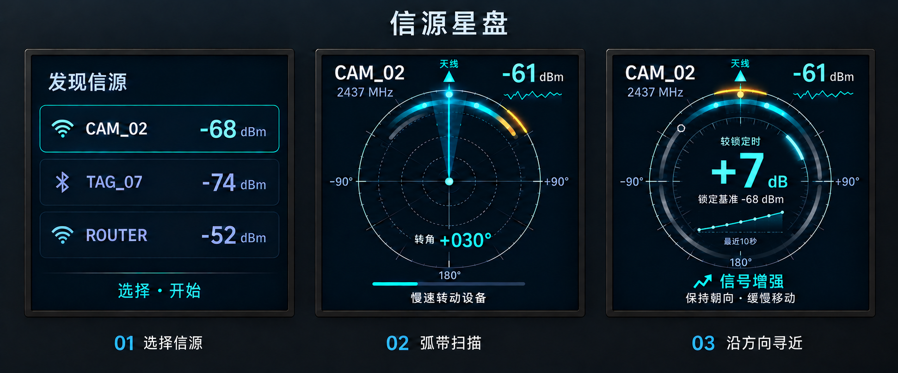
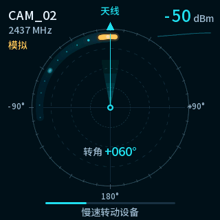
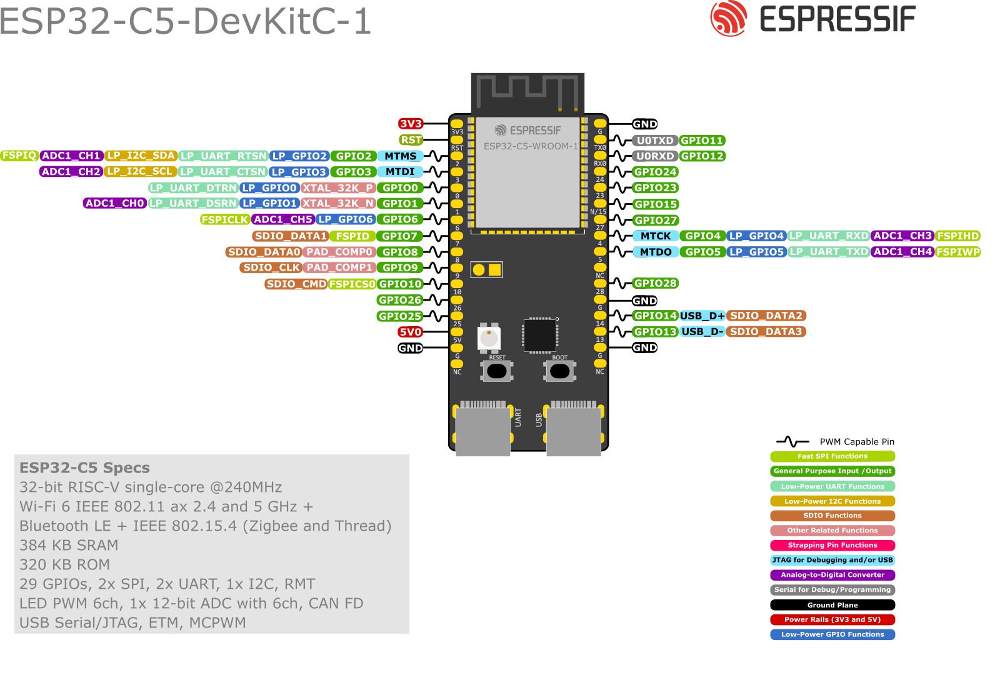
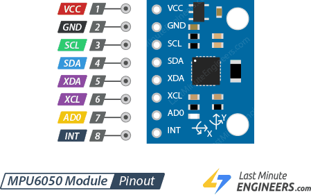
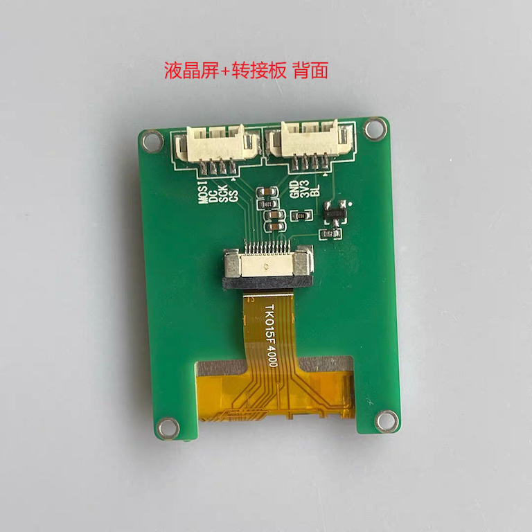

# esp32-adc-detector

基于 ESP32-C5 的单屏信源星盘原型，沿用 PlatformIO + ESP-IDF 5.5.5。MPU6050 提供相对偏航，ST7796 SPI 屏显示固定天线与反向旋转的历史弧带；真实模式锁定一个 Wi-Fi AP 的 Beacon RSSI，不关联网络。本版不包含 BLE、信源列表或距离估算。



实现要求见 [星盘 UI V1](docs/星盘UI_V1_AI实现要求.md)，配置与完整调试流程见 [原型说明](docs/starchart-prototype.md)。

下一版的 [星盘 UI 还原需求与实施计划](docs/starchart-ui-reconstruction-plan.md)：大星盘布局(R=114、圆心 (160,156))、16 px 脏格差异刷新、双 32 行缓冲，目标为转动时约 120 FPS，以及压力测试代码迁移清理。P0 设计已确认，P1 完成布局与字库(字号 10/12/18/24 px，修复 `CAM_02` 下划线丢失)；差异刷新与默认分支切换仍在 P2..P5，下述默认固件尚未改变。

**当前默认固件以 14「WINDOW PIPE32」为新基线**，新增 15「PIPE32 O2」作为同算法 O2 热路径对照，保留 10「WIRE 80M MAX」旧基线和 13「WINDOW SYNC」同步窗口对照。BOOT 顺序为 **14→15→10→13→14**，30 ms 消抖，长按不重复。15 只优化刷新与窗口函数，IDF SPI 驱动不变。原星盘 UI/IMU/Wi-Fi 暂停，完整动态面积 320×128，40 KiB 像素分配不增加。初始化/命令为 40 MHz，动态像素为 80 MHz，各策略每秒日志/FPS 维护口径相同；切换前 DMA 全部回收。`CHART_LCD_REFRESH_TEST=0` 恢复星盘。完整方案见 [LCD 刷新测试](docs/lcd-refresh-test.md)。

串口保留 `swap/cmd/dma` 分项耗时、堆栈与帧间隔统计，仍完整刷新 320×128，未做脏矩形，后者留到真实 UI 阶段。

此前实测 8 约 54.0 FPS、9 约 58.6 FPS；9 保留看门狗和 DMA 完成阻塞，普通帧间隔约 16.93 ms，每秒 FPS 维护约 23.5 ms。80 MHz 属于模块尚未保证支持的实验频率，不以 SPI 发送成功代替屏幕接收可靠性确认。

三策略固件已烧录并通过哈希校验，90 秒对照稳定窗口约为 10：113.34、13：114.71、14：117.90 FPS；动态帧分别约 8.769/8.663/8.428 ms。14 比同固件 10 约快 4%，尚未达到均匀 120 FPS。未记录 DMA、看门狗或重启错误，但用户看到 14 间歇横向条纹、其他策略闪烁拖影，光学问题仍未定位，不能视作完整验收通过。主机 ASan/UBSan、C5 及原 UI 分支编译通过，历史 11/12 不恢复。

四策略固件也已烧录；120 秒同固件 O2 对照中 14/15 均约 117.89 FPS、动态帧均为 8.428 ms，未测到可辨别收益。最后 15 连续约 81 秒，堆栈稳定，未记录 DMA/看门狗/重启错误；14 继续作为默认基线，15 保留实验对照。

以下为设备端共用 RGB565 渲染器输出的模拟预览，不是实机照片：



[旋转与停止采样动画](docs/preview/starchart-sim.gif) · [等待信号状态](docs/preview/starchart-wait.png)

## 硬件

### ESP32-C5

- 芯片为 revision v1.2，16 MB Flash
- 外接定向天线，用于确定信号方向



### MP6050

与天线刚性连接，用于确定天线朝向



### LCD (TK015F4000)

The TK015F4000 is a 1.54-inch 320×320 resolution SPI IPS display module driven by the ST7796 controller chip, which can be interfaced with an ESP32 microcontroller and the LVGL (Light and Versatile Graphics Library) framework.



## Pinout

屏幕接线全部集中在 C5 左侧，MPU6050 的信号线集中在右侧。

**3.3 V 电源** 引脚共用：这块开发板右侧没有引出的 3V3，所以 MPU6050 的供电需要从左侧分出一根线。

| 屏幕转接板 | C5 引脚 | 功能 |
|---|---|---|
| MOSI | **左侧 GPIO8** | 显示数据输入 |
| DC | **左侧 GPIO9** | 命令/数据选择 |
| SCK | **左侧 GPIO6** | SPI 时钟 |
| CS | **左侧 GPIO10** | 屏幕片选 |
| GND | **左侧 GND** | 地 |
| 3V3 | **左侧 3V3** | 模块供电 |
| BL | **左侧 GPIO0**（用户已连接） | 本轮不调整背光，固件仍不驱动；不能用 GPIO 直接供背光电流 |
| 无标记脚 | 暂不接 | NA |

GPIO8、9、6、10 都在左侧相邻区域，接线比较集中。GPIO8、9 通过 GPIO 矩阵配置为 MOSI、DC 即可，不需要拘泥于开发板图上的默认复用功能。

建议避开 GPIO15：**带 SPI PSRAM 的 C5 模组可能占用这个脚**。

**MPU6050 采用下面这组右侧接线：**

| MPU6050 | C5 接法 | 说明 |
|---|---|---|
| SDA | **右侧 GPIO23** | I²C 数据 |
| SCL | **右侧 GPIO24** | I²C 时钟 |
| GND | **右侧顶部 GND** | 地 |
| VCC | 共用左侧 3V3 电源分支 | 前提是模块支持 3.3 V 输入 |
| AD0 | 接 MPU6050 自身的 GND | 固定地址为 `0x68` |
| INT | 可选接右侧 GPIO5 | 初版轮询可不接 |
| XDA、XCL | 不接 | 当前不使用辅助 I²C |

GPIO23、24 在右侧相邻位置，适合把 MPU6050 放在开发板右边。

最终软件配置：

```text
屏幕：MOSI=8，SCK=6，CS=10，DC=9，BL=GPIO0（已接，软件不驱动）
MPU6050：SDA=23，SCL=24，INT可选=5
```

屏幕未引出已确认的 RESET 脚，初始化时可先尝试 ST7796 的软件复位；无标记脚继续留空，不能擅自接成 RESET。

用户已确认接线并看到屏幕显示，但文字和色条左右镜像。本轮保持 `CHART_LCD_BL=-1`，不驱动已连接 GPIO0 的 BL；启用 `CHART_LCD_MIRROR_X=1` 校正左右镜像，上电测试图保持 5 秒，再进入星盘。SPI 恢复 40 MHz，像素数据采用中断完成的 DMA 传输，短命令仍轮询；单个 16 行 DMA 缓冲在传输完成后才复用。若出现花屏或丢色条，先将 `CHART_LCD_SPI_HZ` 降回 10 MHz 检查接线。

串口每约 5 秒输出 `lcd: perf fps=... draw=... ms/frame spi=... ms/frame max_work=... ms`：`draw` 是整帧分块绘制耗时，`spi` 包含字节交换、窗口命令、DMA 传输及等待，二者均为墙钟时间，包含被其他任务抢占的时间。实际完整帧率以该日志和 `health fps` 为准。320×320 RGB565 在 40 MHz 下仅像素传输就需 40.96 ms，理想上限约 24.4 FPS，实际还要扣除绘制和调度开销。

## 构建与烧录

PlatformIO + ESP-IDF 5.5.5，默认环境 `esp32-c5`。通过固定的 pioarduino release 安装标准工具链

```sh
export PATH="$HOME/.platformio/penv/bin:$PATH"
pio run
pio run -t upload --upload-port /dev/cu.usbmodem101
pio device monitor --port /dev/cu.usbmodem101
```

串口以 `pio device list` 为准。

默认 `UI_SIM`，屏幕上明确显示「模拟」。所有 GPIO、显示窗口、IMU 轴、模式和目标 AP 集中在 `include/starchart_config.h`。切换真实模式前填写 `CHART_TARGET_SSID`；可选 BSSID 防止同名 AP 混淆。

```text
help          查看串口命令
mode ui       自动姿态 + 合成 RSSI
mode imu      MPU6050 + 合成 RSSI，静置 2.5 秒校准
mode live     MPU6050 + 固定 BSSID 的 Beacon RSSI
angle 30      模拟姿态设为 +30°，停止自动旋转
signal off    停止合成采样，盘仍跟随姿态
zero          重新置零并清空本轮
cal           重新初始化 MPU6050、校准并清空本轮
stats         查看角度、覆盖、包数及时间对齐统计
```

主机验证与预览生成：

```sh
sh tools/test_chart.sh
python3 -m pip install Pillow
python3 tools/build_chart_preview.py
```

当前已通过 ESP32-C5 编译和主机模拟测试。2026-10-13 已通过 `/dev/cu.usbmodem1101` 烧录黑屏排查固件，写入哈希校验通过；启动日志确认 10 MHz SPI 测试图发送成功并保持 60 秒，BL 仍未驱动。这不代表屏幕已实际显示，光学效果仍待确认。屏幕初始化、窗口偏移、RGB/BGR、背光电路、IMU 轴符号、真实 RSSI 和十分钟设备稳定性仍需实测；此前固件串口观察到星盘约 0.40 FPS，未达到 25 FPS 目标。
