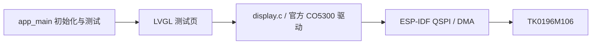
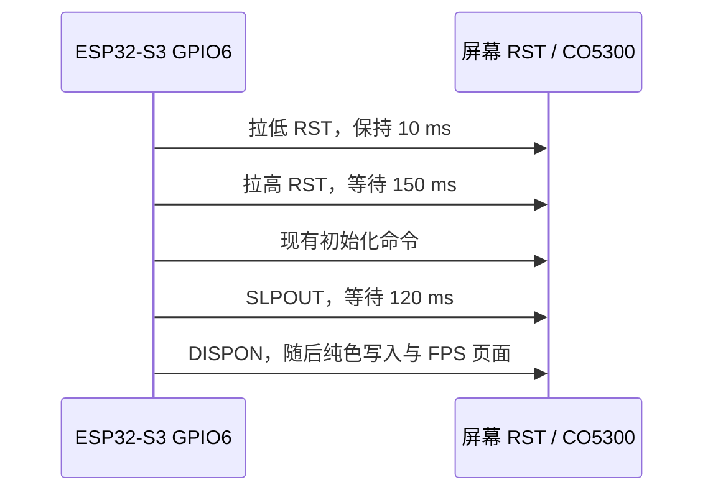

# ESP32-S3 + TK0196M106 适配设计与验证记录

日期：2026-10-18。用户已确认最小点屏方案，并授权决定 FPS/刷新测试页设计。开发板参数已实测；用户已确认物理接线；40 MHz 与 10 MHz 的可见显示验证均未通过，正在排查。显示接口按用户要求采用高速 QSPI。

## 已验证的开发板

通过 `/dev/cu.usbmodem1401` 执行 `esptool flash-id`：

| 项目 | 结果 |
|---|---|
| 芯片 | ESP32-S3，QFN56，revision v0.2 |
| CPU 能力 | 双核，最高 240 MHz |
| 晶振 | 40 MHz |
| Flash | 8 MB，Quad，eFuse 电压 3.3 V |
| PSRAM | 芯片报告 Embedded PSRAM 8 MB (AP_3v3) |
| USB | USB Serial/JTAG |

`platformio.ini` 已配置 8 MB Flash、QIO/80 MHz。`sdkconfig.defaults` 及 `sdkconfig.esp32-s3-n8r8` 配置 Octal PSRAM/80 MHz、开机内存测试、240 MHz CPU 和 USB Serial/JTAG 控制台。

PSRAM 已通过新固件启动验证：识别 8 MB、80 MHz，日志显示 `SPI SRAM memory test OK`。开发板 GPIO 与排针位置现已依据用户补充的 [ESP32-S3_R8N8_pinlayout.png](../ESP32-S3_R8N8_pinlayout.png) 核对：正面朝向自己、USB 朝下时，GPIO7–14 均位于左侧连续排针。旧 C5 引脚图不再作为依据。

## 屏幕资料核对

- [规格书](TK0196M106_规格书_V1.0.pdf)第 2、6、7、8 页：1.96 英寸、368×448、CO5300、CHSC6417 电容触摸；QSPI / 4-Line SPI；触摸为 I²C。
- [成品板背面](AMOLED-pinout.jpg)：六线接口从照片顶部向下为 `D3 / D2 / D1 / D0 / SCK / CS`；四线接口从上到下为 `GND / 3V3 / SCL / SDA`。以板上丝印为准，不按线材颜色推断。
- [板卡 PDF](TK0196M106_SCH.pdf)主要包含布局、BOM、丝印；电路连接还核对了随附 PADS 文件 `TK0196M106/TK0196M106/TK0196M106/TK0196M106.txt`。
- PADS `*SIGNAL* RST` 网络同时连接 LCD_RST（U6.1）、TP_RST（U6.18）、RST 测试点及 R8/C7 复位电路；R8=18 kΩ，上拉到 3V3。EN 测试点在设计文件中名为 BL_CTR，连接 VCI_EN（U6.24）及 R3=18 kΩ 到 3V3 的上拉。常规插座未引出这些控制信号。
- 规格书中的 1.8 V 数字供电描述针对模组。成品板外部电源按实物 `3V3` 标记接入，不将裸屏 FPC 引脚号当成成品板插座编号。

## GPIO 分配（按 S3 板上丝印接线）

本表已替换上一版 GPIO6/7/15/16/17/18 接线，与代码 `src/board.h` 一致。选用 SPI2 原生 IO_MUX 引脚，全部集中在左侧 GPIO9–14。依据 ESP-IDF 5.5.5 的 `components/soc/esp32s3/include/soc/spi_pins.h`：CLK=12、CS=10、MOSI/D0=11、MISO/D1=13、WP/D2=14、HD/D3=9。用户已确认按此表连接（包括 GPIO7/8）；已完成烧录和串口运行验证。

| 成品屏接口 | ESP32-S3 连接 | 用途 |
|---|---|---|
| 3V3 | 3V3 | 成品屏供电 |
| GND | GND | 共地 |
| SCK | GPIO12 | QSPI 时钟 |
| CS | GPIO10 | QSPI 片选 |
| D0 | GPIO11 | QSPI DATA0 |
| D1 | GPIO13 | QSPI DATA1 |
| D2 | GPIO14 | QSPI DATA2 |
| D3 | GPIO9 | QSPI DATA3 |
| SCL | GPIO8 | 触摸 I²C 时钟 |
| SDA | GPIO7 | 触摸 I²C 数据 |
| RST / TE / EN 测试点 | 暂不接线，待初始化验证 | 非插座信号 |

保留 GPIO19/20 给原生 USB，GPIO0 给 BOOT、GPIO48 给板载 LED；GPIO1 暂留作后续 ADC。避开 GPIO3/45/46 启动配置引脚和 Flash/PSRAM 引脚。触摸作为下一步接线：完成显示验证后，断电连接 SCL→GPIO8、SDA→GPIO7，沿用屏幕的 3V3/GND；后续再开发 CHSC6417 驱动和 LVGL 输入接入。当前最小点屏固件未启用触摸。屏幕 RST/TE/EN 测试点不接到开发板 RST。操作步骤见 [README 的触摸接线引导](../../README.md#下一步触摸接线)。

## QSPI 刷新方案（已确认）

- 使用 SPI2_HOST、四条数据线和 DMA，RGB565；不使用旧 RLCD 的灰度转 1bpp 刷新路径。
- 初始目标时钟 40 MHz。规格书 QSPI 写周期下限 20 ns，对应 50 MHz 时钟上限；是否提高至 50 MHz 取决于线长、信号质量和实测稳定性。
- 368×448 的 RGB565 整帧为 329728 字节。40 MHz 四数据线的理想负载为 20 MB/s，整帧传输理论上限约 60.7 帧/秒，尚未扣除命令、间隔、绘制等开销，不能视为实际帧率。
- LVGL 使用局部刷新和两个 DMA 缓冲区；传输完成回调才交还缓冲区。每个缓冲区为 368×48×2 字节，共两个内部 DMA 缓冲区。
- 先验证纯色、色条、边界与方向，再验证 LVGL 连续刷新；新 UI 另按用户提供的设计实现。

实现组件关系：

模块职责：`main.c` 记录硬件信息并进入测试循环；`display.c/.h` 负责 QSPI、LVGL 缓冲区、DMA 完成与统计；`ui.c/.h` 负责测试画面。`board.h` 是 GPIO 和屏幕参数的唯一来源。使用固定版本 `espressif/esp_lcd_co5300` 2.2.0，不接入旧 RLCD、扫描、字体或触摸组件；保留旧文件但从 CMake 源码清单排除。

初始化顺序：硬件日志 → LVGL 初始化 → QSPI/CO5300 初始化 → 注册显示 → 创建测试页 → 单一主任务运行 LVGL。ISR 仅累计完成统计并调用 LVGL flush_ready，其他 LVGL 操作均在主任务。首个分块提交开始计时，最后一个分块 DMA 完成才计为一帧；耗时不包含首块提交前的绘制，局部更新的帧不等同于全屏传输。

## 测试画面与指标

- 每 15 秒自动切换 PARTIAL（局部更新）和 FULL（主动整屏失效）模式；不依赖触摸或按键。
- 固定 RGB 色条、灰阶、屏幕边框检查颜色、字节序、可见区域和裁剪。
- 移动竖条、交错运动色块观察卡顿和撕裂；FULL 模式每帧传输全部 368×448 像素。
- 每秒显示并打印 DMA 完成 FPS、有效像素 MB/s、首块提交至末块完成的平均/最大耗时、全屏等效 FPS。动画定时器和 LVGL 刷新周期均为 16 ms（目标约 60 FPS，不代表实测值）。
- 不读取 TE，因此没有垂直同步；统计是主机写入屏幕 GRAM 的速度，不能证明面板扫描频率或保证无撕裂。
- 初始化采用官方 CO5300 默认序列的基础寄存器，亮度降为约 40%，休眠退出等待 120 ms；地址窗口改为 368×448，未获得商家专用初始化表时需以实际点屏结果验证。
- 驱动依据：[官方 CO5300 组件](https://components.espressif.com/components/espressif/esp_lcd_co5300/versions/2.2.0/readme)。

## 验证状态

| 检查 | 状态 |
|---|---|
| esptool 芯片与 Flash 识别 | 通过 |
| ESP-IDF Kconfig 配置生成 | 通过；使用本地 IDF 5.5.5 |
| 新屏驱动 / pinout 对应代码 | 已实现；GPIO 分配与 README 一致；已按 S3 图改为原生 SPI2 GPIO9–14 |
| 固件构建 | 通过：ESP-IDF 5.5.5 / LVGL 9.4.0 / CO5300 2.2.0；新接线版本复编译通过，firmware.bin 518448 字节 |
| 固件校验及配置检查 | 通过：ESP32-S3 镜像、8 MB Flash、80 MHz、校验和及哈希有效；最小源码清单、GPIO 和 sdkconfig 一致 |
| 烧录、PSRAM 启动测试 | 通过：Bootloader/分区/应用写入哈希校验成功；8 MB PSRAM / 80 MHz 内存测试通过 |
| QSPI 刷新统计 | 串口已获得 PARTIAL / FULL 的 DMA 完成统计，详见下方实测记录 |
| 可见点屏效果、颜色、撕裂 | 未通过：用户报告首次雪花背景、黄/绿色块，复位后黑屏；正在诊断 |
| 触摸 | 用户已接 GPIO7/8；当前固件未初始化，未测试 |

可复制的构建、烧录命令和测试判读见 [项目 README](../../README.md)。

## 2026-10-18 刷机与串口实测

用户确认显示 QSPI 和触摸 GPIO7/8 已连接。通过 `/dev/cu.usbmodem1401` 烧录测试固件，Bootloader、分区表和应用均完成写入哈希校验。随后主动复位并采集约 50 秒串口日志，覆盖 PARTIAL → FULL → PARTIAL → FULL。

- Flash：8 MB，QIO / 80 MHz；CPU：240 MHz。
- PSRAM：8 MB Octal / 80 MHz，`SPI SRAM memory test OK`。
- 显示链路：QSPI 40 MHz、368×448 RGB565、两个 35328 字节内部 DMA 缓冲区。
- 此观察窗口仅有一次预期的主动复位启动；未发现崩溃、断言、Brownout 或错误级别日志。

| 模式 | 有效采样窗口数 | 完成 FPS 范围 | 像素 MB/s | 平均帧耗时均值 / ms | 最大帧耗时 / ms |
|---|---:|---|---|---:|---:|
| PARTIAL | 27 | 62.0–62.8（均值 62.50） | 0.68–0.69 | 7.07 | 13.2 |
| FULL | 18 | 27.0–27.0（均值 27.00） | 8.89–8.90 | 32.33 | 32.5 |

数据来自每秒统计日志，已排除固件标为 settling 的窗口。PARTIAL 只传输变化区域，FULL 传输整屏，不能只根据 FPS 数字比较传输能力。FULL 约 27 FPS 是当前 LVGL 测试负载的主机完成速率，不是屏幕扫描频率或 CO5300 理论极限。

**验证边界：用户反馈实际显示未通过（首次雪花背景与黄/绿色块，复位后黑屏）。以上 FPS 仅说明主机 DMA 提交完成。触摸虽已接线，固件未初始化，尚未验证。**

原始日志：[2026-10-18-first-boot.log](logs/2026-10-18-first-boot.log)。

## 黑屏/雪花屏诊断方案

保持既定 main → display → 官方 CO5300 → QSPI 架构和所有接线。按此前“先纯色再 LVGL”的验证顺序，在 display 初始化中使用同一 DMA 缓冲区依次全屏写入红、绿、蓝、白、黑，每色 2 秒；每块传输由完成信号量同步，全部结束后才开始 LVGL 页面与其统计，两个阶段不共享在途传输。

- QSPI 暂由 40 MHz 降为 10 MHz，作为保守诊断条件；恢复高速前需先通过可见显示验证。
- 官方 CO5300 2.2.0 软件复位只等待 80 ms；当前序列随后约 30 ms 即发送 SLPOUT，不满足手册第 127 页在 Sleep Out 状态软件复位后等待至少 120 ms 才能 SLPOUT 的要求。额外等待 70 ms，将复位等待提高到至少 150 ms。这是已发现的时序问题，尚不能认定是所有显示异常的根因。
- SLPOUT 后继续等待 120 ms，不添加未经确认的厂商扩展寄存器。
- 供电电压、连接线长度待用户测量反馈；纯色及页面可见效果需要用户观察。

### 10 MHz 诊断固件执行结果

已编译并烧录，应用镜像 519120 字节，写入哈希校验成功。主动复位后串口依次记录 RED/GREEN/BLUE/WHITE/BLACK 五次全屏写入，再进入 10 MHz LVGL 页面；采集窗口内未发现 DMA 超时、崩溃、Brownout 或意外重启。

这仍只是主机流程验证。诊断版的实际纯色和页面效果、屏幕端电压及线长，尚待用户反馈；尚未确认修复黑屏/雪花问题。

日志：[2026-10-18-diagnostic-10mhz.log](logs/2026-10-18-diagnostic-10mhz.log)。原黑屏状态日志：[2026-10-18-black-screen.log](logs/2026-10-18-black-screen.log)。

### 用户反馈与下一步硬件核验

- 屏幕插座供电实测 **3.333 V**；QSPI 线约 **8 cm**，为排线转杜邦线。
- 10 MHz 诊断版仍未显示正确纯色：只闪现白色大块、中间黑线，随后黑屏。纯色流程发生在 LVGL 刷新前，因此目前集中排查底层接口、复位和屏幕专用初始化，不调整页面布局。
- 成品板 D0/D1/D2/D3 分别接 FPC 的 SPI_SIO0（7）、SPI_SIO1（6）、SPI_SI02（23）、SPI_SI03（22）；当前软件顺序与此一致，但线材的实际端到端导通尚未测量。
- 用户实测 **RST=3.329 V、EN=3.326 V**，均为正常稳态高电平，未发现持续拉低。静态测量不能证明上电/复位脉冲符合要求。
- 若电平正常而仍需要主动复位，可提出 GPIO6 → 屏幕 RST 测试点的接线方案（保留 TE/EN 不接）。这将改变既定软件复位方案，尚未应用、未刷入，需用户确认后实施。GPIO6 目前未被 QSPI/触摸占用。

### 主动硬件复位提案（待用户确认接线后实施）

新增一根线：**ESP32-S3 GPIO6 → 屏幕背面顶部 RST 金色测试点**。不要接到旁边 TE 点，也不要接开发板 RST/EN 引脚；屏幕 EN 测试点保持现状。断电后连接。GPIO6 位于开发板左侧 GPIO5 下方、GND 上方。

拟议固件差异：`src/board.h` 的 `LCD_PIN_RST` 从 `-1` 改为 `6`；删除仅为软件复位增加的 70 ms 等待，使用当前官方驱动已有的低有效硬件复位：GPIO6 拉低 10 ms → 拉高并等待 150 ms。继续保持 10 MHz、现有初始化命令和纯色/FPS 测试，不同时试换其他寄存器。

这是从软件复位变为额外 GPIO 控制硬件复位的设计提案，当前尚未修改活动固件、尚未刷入；按 AGENTS.md 对接口和生命周期变更的要求，等待用户确认并完成新增接线后实施。

### 无焊接/探针条件下的替代路径

用户没有给 RST 测试点搭接线的条件，因此主动硬件复位提案暂不采用，GPIO6 保持未连接，固件仍为软件复位的 10 MHz 纯色诊断版。

优先做整机冷启动对照：断开开发板 USB 及其他供电，让开发板和屏幕同时失电；待 3V3 降至接近 0 V 后重新上电，观察五种纯色及 FPS 页面。此步骤不改接线、不改固件，用于与仅按 MCU RST 的温复位结果比较。

若冷启动仍未通过，可准备单数据线写像素与 QSPI 的对照诊断来隔离 D1–D3 路径；现有官方驱动把 QSPI 命令包装和四线像素 opcode 绑定，不能只关闭 quad_mode 就认为已切换成功。该后续诊断尚未实现、未刷入；最终目标仍是 QSPI 高速刷新。

### 冷启动结果与唤醒后配置校验

用户完整断电重上电后仍为：先黑屏一段时间 → 白块/黑线 → 黑屏，不能用冷启动解决。主动 RST 线因用户没有搭接条件不采用。

核对本地附带示例 `esp32_lcd_qspi_lvgl/components/espressif__esp_lcd_tk018/esp_lcd_tk018.c`，它在 SLPOUT 后再次写 FE=00、C4=80、3A=55；当前通用序列则在 SLPOUT 前写 C4，RGB565 由驱动在自定义序列前写入。按控制器手册，SLPOUT 会装载部分默认寄存器；是否影响本屏这些设置仍需实测，不能仅据此认定根因。

本轮仅调整原 display 模块内的寄存器设置时点：先 FE=00、SLPOUT、等待 120 ms，再 FE=00、C4=80、3A=55、36=00，随后使用已有亮度和地址窗口配置，再 DISPON、五色及 LVGL 测试。所有接口、模块、GPIO、10 MHz 时钟和驱动依赖保持现状，不引入示例中的未确认扩展命令 CE/D8/58。

本轮唤醒后重设格式的版本已编译并刷入（应用镜像 519184 字节），写入哈希校验成功。日志显示 3A/36 默认值被自定义序列覆盖（预期告警），五色流程继续执行，随后进入 LVGL；未发现错误级别日志、超时或崩溃。实际画面结果等待用户反馈，尚不能认定修复。日志：[2026-10-18-post-wake-format.log](logs/2026-10-18-post-wake-format.log)。

### 卖家示例单线 SPI 点屏验证（2026-10-18，通过）

为确认屏幕本身是否完好，改用卖家示例 `esp32_lcd_qspi_lvgl/` 在同一接线上刷机测试，主工程代码未改动。

- 示例实际使用**单线 SPI**：只用 SCK/CS/D0，像素也走 0x02 命令（`use_qspi_interface = 0`），SPI mode 3，并带有厂商初始化序列（含 CE/D8/58，SLPOUT 后再写 C4/3A）。
- 引脚改为本文 GPIO 表（CS=10、SCK=12、D0=11、D1=13、D2=14、D3=9，触摸 SCL=8、SDA=7）；示例默认 50 MHz 改为 10 MHz；`test_lvgl=0` 运行纯色/色带循环。
- 示例 `sdkconfig` 按 N8R8 修正：8 MB QIO Flash、Octal PSRAM 80 MHz、CPU 240 MHz、single app large 分区。使用 ESP-IDF 5.5.5 编译（应用 278 KB），烧录哈希校验通过，启动日志 PSRAM 测试 OK。
- 用户观察：红屏 → 色带 → 黄屏 → 色带正常循环。黄屏后的 `test_draw_bitmap` 色带自上而下为蓝 → 绿 → 红（最上面几条是低位，亮度很暗）。这说明 RGB 顺序和 RGB565 大端字节序都正确。
- **线材接触不良已复现**：第一次观察时色带位置出现横向黑条纹裂屏，用户挪动排线后，同一固件（未重刷）恢复正常。

结论：屏幕、供电、SCK/CS/D0 链路，以及示例初始化序列在单线 SPI 10 MHz 下均正常。之前 QSPI 版本的白块/黑屏，**不能排除就是杜邦线接触不良**；另外 D1–D3 线路，以及与示例的差异（mode 0 与 3、缺少厂商寄存器）也都尚未排除。

触摸：GPIO7/8 自检正常，但 I2C 扫描 112 个地址全部超时，未发现设备；待显示稳定后再排查。

### 主工程 QSPI 逐项对齐卖家示例（2026-10-18）

线材固定后，按以下顺序每次只改一项，均为 10 MHz：

| 步骤 | 改动 | 用户观察 |
|---|---|---|
| 1 | 原 QSPI 固件不改，重新烧录 | 白块 → 黑屏 |
| 2 | `spi_mode` 0 → 3（手册 p.20：SCL 空闲为高电平、上升沿采样；与示例一致） | 白块 → 黑屏 |
| 3 | 初始化序列整段换成示例序列（含 CE/D8/58，亮度 0x30） | 白块 → 黑屏 |
| 4 | `LCD_SINGLE_WIRE=1`：总线只用 SCK/CS/D0，窗口和像素都用 0x02 单线写入 | **红绿蓝白黑 + LVGL 测试页正常** |

结论：步骤 4 与步骤 3 只差像素写入方式（0x32 四线 → 0x02 单线）。命令通道、初始化、复位、RGB565 字节序和 LVGL 链路均已验证正常，故障集中在 0x32 四线像素写入，即 D1–D3 信号路径（断路、错位、互相短路或信号质量）。官方驱动的 0x32 写法与手册 p.20–21 一致（opcode 和 24 位地址走单线，像素走四线）。

保留步骤 2、3 的改动：单线验证正是在这两项都生效的条件下通过的。

### QSPI 数据线测试（2026-10-18）

**静态单线测试**：每次只让一根数据线保持高电平（像素字节为 `0x11 << n`），横条纹之间夹黑带。用户观察依次为蓝 → 绿 → 亮绿 → 粉红/玫红，与预期的 0x1111 / 0x2222 / 0x4444 / 0x8888 RGB565 颜色完全一致。说明 D0–D3 都能连通，顺序正确，没有互换或短接。紧接着的红色纯色测试（0xF800，四根线每个时钟都在翻转）又出现白块和黑线，之后持续黑屏。

推断：单根线保持电平时能正常传输，多根线同时快速翻转时出错。比较可能是杜邦线上的串扰或地弹，属于信号完整性问题。

**翻转测试**：依次让 D0、D0–D1、D0–D2、D0–D3 在每个时钟翻转（像素字节为 `((1 << n) - 1) << 4`），通过第一个失败的步骤，判断同时翻转几根线时开始出错。

翻转测试结果：D0 翻转显示蓝条纹，通过。D0–D1 一起翻转显示紫条纹（0x3333），通过，但紫色停留了约两轮时间，说明 D0–D2 那一轮没能刷新画面。随后出现白块和黑线，之后一直黑屏。**结论：两根线同时翻转可以正常传输，三根及以上同时翻转就会出错。** 这符合同步开关噪声和串扰的特征。用户短期内不方便改线，所以先从软件层面处理。

**软件尝试 1**：把 SCK 和 D0–D3 的 GPIO 驱动能力从 ESP-IDF 默认的 2 降到 0（约 5 mA），让信号边沿变缓，减小串扰和地弹。仍为 10 MHz，测试画面不变。

驱动能力降到 0 后的结果：D0、D0–D1、D0–D2 三档翻转都通过（蓝、紫、粉/玫红）。D0–D3 四线全翻转那一档没刷出来，画面停在上一档。后面的纯色红、绿正常，蓝没出来，白正常，之后黑屏（LVGL 页面本身是黑底，但这里很可能也是写入失败）。**有明显改善，从两线能用提升到三线能用，但四线全翻转仍会出错。** 两个失败的画面都要求四根线同时翻转：蓝 0x001F 的低字节 0x1F，四根线在每个时钟都翻转；而能显示的红 0xF800、绿 0x07E0，同时翻转的线不到四根。这和翻转测试的结论一致。

**软件尝试 2**：保持驱动能力 0，QSPI 降到 1 MHz，用来判断剩下的故障是否和速度有关。

1 MHz 的结果：现象和 10 MHz 完全一样，只是刷新变慢。**这说明故障和时钟频率无关。** 降低驱动能力（让信号边沿变缓）有明显效果，而降低频率没有效果，这符合由边沿引起的串扰或地弹：每次跳变产生的噪声取决于边沿有多陡、有几根线同时跳，和每秒跳多少次无关。所以继续降频，或者调整采样时序，都解决不了这个问题。

兼容性核对：Waveshare 的量产板 ESP32-S3-Touch-AMOLED-1.75 和 2.06 都是 ESP32-S3R8 通过 QSPI 驱动 CO5300，说明 S3 的 QSPI 和 CO5300 本身是兼容的。本工程的 QSPI 写入时序（模式 3，命令 0x02，像素 0x32 加 24 位地址）也和手册第 20–21 页一致。剩下的差别在物理连接：量产板是 PCB 短走线加完整地平面，本工程是约 8 cm 杜邦线，只有一根地线。

### 根因与修复（2026-10-18，已点亮）

1 MHz 下仍然失败。用户把屏幕 GND 改接到开发板上靠近 GPIO7–14 的 GND 后，四组翻转条纹（蓝 / 紫 / 玫红 / 粉红）、五个纯色和 LVGL 测试页全部正常。**根因是地回路**：原先的 GND 离 QSPI 信号线较远，四根数据线同时翻转时，回流电流在共用的地线上造成地弹。由于这类故障取决于信号边沿而不是频率，所以降频无效，降低驱动能力只能部分缓解。

保留的软件设置：SPI mode 3、卖家初始化序列、SCK/D0–D3 驱动能力 0、`LCD_SINGLE_WIRE` 诊断开关（默认 0 = QSPI）。

### 40 MHz 尝试（未通过，已回退）

| 尝试 | 配置 | 用户观察 |
|---|---|---|
| A | 40 MHz，驱动能力 0，启动单屏检测（上 3/4 为 R/G/B/W/K 竖条，底部为 0xF0F0 四线翻转带） | 上方花屏，底部粉色正常，之后黑屏 |
| B | 40 MHz，驱动能力 2 | 黑屏后出现雪花，可见移动的黄、红色块，其他色块不动 |

串口统计在 A 下为 FULL 26.3 FPS / 8.67 MB/s，但实际画面错误，这组数字没有意义。0xF0F0 是规律的 0/F 交替，采样稍有偏移仍可能读对，所以底部能正常显示，并不能证明时序足够。8 cm 杜邦线在 40 MHz 下的建立/保持余量不够：手册 p.107 要求写入周期 ≥ 20 ns、SCL 高低电平各 ≥ 6.5 ns、数据建立/保持各 ≥ 4 ns、边沿 ≤ 3.5 ns。

**Baseline**：回退到已验证的 1 MHz 加驱动能力 0，启动时运行翻转条纹和纯色检测，串口输出与通过时一致。后续再在 1 到 40 MHz 之间逐档寻找能稳定工作的最高频率。
