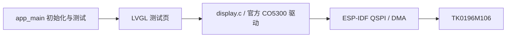
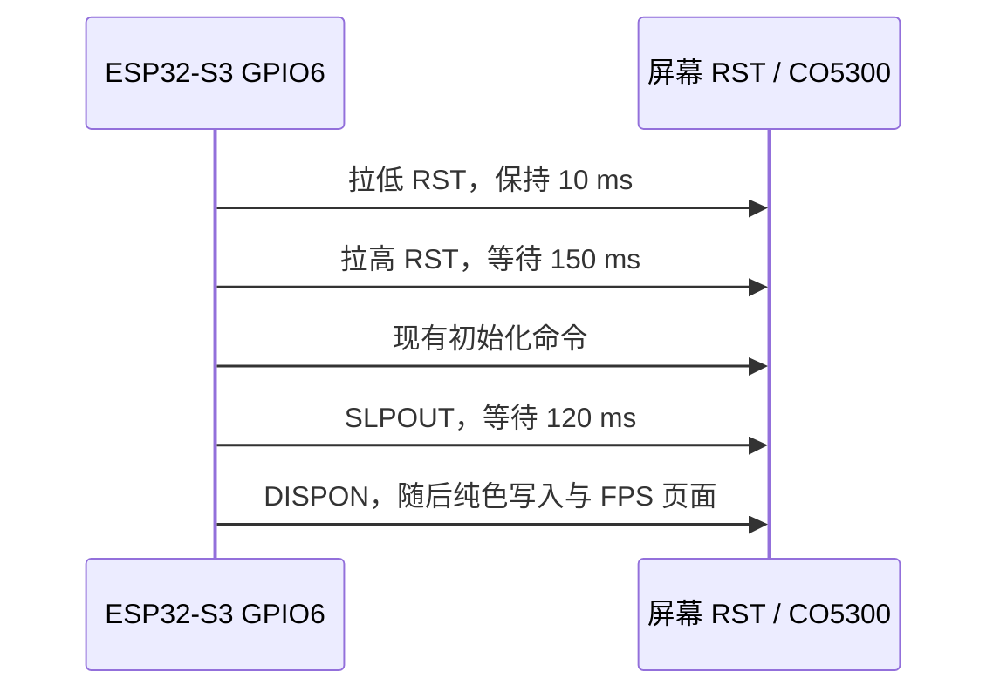
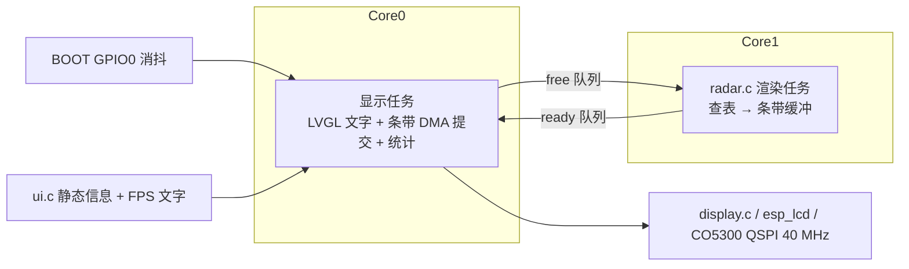
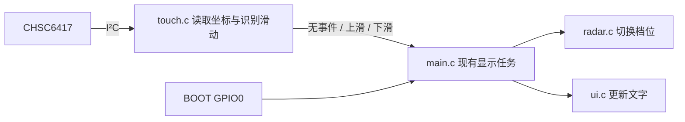
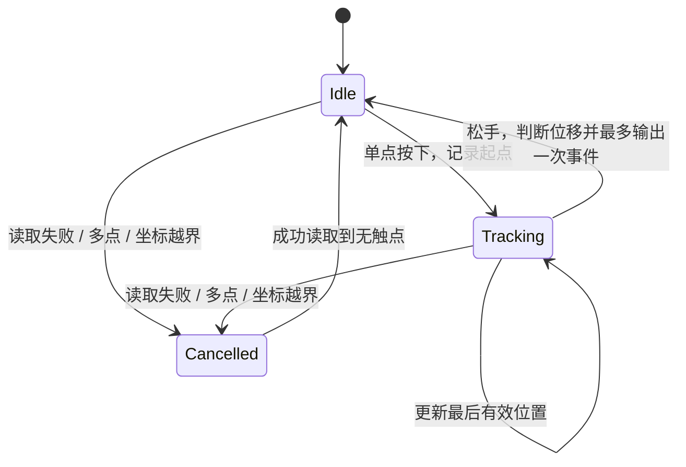
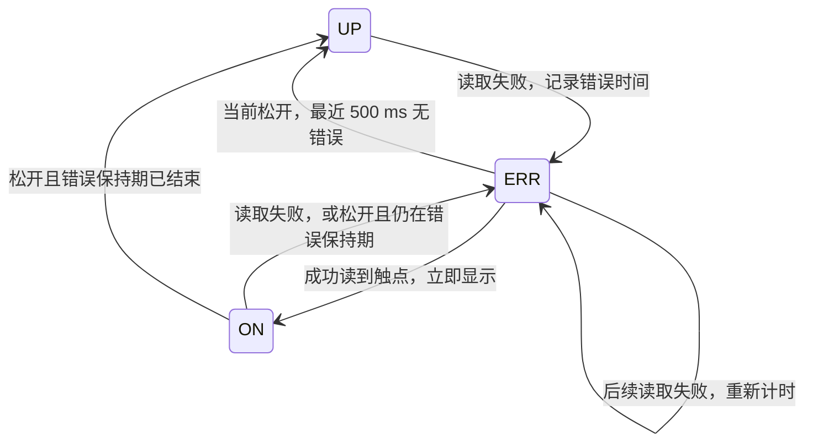

# ESP32-S3 + TK0196M106 适配设计与验证记录

日期：2026-10-18。用户已确认最小点屏方案，并授权决定 FPS/刷新测试页设计。开发板参数已实测；用户已确认物理接线；40 MHz 与 10 MHz 的可见显示验证均未通过，正在排查。显示接口按用户要求采用高速 QSPI。

## 已验证的开发板

通过 `/dev/cu.usbmodem1401` 执行 `esptool flash-id`：

| 项目 | 结果 |
|---|---|
| 芯片 | ESP32-S3，QFN56，revision v0.2 |
| CPU 能力 | 双核，最高 240 MHz |
| 晶振 | 40 MHz |
| Flash | 8 MB，Quad，eFuse 电压 3.3 V |
| PSRAM | 芯片报告 Embedded PSRAM 8 MB (AP_3v3) |
| USB | USB Serial/JTAG |

`platformio.ini` 已配置 8 MB Flash、QIO/80 MHz。`sdkconfig.defaults` 及 `sdkconfig.esp32-s3-n8r8` 配置 Octal PSRAM/80 MHz、开机内存测试、240 MHz CPU 和 USB Serial/JTAG 控制台。

PSRAM 已通过新固件启动验证：识别 8 MB、80 MHz，日志显示 `SPI SRAM memory test OK`。开发板 GPIO 与排针位置现已依据用户补充的 [ESP32-S3_R8N8_pinlayout.png](../ESP32-S3_R8N8_pinlayout.png) 核对：正面朝向自己、USB 朝下时，GPIO7–14 均位于左侧连续排针。旧 C5 引脚图不再作为依据。

## 屏幕资料核对

- [规格书](TK0196M106_规格书_V1.0.pdf)第 2、6、7、8 页：1.96 英寸、368×448、CO5300、CHSC6417 电容触摸；QSPI / 4-Line SPI；触摸为 I²C。
- [成品板背面](AMOLED-pinout.jpg)：六线接口从照片顶部向下为 `D3 / D2 / D1 / D0 / SCK / CS`；四线接口从上到下为 `GND / 3V3 / SCL / SDA`。以板上丝印为准，不按线材颜色推断。
- [板卡 PDF](TK0196M106_SCH.pdf)主要包含布局、BOM、丝印；电路连接还核对了随附 PADS 文件 `TK0196M106/TK0196M106/TK0196M106/TK0196M106.txt`。
- PADS `*SIGNAL* RST` 网络同时连接 LCD_RST（U6.1）、TP_RST（U6.18）、RST 测试点及 R8/C7 复位电路；R8=18 kΩ，上拉到 3V3。EN 测试点在设计文件中名为 BL_CTR，连接 VCI_EN（U6.24）及 R3=18 kΩ 到 3V3 的上拉。常规插座未引出这些控制信号。
- 规格书中的 1.8 V 数字供电描述针对模组。成品板外部电源按实物 `3V3` 标记接入，不将裸屏 FPC 引脚号当成成品板插座编号。

## GPIO 分配（按 S3 板上丝印接线）

本表已替换上一版 GPIO6/7/15/16/17/18 接线，与代码 `src/board.h` 一致。选用 SPI2 原生 IO_MUX 引脚，全部集中在左侧 GPIO9–14。依据 ESP-IDF 5.5.5 的 `components/soc/esp32s3/include/soc/spi_pins.h`：CLK=12、CS=10、MOSI/D0=11、MISO/D1=13、WP/D2=14、HD/D3=9。用户已确认按此表连接（包括 GPIO7/8）；已完成烧录和串口运行验证。

| 成品屏接口 | ESP32-S3 连接 | 用途 |
|---|---|---|
| 3V3 | 3V3 | 成品屏供电 |
| GND | GND | 共地 |
| SCK | GPIO12 | QSPI 时钟 |
| CS | GPIO10 | QSPI 片选 |
| D0 | GPIO11 | QSPI DATA0 |
| D1 | GPIO13 | QSPI DATA1 |
| D2 | GPIO14 | QSPI DATA2 |
| D3 | GPIO9 | QSPI DATA3 |
| SCL | GPIO8 | 触摸 I²C 时钟 |
| SDA | GPIO7 | 触摸 I²C 数据 |
| RST / TE / EN 测试点 | 暂不接线，待初始化验证 | 非插座信号 |

保留 GPIO19/20 给原生 USB，GPIO0 给 BOOT、GPIO48 给板载 LED；GPIO1 暂留作后续 ADC。避开 GPIO3/45/46 启动配置引脚和 Flash/PSRAM 引脚。触摸作为下一步接线：完成显示验证后，断电连接 SCL→GPIO8、SDA→GPIO7，沿用屏幕的 3V3/GND；后续再开发 CHSC6417 驱动和 LVGL 输入接入。当前最小点屏固件未启用触摸。屏幕 RST/TE/EN 测试点不接到开发板 RST。操作步骤见 [README 的触摸接线引导](../../README.md#触摸接线与操作)。

## QSPI 刷新方案（已确认）

- 使用 SPI2_HOST、四条数据线和 DMA，RGB565；不使用旧 RLCD 的灰度转 1bpp 刷新路径。
- 初始目标时钟 40 MHz。规格书 QSPI 写周期下限 20 ns，对应 50 MHz 时钟上限；是否提高至 50 MHz 取决于线长、信号质量和实测稳定性。
- 368×448 的 RGB565 整帧为 329728 字节。40 MHz 四数据线的理想负载为 20 MB/s，整帧传输理论上限约 60.7 帧/秒，尚未扣除命令、间隔、绘制等开销，不能视为实际帧率。
- LVGL 使用局部刷新和两个 DMA 缓冲区；传输完成回调才交还缓冲区。每个缓冲区为 368×48×2 字节，共两个内部 DMA 缓冲区。
- 先验证纯色、色条、边界与方向，再验证 LVGL 连续刷新；新 UI 另按用户提供的设计实现。

实现组件关系：



模块职责：`main.c` 记录硬件信息并进入测试循环；`display.c/.h` 负责 QSPI、LVGL 缓冲区、DMA 完成与统计；`ui.c/.h` 负责测试画面。`board.h` 是 GPIO 和屏幕参数的唯一来源。使用固定版本 `espressif/esp_lcd_co5300` 2.2.0，不接入旧 RLCD、扫描、字体或触摸组件；保留旧文件但从 CMake 源码清单排除。

初始化顺序：硬件日志 → LVGL 初始化 → QSPI/CO5300 初始化 → 注册显示 → 创建测试页 → 单一主任务运行 LVGL。ISR 仅累计完成统计并调用 LVGL flush_ready，其他 LVGL 操作均在主任务。首个分块提交开始计时，最后一个分块 DMA 完成才计为一帧；耗时不包含首块提交前的绘制，局部更新的帧不等同于全屏传输。

## 测试画面与指标

- 每 15 秒自动切换 PARTIAL（局部更新）和 FULL（主动整屏失效）模式；不依赖触摸或按键。
- 固定 RGB 色条、灰阶、屏幕边框检查颜色、字节序、可见区域和裁剪。
- 移动竖条、交错运动色块观察卡顿和撕裂；FULL 模式每帧传输全部 368×448 像素。
- 每秒显示并打印 DMA 完成 FPS、有效像素 MB/s、首块提交至末块完成的平均/最大耗时、全屏等效 FPS。动画定时器和 LVGL 刷新周期均为 16 ms（目标约 60 FPS，不代表实测值）。
- 不读取 TE，因此没有垂直同步；统计是主机写入屏幕 GRAM 的速度，不能证明面板扫描频率或保证无撕裂。
- 初始化采用官方 CO5300 默认序列的基础寄存器，亮度降为约 40%，休眠退出等待 120 ms；地址窗口改为 368×448，未获得商家专用初始化表时需以实际点屏结果验证。
- 驱动依据：[官方 CO5300 组件](https://components.espressif.com/components/espressif/esp_lcd_co5300/versions/2.2.0/readme)。

## 验证状态

| 检查 | 状态 |
|---|---|
| esptool 芯片与 Flash 识别 | 通过 |
| ESP-IDF Kconfig 配置生成 | 通过；使用本地 IDF 5.5.5 |
| 新屏驱动 / pinout 对应代码 | 已实现；GPIO 分配与 README 一致；已按 S3 图改为原生 SPI2 GPIO9–14 |
| 固件构建 | 通过：ESP-IDF 5.5.5 / LVGL 9.4.0 / CO5300 2.2.0；新接线版本复编译通过，firmware.bin 518448 字节 |
| 固件校验及配置检查 | 通过：ESP32-S3 镜像、8 MB Flash、80 MHz、校验和及哈希有效；最小源码清单、GPIO 和 sdkconfig 一致 |
| 烧录、PSRAM 启动测试 | 通过：Bootloader/分区/应用写入哈希校验成功；8 MB PSRAM / 80 MHz 内存测试通过 |
| QSPI 刷新统计 | 串口已获得 PARTIAL / FULL 的 DMA 完成统计，详见下方实测记录 |
| 可见点屏效果、颜色、撕裂 | 未通过：用户报告首次雪花背景、黄/绿色块，复位后黑屏；正在诊断 |
| 触摸 | 用户已接 GPIO7/8；当前固件未初始化，未测试 |

可复制的构建、烧录命令和测试判读见 [项目 README](../../README.md)。

## 2026-10-18 刷机与串口实测

用户确认显示 QSPI 和触摸 GPIO7/8 已连接。通过 `/dev/cu.usbmodem1401` 烧录测试固件，Bootloader、分区表和应用均完成写入哈希校验。随后主动复位并采集约 50 秒串口日志，覆盖 PARTIAL → FULL → PARTIAL → FULL。

- Flash：8 MB，QIO / 80 MHz；CPU：240 MHz。
- PSRAM：8 MB Octal / 80 MHz，`SPI SRAM memory test OK`。
- 显示链路：QSPI 40 MHz、368×448 RGB565、两个 35328 字节内部 DMA 缓冲区。
- 此观察窗口仅有一次预期的主动复位启动；未发现崩溃、断言、Brownout 或错误级别日志。

| 模式 | 有效采样窗口数 | 完成 FPS 范围 | 像素 MB/s | 平均帧耗时均值 / ms | 最大帧耗时 / ms |
|---|---:|---|---|---:|---:|
| PARTIAL | 27 | 62.0–62.8（均值 62.50） | 0.68–0.69 | 7.07 | 13.2 |
| FULL | 18 | 27.0–27.0（均值 27.00） | 8.89–8.90 | 32.33 | 32.5 |

数据来自每秒统计日志，已排除固件标为 settling 的窗口。PARTIAL 只传输变化区域，FULL 传输整屏，不能只根据 FPS 数字比较传输能力。FULL 约 27 FPS 是当前 LVGL 测试负载的主机完成速率，不是屏幕扫描频率或 CO5300 理论极限。

**验证边界：用户反馈实际显示未通过（首次雪花背景与黄/绿色块，复位后黑屏）。以上 FPS 仅说明主机 DMA 提交完成。触摸虽已接线，固件未初始化，尚未验证。**

原始日志：[2026-10-18-first-boot.log](logs/2026-10-18-first-boot.log)。

## 黑屏/雪花屏诊断方案

保持既定 main → display → 官方 CO5300 → QSPI 架构和所有接线。按此前“先纯色再 LVGL”的验证顺序，在 display 初始化中使用同一 DMA 缓冲区依次全屏写入红、绿、蓝、白、黑，每色 2 秒；每块传输由完成信号量同步，全部结束后才开始 LVGL 页面与其统计，两个阶段不共享在途传输。

- QSPI 暂由 40 MHz 降为 10 MHz，作为保守诊断条件；恢复高速前需先通过可见显示验证。
- 官方 CO5300 2.2.0 软件复位只等待 80 ms；当前序列随后约 30 ms 即发送 SLPOUT，不满足手册第 127 页在 Sleep Out 状态软件复位后等待至少 120 ms 才能 SLPOUT 的要求。额外等待 70 ms，将复位等待提高到至少 150 ms。这是已发现的时序问题，尚不能认定是所有显示异常的根因。
- SLPOUT 后继续等待 120 ms，不添加未经确认的厂商扩展寄存器。
- 供电电压、连接线长度待用户测量反馈；纯色及页面可见效果需要用户观察。

### 10 MHz 诊断固件执行结果

已编译并烧录，应用镜像 519120 字节，写入哈希校验成功。主动复位后串口依次记录 RED/GREEN/BLUE/WHITE/BLACK 五次全屏写入，再进入 10 MHz LVGL 页面；采集窗口内未发现 DMA 超时、崩溃、Brownout 或意外重启。

这仍只是主机流程验证。诊断版的实际纯色和页面效果、屏幕端电压及线长，尚待用户反馈；尚未确认修复黑屏/雪花问题。

日志：[2026-10-18-diagnostic-10mhz.log](logs/2026-10-18-diagnostic-10mhz.log)。原黑屏状态日志：[2026-10-18-black-screen.log](logs/2026-10-18-black-screen.log)。

### 用户反馈与下一步硬件核验

- 屏幕插座供电实测 **3.333 V**；QSPI 线约 **8 cm**，为排线转杜邦线。
- 10 MHz 诊断版仍未显示正确纯色：只闪现白色大块、中间黑线，随后黑屏。纯色流程发生在 LVGL 刷新前，因此目前集中排查底层接口、复位和屏幕专用初始化，不调整页面布局。
- 成品板 D0/D1/D2/D3 分别接 FPC 的 SPI_SIO0（7）、SPI_SIO1（6）、SPI_SI02（23）、SPI_SI03（22）；当前软件顺序与此一致，但线材的实际端到端导通尚未测量。
- 用户实测 **RST=3.329 V、EN=3.326 V**，均为正常稳态高电平，未发现持续拉低。静态测量不能证明上电/复位脉冲符合要求。
- 若电平正常而仍需要主动复位，可提出 GPIO6 → 屏幕 RST 测试点的接线方案（保留 TE/EN 不接）。这将改变既定软件复位方案，尚未应用、未刷入，需用户确认后实施。GPIO6 目前未被 QSPI/触摸占用。

### 主动硬件复位提案（待用户确认接线后实施）

新增一根线：**ESP32-S3 GPIO6 → 屏幕背面顶部 RST 金色测试点**。不要接到旁边 TE 点，也不要接开发板 RST/EN 引脚；屏幕 EN 测试点保持现状。断电后连接。GPIO6 位于开发板左侧 GPIO5 下方、GND 上方。

拟议固件差异：`src/board.h` 的 `LCD_PIN_RST` 从 `-1` 改为 `6`；删除仅为软件复位增加的 70 ms 等待，使用当前官方驱动已有的低有效硬件复位：GPIO6 拉低 10 ms → 拉高并等待 150 ms。继续保持 10 MHz、现有初始化命令和纯色/FPS 测试，不同时试换其他寄存器。



这是从软件复位变为额外 GPIO 控制硬件复位的设计提案，当前尚未修改活动固件、尚未刷入；按 AGENTS.md 对接口和生命周期变更的要求，等待用户确认并完成新增接线后实施。

### 无焊接/探针条件下的替代路径

用户没有给 RST 测试点搭接线的条件，因此主动硬件复位提案暂不采用，GPIO6 保持未连接，固件仍为软件复位的 10 MHz 纯色诊断版。

优先做整机冷启动对照：断开开发板 USB 及其他供电，让开发板和屏幕同时失电；待 3V3 降至接近 0 V 后重新上电，观察五种纯色及 FPS 页面。此步骤不改接线、不改固件，用于与仅按 MCU RST 的温复位结果比较。

若冷启动仍未通过，可准备单数据线写像素与 QSPI 的对照诊断来隔离 D1–D3 路径；现有官方驱动把 QSPI 命令包装和四线像素 opcode 绑定，不能只关闭 quad_mode 就认为已切换成功。该后续诊断尚未实现、未刷入；最终目标仍是 QSPI 高速刷新。

### 冷启动结果与唤醒后配置校验

用户完整断电重上电后仍为：先黑屏一段时间 → 白块/黑线 → 黑屏，不能用冷启动解决。主动 RST 线因用户没有搭接条件不采用。

核对本地附带示例 `esp32_lcd_qspi_lvgl/components/espressif__esp_lcd_tk018/esp_lcd_tk018.c`，它在 SLPOUT 后再次写 FE=00、C4=80、3A=55；当前通用序列则在 SLPOUT 前写 C4，RGB565 由驱动在自定义序列前写入。按控制器手册，SLPOUT 会装载部分默认寄存器；是否影响本屏这些设置仍需实测，不能仅据此认定根因。

本轮仅调整原 display 模块内的寄存器设置时点：先 FE=00、SLPOUT、等待 120 ms，再 FE=00、C4=80、3A=55、36=00，随后使用已有亮度和地址窗口配置，再 DISPON、五色及 LVGL 测试。所有接口、模块、GPIO、10 MHz 时钟和驱动依赖保持现状，不引入示例中的未确认扩展命令 CE/D8/58。

本轮唤醒后重设格式的版本已编译并刷入（应用镜像 519184 字节），写入哈希校验成功。日志显示 3A/36 默认值被自定义序列覆盖（预期告警），五色流程继续执行，随后进入 LVGL；未发现错误级别日志、超时或崩溃。实际画面结果等待用户反馈，尚不能认定修复。日志：[2026-10-18-post-wake-format.log](logs/2026-10-18-post-wake-format.log)。

### 卖家示例单线 SPI 点屏验证（2026-10-18，通过）

为确认屏幕本身是否完好，改用卖家示例 `esp32_lcd_qspi_lvgl/` 在同一接线上刷机测试，主工程代码未改动。

- 示例实际使用**单线 SPI**：只用 SCK/CS/D0，像素也走 0x02 命令（`use_qspi_interface = 0`），SPI mode 3，并带有厂商初始化序列（含 CE/D8/58，SLPOUT 后再写 C4/3A）。
- 引脚改为本文 GPIO 表（CS=10、SCK=12、D0=11、D1=13、D2=14、D3=9，触摸 SCL=8、SDA=7）；示例默认 50 MHz 改为 10 MHz；`test_lvgl=0` 运行纯色/色带循环。
- 示例 `sdkconfig` 按 N8R8 修正：8 MB QIO Flash、Octal PSRAM 80 MHz、CPU 240 MHz、single app large 分区。使用 ESP-IDF 5.5.5 编译（应用 278 KB），烧录哈希校验通过，启动日志 PSRAM 测试 OK。
- 用户观察：红屏 → 色带 → 黄屏 → 色带正常循环。黄屏后的 `test_draw_bitmap` 色带自上而下为蓝 → 绿 → 红（最上面几条是低位，亮度很暗）。这说明 RGB 顺序和 RGB565 大端字节序都正确。
- **线材接触不良已复现**：第一次观察时色带位置出现横向黑条纹裂屏，用户挪动排线后，同一固件（未重刷）恢复正常。

结论：屏幕、供电、SCK/CS/D0 链路，以及示例初始化序列在单线 SPI 10 MHz 下均正常。之前 QSPI 版本的白块/黑屏，**不能排除就是杜邦线接触不良**；另外 D1–D3 线路，以及与示例的差异（mode 0 与 3、缺少厂商寄存器）也都尚未排除。

触摸：GPIO7/8 自检正常，但 I2C 扫描 112 个地址全部超时，未发现设备；待显示稳定后再排查。

### 主工程 QSPI 逐项对齐卖家示例（2026-10-18）

线材固定后，按以下顺序每次只改一项，均为 10 MHz：

| 步骤 | 改动 | 用户观察 |
|---|---|---|
| 1 | 原 QSPI 固件不改，重新烧录 | 白块 → 黑屏 |
| 2 | `spi_mode` 0 → 3（手册 p.20：SCL 空闲为高电平、上升沿采样；与示例一致） | 白块 → 黑屏 |
| 3 | 初始化序列整段换成示例序列（含 CE/D8/58，亮度 0x30） | 白块 → 黑屏 |
| 4 | `LCD_SINGLE_WIRE=1`：总线只用 SCK/CS/D0，窗口和像素都用 0x02 单线写入 | **红绿蓝白黑 + LVGL 测试页正常** |

结论：步骤 4 与步骤 3 只差像素写入方式（0x32 四线 → 0x02 单线）。命令通道、初始化、复位、RGB565 字节序和 LVGL 链路均已验证正常，故障集中在 0x32 四线像素写入，即 D1–D3 信号路径（断路、错位、互相短路或信号质量）。官方驱动的 0x32 写法与手册 p.20–21 一致（opcode 和 24 位地址走单线，像素走四线）。

保留步骤 2、3 的改动：单线验证正是在这两项都生效的条件下通过的。

### QSPI 数据线测试（2026-10-18）

**静态单线测试**：每次只让一根数据线保持高电平（像素字节为 `0x11 << n`），横条纹之间夹黑带。用户观察依次为蓝 → 绿 → 亮绿 → 粉红/玫红，与预期的 0x1111 / 0x2222 / 0x4444 / 0x8888 RGB565 颜色完全一致。说明 D0–D3 都能连通，顺序正确，没有互换或短接。紧接着的红色纯色测试（0xF800，四根线每个时钟都在翻转）又出现白块和黑线，之后持续黑屏。

推断：单根线保持电平时能正常传输，多根线同时快速翻转时出错。比较可能是杜邦线上的串扰或地弹，属于信号完整性问题。

**翻转测试**：依次让 D0、D0–D1、D0–D2、D0–D3 在每个时钟翻转（像素字节为 `((1 << n) - 1) << 4`），通过第一个失败的步骤，判断同时翻转几根线时开始出错。

翻转测试结果：D0 翻转显示蓝条纹，通过。D0–D1 一起翻转显示紫条纹（0x3333），通过，但紫色停留了约两轮时间，说明 D0–D2 那一轮没能刷新画面。随后出现白块和黑线，之后一直黑屏。**结论：两根线同时翻转可以正常传输，三根及以上同时翻转就会出错。** 这符合同步开关噪声和串扰的特征。用户短期内不方便改线，所以先从软件层面处理。

**软件尝试 1**：把 SCK 和 D0–D3 的 GPIO 驱动能力从 ESP-IDF 默认的 2 降到 0（约 5 mA），让信号边沿变缓，减小串扰和地弹。仍为 10 MHz，测试画面不变。

驱动能力降到 0 后的结果：D0、D0–D1、D0–D2 三档翻转都通过（蓝、紫、粉/玫红）。D0–D3 四线全翻转那一档没刷出来，画面停在上一档。后面的纯色红、绿正常，蓝没出来，白正常，之后黑屏（LVGL 页面本身是黑底，但这里很可能也是写入失败）。**有明显改善，从两线能用提升到三线能用，但四线全翻转仍会出错。** 两个失败的画面都要求四根线同时翻转：蓝 0x001F 的低字节 0x1F，四根线在每个时钟都翻转；而能显示的红 0xF800、绿 0x07E0，同时翻转的线不到四根。这和翻转测试的结论一致。

**软件尝试 2**：保持驱动能力 0，QSPI 降到 1 MHz，用来判断剩下的故障是否和速度有关。

1 MHz 的结果：现象和 10 MHz 完全一样，只是刷新变慢。**这说明故障和时钟频率无关。** 降低驱动能力（让信号边沿变缓）有明显效果，而降低频率没有效果，这符合由边沿引起的串扰或地弹：每次跳变产生的噪声取决于边沿有多陡、有几根线同时跳，和每秒跳多少次无关。所以继续降频，或者调整采样时序，都解决不了这个问题。

兼容性核对：Waveshare 的量产板 ESP32-S3-Touch-AMOLED-1.75 和 2.06 都是 ESP32-S3R8 通过 QSPI 驱动 CO5300，说明 S3 的 QSPI 和 CO5300 本身是兼容的。本工程的 QSPI 写入时序（模式 3，命令 0x02，像素 0x32 加 24 位地址）也和手册第 20–21 页一致。剩下的差别在物理连接：量产板是 PCB 短走线加完整地平面，本工程是约 8 cm 杜邦线，只有一根地线。

### 根因与修复（2026-10-18，已点亮）

1 MHz 下仍然失败。用户把屏幕 GND 改接到开发板上靠近 GPIO7–14 的 GND 后，四组翻转条纹（蓝 / 紫 / 玫红 / 粉红）、五个纯色和 LVGL 测试页全部正常。**根因是地回路**：原先的 GND 离 QSPI 信号线较远，四根数据线同时翻转时，回流电流在共用的地线上造成地弹。由于这类故障取决于信号边沿而不是频率，所以降频无效，降低驱动能力只能部分缓解。

保留的软件设置：SPI mode 3、卖家初始化序列、SCK/D0–D3 驱动能力 0、`LCD_SINGLE_WIRE` 诊断开关（默认 0 = QSPI）。

### 40 MHz 尝试（未通过，已回退）

| 尝试 | 配置 | 用户观察 |
|---|---|---|
| A | 40 MHz，驱动能力 0，启动单屏检测（上 3/4 为 R/G/B/W/K 竖条，底部为 0xF0F0 四线翻转带） | 上方花屏，底部粉色正常，之后黑屏 |
| B | 40 MHz，驱动能力 2 | 黑屏后出现雪花，可见移动的黄、红色块，其他色块不动 |

串口统计在 A 下为 FULL 26.3 FPS / 8.67 MB/s，但实际画面错误，这组数字没有意义。0xF0F0 是规律的 0/F 交替，采样稍有偏移仍可能读对，所以底部能正常显示，并不能证明时序足够。8 cm 杜邦线在 40 MHz 下的建立/保持余量不够：手册 p.107 要求写入周期 ≥ 20 ns、SCL 高低电平各 ≥ 6.5 ns、数据建立/保持各 ≥ 4 ns、边沿 ≤ 3.5 ns。

**Baseline**：回退到已验证的 1 MHz 加驱动能力 0，启动时运行翻转条纹和纯色检测，串口输出与通过时一致。后续再在 1 到 40 MHz 之间逐档寻找能稳定工作的最高频率。

### 10 MHz 与渐变检测画面（2026-10-18，通过）

启动检测改为单屏，显示 3 秒：上 2/5 为红 / 绿 / 蓝 / 白 / 黑竖条，下 3/5 为红、绿、蓝、灰四条横向渐变。渐变里相邻像素各不相同，只要有一位出错就会出现噪点或断层，比纯色和规律条纹更容易发现时序问题。原来的翻转条纹和纯色序列已删除。

QSPI 10 MHz、驱动能力 0：用户确认竖条和渐变都显示正常。

现象归类为地弹（同步开关噪声）。屏幕 6 针 QSPI 插座没有 GND 针，数据线的回流只能走 4 针线里的那一根 GND，回路面积大。规避措施（线不能缩短时）：两束线贴在一起、GND 贴着信号线走；在面包板上给 SCK/D0–D3 串 22–33 Ω 电阻；找出能稳定工作的最高频率；UI 尽量局部刷新。

### 现象的资料依据

- **地弹（ground bounce）/ 同步开关噪声（SSN，Simultaneous Switching Noise）**：多个输出同时跳变时，瞬态电流流过共用地回路的电感，产生 V = L·di/dt 的电压。接收端看到的地电位因此偏移，逻辑电平被误判。同时跳变的输出越多、边沿越陡，偏移越大。[Wikipedia: Ground bounce](https://en.wikipedia.org/wiki/Ground_bounce) 列出的对策有：低阻抗地连接、足够的旁路电容、在每个开关输出上串联 10–30 Ω 电阻。TI 应用报告 [SCBA015A](https://www.ti.com/lit/an/scba015a/scba015a.pdf) 也指出："If several signal lines are switched simultaneously, considerable current fluctuations may occur."
- **乐鑫 [ESP32-S3 PCB 布局指南](https://docs.espressif.com/projects/esp-hardware-design-guidelines/en/latest/esp32s3/pcb-layout-design.html)** 对 SPI（Flash/PSRAM）的要求："add ground copper and ground vias around the clock and data traces of SPI separately"，并建议在靠近芯片处串联电阻，第二层保持完整的 GND 平面。该指南没有针对 LCD 的单独要求，但原理相同：高速 SPI 时钟线和数据线需要紧贴的回流地。
- **CO5300 手册 p.107**：QSPI 写周期 ≥ 20 ns，SCL 高、低电平各 ≥ 6.5 ns，边沿 ≤ 3.5 ns，数据建立和保持时间各 ≥ 4 ns。

与本项目的对应关系：1 根或 2 根数据线翻转时正常，3 根以上同时翻转就出错（同时跳变的数量）；降低驱动能力后有改善（di/dt 变小）；降频无效（噪声由边沿决定，与频率无关）；换成靠近信号线的 GND 后恢复（回路电感变小）。屏幕的 QSPI 插座没有 GND 针，这是回路大的结构性原因。

### 接线加固与 20 MHz

用户把两束线并拢绑紧，并加了一根屏蔽地线：一端接 ESP32 远离 USB 的 GND，另一端悬空，绑在 QSPI 线束中间。说明：一端悬空的地线不承载回流电流，主要起静电屏蔽、减少串扰的作用；如果另一端也接到屏幕侧 GND，才能分担回流。

QSPI 改为 20 MHz（驱动能力 0）。40 秒串口日志无错误；FULL 模式稳定在 21.7 FPS / 7.16 MB/s，帧耗时 41.7 ms；PARTIAL 约 62 FPS。**用户确认：启动渐变和 FULL 模式画面均正常。**

### 40 MHz（通过）

接线保持不变（绑紧加屏蔽地线），驱动能力 0，QSPI 改为 40 MHz。用户目视确认：启动渐变和 FULL 模式均正常。串口数据：FULL 26.3 FPS / 8.67 MB/s，帧耗时 33 ms；PARTIAL 约 62 FPS。40 MHz 下传一整屏约 16 ms，只占每帧耗时的一半左右，剩下的主要是 LVGL 绘制时间（当前编译选项为 `-Og`）。

### 80 MHz 超频测试（未通过，已回退）

80 MHz 超出手册 p.107 规定的 QSPI 写入上限 50 MHz（写周期 ≥ 20 ns），一个周期只有 12.5 ns，SCL 高低电平各约 6.25 ns，已低于手册要求的 6.5 ns。这次只是为了确认余量。

用户观察：第一次烧录后有画面，但动画移动后出现雪花点；按 RST 后，以及断电重新上电后，都是一闪就黑屏。串口日志没有报错，FULL 模式统计和 40 MHz 一样（26.3 FPS，瓶颈在 LVGL 绘制，不在总线）。所以 80 MHz 即使能稳定，帧率也不会提高。

结论：**40 MHz 定为上限**，已回退到 40 MHz 并重新烧录。

## 刷新上限测试设计（雷达扫描，2026-10-18 讨论确认）

### 目标与指标定义

- **写入 FPS**：每秒完成写入 GRAM 的完整雷达帧数（一帧的所有条带 DMA 都完成才算一帧）。第一阶段目标为 **120 FPS**，这是写入速率。
- **可见刷新率**：面板从 GRAM 扫描显示的频率。规格书第 4 节和手册 p.108 都只给出 60 Hz（低功耗模式 15 Hz），第二阶段再研究。
- 未连接 TE：写入和面板扫描不同步，扫描指针处可能出现撕裂，这在预期之内。
- 参考：[openwalkietalkie display-performance](https://github.com/conol-ai/openwalkietalkie/blob/main/docs/display-performance.md)，同为 CO5300 加 QSPI，在 SF32LB52 上走 PCB 直连，实际 48 MHz，TE 关闭，没有修改帧率寄存器。该文采用偶数像素对齐、48 行条带切分脏区、双缓冲让 DMA 与绘制重叠。实测局部重绘 27 ms 中有 25 ms 花在绘制上，说明瓶颈在绘制而不在总线，支持本方案用查表绘制。

### 布局（368×448）

```
┌──────────────────────────┐ y=0
│ 静态信息：档位/面积/理论上限 │  LVGL，只在切档时重绘
├──────────────────────────┤ y≈88
│ ╭────────────────────╮   │
│ │ 雷达圆 Ø352          │   │  左右各留 8 px 边框，圆心 (184, 264)
│ │ 底盘灰 + 刻度环       │   │
│ ╰────────────────────╯ fps│  右下角圆外：LVGL FPS 文字，2 Hz 刷新
└──────────────────────────┘ y=448
```

### 刷新面积档位（BOOT 键 GPIO0 循环切换）

用余晖角度控制面积。指针为亮绿色，向后渐变到灰色，再渐变回底盘灰。余晖以外的像素保持底盘色，不需要传输。每帧的脏区是余晖扇形，加上本帧尾部移出余晖的一小条（需要恢复成底盘色）。百分比以整屏 164,864 px 为基准，圆面积约 97.3K px，占整屏 59%。

| 档位 | 余晖角度 | 每帧像素 | 理论上限（40 MHz QSPI ≈ 20 MB/s） |
|---|---|---|---|
| 10% | ~61° | 16.5K | ~600 FPS |
| 25% | ~152° | 41K | ~240 FPS |
| 35% | ~213° | 58K | ~170 FPS |
| 50% | ~305° | 82K | ~121 FPS |
| 整圈 | 360° | 97K | ~103 FPS |
| LVGL 对比 | LVGL 9 原生绘制 | 按 LVGL 失效区域计（可能是整个圆的外接矩形） | 对照用 |

指针转速按时间推进（例如每 2 秒一圈），与帧率无关。切档后第一个统计窗口标记为 settling，不计入结果。

### 绘制与传输

- **查表绘制，不经过 LVGL**：开机时生成四分之一圆的查找表（176×176×2 B ≈ 62 KB，放内部 RAM），每像素存 12 位角度和 1 位类别（底盘或刻度环），其他三个象限按对称换算。颜色 = palette[类别][指针角度 − 像素角度]。调色板预先存成大端 RGB565，flush 时不再做字节交换。
- **条带传输**：每 `RADAR_BAND_LINES` 行为一条（可设 8/16/32，实测选最优）。每条只传扇形覆盖的 x 区间；余晖超过 180° 时，一条可能拆成两个矩形。每行的角度随 x 单调变化，所以 x 区间用二分查找求出。起点和宽高都对齐到偶数。选条带而不选小方块，是因为每次传输都有约 10 µs 的 CASET/RASET/RAMWR 命令开销，块太小时这部分占比过高。
- **双核流水线**：core 1 的渲染任务把条带画进空闲缓冲；core 0 的显示任务提交 DMA，并负责 LVGL。两个任务之间用 FreeRTOS 队列传递 free/ready 缓冲指针，共 4 个条带缓冲，每个最大 368×32×2 ≈ 23.5 KB，放内部 DMA 内存。
- **总线所有权**：只有 core 0 的显示任务访问 esp_lcd/QSPI。LVGL 的 flush（静态信息和 FPS 文字）与雷达条带在这个任务里串行提交，两者区域不重叠。LVGL 缓冲减小到够绘制文字即可。
- **其他**：`trans_queue_depth` 从 2 改为 8；整个工程编译优化改为 `-O2`（`CONFIG_COMPILER_OPTIMIZATION_PERF`）。



模块变化：`ui.c` 原来的 PARTIAL/FULL 测试页由雷达测试页替代，FULL 页删除。新增 `radar.c/.h` 负责查找表、档位和条带渲染。`display.c` 增加原始条带提交接口，以及传输完成、统计回调。`main.c` 创建两个任务，并处理 BOOT 键。`board.h` 仍是引脚和参数的唯一来源。

### 统计（串口每秒一次，屏幕 FPS 文字 2 Hz）

写入 FPS、像素 MB/s、总线利用率（相对 20 MB/s）、每帧渲染耗时（core 1）、每帧传输耗时（首条提交到末条完成）、总线空闲比例。由此判断瓶颈在绘制、命令开销还是带宽。

### 备忘（第一阶段之后）

1. **绕过 esp_lcd 的命令等待**：`esp_lcd_panel_io_tx_param` 每次发命令前，都要等此前所有排队的 DMA 完成，所以条带之间总线会空闲。如果实测空闲比例明显，就改用 `spi_device_queue_trans`，把命令和像素一起排队，让总线连续工作。
2. **不接线读扫描行（GSL 0x45，手册 p.182）**：在 D0 上半双工读取（3-wire），读时钟 ≤ 10 MHz（p.107 读周期 ≥ 100 ns）。esp_lcd 在四线模式下从 D1 读，所以需要在同一总线上另挂一个 3-wire 低速设备，并处理 CS 共用问题，需要先做原型验证。用途：实测面板真实帧率（扫描行回绕的周期）、追扫描线写入以避免撕裂。
3. **可见刷新率 hack（实验性，需另行确认后再做）**：命令模式面板的显示帧率由 DDIC 内部振荡器、行时间和 porch 决定。主机写得再快也不会提高可见帧率，只能改 DDIC 的扫描时序。思路：以第 2 项的扫描行周期作为测量工具，先试公开命令（局部显示 0x12/0x30、idle 0x39），观察扫描周期是否变化；再按手册 p.117 解锁 CMD2（FE=0x20，F4=0x5A，F5=0x59），先只读取 GOA 时序页（FE=0x70）；然后逐个写入、测量、断电恢复。**禁止写电源页（FE=0x40）和任何 MTP 烧录相关命令**（手册注明 CMD2 寄存器可以被 MTP 编程，烧录不可逆）。

### 补充决定（2026-10-18）

- **时钟**：ESP32-S3 的 SPI 时钟只能由 80 MHz APB 整数分频得到，所以拿不到参考项目用的 48 MHz，40 MHz 已是上限。不改 PLL。TE 保持关闭（与参考项目一致）。
- **直接写入（绕开官方驱动）**：`display.c` 自己拥有 SPI 设备，复位、初始化命令和像素写入都直接走 `spi_device_queue_trans`，不再使用 esp_lcd / esp_lcd_co5300（移除这两个依赖）。命令格式与之前一致：opcode 0x02 加 24 位地址发命令，像素用 0x32 四线写入。
  - CASET/RASET 用 `SPI_TRANS_USE_TXDATA`，参数直接放在事务描述符里。
  - 传输完成后通过 `post_cb`（ISR）回收描述符，并归还条带缓冲或调用 LVGL 的 flush_ready。整个过程不再等待前一笔 DMA 完成，总线可以连续工作。
- **RGB332 模式**：用公开命令 `COLMOD 3Ah` 切换。0x55 为 RGB565，0x22 为 RGB332（IFPF=010，手册 p.25/p.176 显示 QSPI 四线支持）。只是普通显示寄存器，不解锁、不烧录，掉电恢复。RGB332 下 LVGL 的 flush 会把 RGB565 原地转换为 RRRGGGBB，雷达直接输出 1 字节像素。
- **BOOT 键**：短按循环切换面积档（10% / 25% / 35% / 50% / 整圈 / LVGL 对比），长按（≥ 0.8 s）切换 RGB565 / RGB332（LVGL 档固定为 RGB565）。每次切档都重设 COLMOD，LVGL 整屏重绘，雷达整圆重绘一次。
- **分步实施**：A. 直接写入的 display.c 加 `-O2`，沿用现有测试页做目视验证；B. radar.c、双核、BOOT、新的 UI；C. LVGL 对比档。

### A 步结果：直接 SPI 加 -O2（通过）

`display.c` 不再经过 esp_lcd，直接通过 `spi_device_queue_trans` 发送；`post_cb` 在 ISR 中回收描述符，总线不再等待命令。单次 DMA 最大 32 KB（`SPI_LL_DMA_MAX_BIT_LEN`），超过时按行拆分，每段各自设窗口。没有数据阶段的命令不能设置 `SPI_TRANS_USE_TXDATA`。用户目视确认：渐变和 PARTIAL/FULL 都正常。

| 模式 | esp_lcd，-Og | 直接 SPI，-O2 |
|---|---|---|
| FULL 帧耗时 | 33 ms | 25.2 ms（30.3 FPS，总线 50%） |
| PARTIAL 帧耗时 | 7.5 ms | 5.0 ms |

PARTIAL 的 FPS 从 62 变为 30，是因为改用了 LVGL 默认的 33 ms 刷新周期，不代表性能下降。

### RGB332 实测（不可用，已移除）

在开机诊断条带上逐一测试（黑底，每条依次红、绿、蓝、白；以条带宽度区分各组合）：

| 写入方式 | RGB565 | RGB332 |
|---|---|---|
| 四线 `32h` | ✓ | ✗（3Ah = 22h / A2h / 02h 都不显示） |
| 四线 `12h`（地址也走四线） | ✓ | ✗ |
| 单线 `02h` | ✓ | ✓ |

与手册 p.176 一致：RGB332 只在 "SPI3/SPI4"（单线）下有效。单线 RGB332 每像素需 8 个时钟，四线 RGB565 只需 4 个，速度反而慢一倍，所以没有提速价值。雷达里原来的 RGB332 选项走的是四线 `32h`，屏幕不接受，画面不再更新，看起来像卡死，但串口统计一直正常输出，说明固件仍在运行。现已移除 RGB332，BOOT 键只用于切换档位。

### B 步结果：雷达刷新测试（40 MHz，RGB565，16 行条带，双核）

FPS 由用户在屏幕上读取，总线占用率和绘制耗时来自串口。

| 档位 | 实测 FPS | 理论上限 | 达成率 | 备注 |
|---|---|---|---|---|
| 10% | 291–307 | 607 | 49% | 绘制约 3.2 ms/帧，与每帧耗时约 3.0 ms 相当，瓶颈在 core 1 绘制 |
| 25% | 172–174 | 243 | 71% | |
| 35% | 127–128 | 173 | 74% | 超过 120 FPS |
| 50% | 93–95 | 121 | 77% | |
| 整圈（59%） | 85–86 | 103 | 83% | 总线 88%（17.6 MB/s），每帧 12.2 ms，绘制 6.5 ms |

档位越大越接近总线上限。差距来自三部分：条带外接矩形带来的额外面积（约多 10–20%）、每块传输前的 CASET/RASET/RAMWR 命令，以及帧与帧之间的空隙。10% 档每帧要处理的条带数是固定的，`band_rects` 每行都要做三角函数计算，这部分开销固定，再加上绘制本身，绘制时间已经超过了传输时间。

**结论：在 40 MHz、四线 RGB565 下，脏区约 35% 以内可以达到 120 FPS 写入。** 50% 档和整圈目前约 94 / 86 FPS。

后续优化方向（未做）：① `band_rects` 每行用 `atan2f`/`cosf`/`sinf` 计算覆盖区间，可以改成查表；② 条带高度试 8 / 32 行；③ 帧级 DMA 预排队，即进一步批量提交（ESP32-S3 SPI2 不支持 SCT 分段传输）。

## 触摸翻页设计（2026-10-19，用户确认）

本节定义新增触摸行为；前文未启用触摸、PARTIAL/FULL 等内容为历史记录。



- `touch.c/.h` 仅提供 `touch_init()` 和 `touch_poll()`，不依赖 UI 或雷达；`main.c` 管理页面，并复用同一切档函数。`board.h` 仍是引脚唯一来源。
- 在现有显示任务约每 10 ms 读取一次，不新增任务、队列或 LVGL 输入设备。主循环繁忙时采样间隔会延长。
- CHSC6417 使用 SCL=GPIO8、SDA=GPIO7、100 kHz、7 位地址 `0x2E`。依据随附卖家驱动，从 `0xE0` 读 3 字节：首字节低两位为触点数，bit6/bit7 分别为 X/Y 的第 8 位，后两字节为 X/Y 低 8 位。方向暂沿用卖家示例的无交换、无镜像设置，待实机验证。
- 不操作与屏幕共享的复位脚，不接 RST/TE/EN 测试点。初始化失败时禁用触摸，显示和 BOOT 继续工作；读取失败取消本次手势，等松手后才接受新手势。



松手时纵向净位移至少 48 px，且至少为横向净位移的 1.5 倍，才认定为纵向滑动。点击、短距离移动、横滑不切页，长滑只切一页。

| 输入 | 页面变化 |
|---|---|
| 下滑后松手 | 下一页 |
| 上滑后松手 | 上一页 |
| BOOT 短按 | 下一页 |
| 页面顺序 | 10% → 25% → 35% → 50% → 整圈 → 10%，反向同样首尾循环 |

验证：编译；用模拟 I²C 数据检查松手触发、阈值、方向、一次一页、异常取消；实机检查上下方向、横滑/点击、首尾循环、BOOT 与 FPS。构建和模拟测试不代表触摸硬件已验证。

### 本次验证结果

- `pio run -e esp32-s3-n8r8` 通过，ESP-IDF 5.5.5 / LVGL 9.4.0，生成 `firmware.bin`。
- 使用临时主机测试程序模拟 I²C 和时钟，直接编译 `src/touch.c`；`-Wall -Wextra -Werror`、AddressSanitizer 和 UndefinedBehaviorSanitizer 检查通过。覆盖初始化失败清理、坐标高位、松手触发、48/47 px 边界、纵横比例、一次一页、采样限频、读取失败/多点/越界取消及恢复；未向工程增加测试框架。
- 当前未发现 `/dev/cu.usb*`，未烧录。触摸控制器实际应答、坐标方向、翻页效果、BOOT 与触摸并用及 FPS 影响均待连接开发板后验证。

### 按下状态提示（2026-10-20）

用户要求在左下角、与右下角 FPS 对应的位置增加按下状态提示。沿用以上组件关系和手势状态机：`touch_poll()` 增加状态输出参数，仍返回原有滑动事件；`main.c` 将状态传给 `ui.c`，触摸模块不依赖 UI。


状态为 `OFF`（初始化失败／未启用）、`UP`（成功读到无触点）、`ON`（成功读到触点）、`ERR`（读取失败）。`ON` 直接依据触点数，与坐标是否合法、手势是否取消无关，便于区分检测到按下但未识别滑动的情况。采样限频期间保留最近状态；初始化成功先显示 `UP`。提示框位于 x=38、y=410，宽 44 px，与 FPS 框对称，位于雷达圆外；只在状态变化时更新文字和颜色。按下采用短文案 `ON`，避免 `DOWN` 在 14 px 字体下换行。

已解决的问题：

- **触摸一直显示 OFF、滑动无响应**：控制器首次探测返回 NACK，几毫秒后同一地址 `0x2E` 又能应答；原程序一次失败便永久禁用触摸。改为最多探测 3 次，每次超时参数 25 ms，仅在地址未应答时等待 20 ms 重试，其他错误立即进入失败路径。实机重试后初始化成功，用户确认触摸和滑动正常；瞬时 NACK 的具体原因尚未确定。
- **按下无可见反馈**：增加圆外的 `ON / UP / ERR / OFF` 提示，直接反映触点或读取状态，无需先识别滑动；短文案避免换行。

保留初始化失败时的地址扫描和 SCL/SDA 电平诊断，不自动更改地址或操作共享复位脚。构建、烧录与写入校验已通过，实机捕获到三次下滑并依次切至 25% / 35% / 50%。仍有间歇性 `ESP_ERR_INVALID_STATE` 读取失败，会取消当前手势；该通信问题尚未解决。

### ERR 提示保持（2026-10-20）

用户确认实际触摸和滑动正常，并同意延长 `ERR` 提示，便于观察。沿用主循环调用 `ui_show_touch()` 的路径，仅在 UI 内保存最后错误的 LVGL tick：最新错误后 500 ms 内，`UP` 仍显示红色 `ERR`；后续错误重新计时；无新错误超过 500 ms 后恢复 `UP`。有效按下 `ON` 和禁用 `OFF` 立即显示。复用主循环检查时间，不新增任务或定时器，不改变 I²C 读取、错误日志或手势状态机。



验证：构建通过，`firmware.bin` 为 559520 字节，`git diff --check` 通过。烧录时 `/dev/cu.usbmodem1401` 消失，随后 `pio device list` 未发现开发板串口，因此此提示保持版本尚未烧录，显示效果待重新连接后验证。
