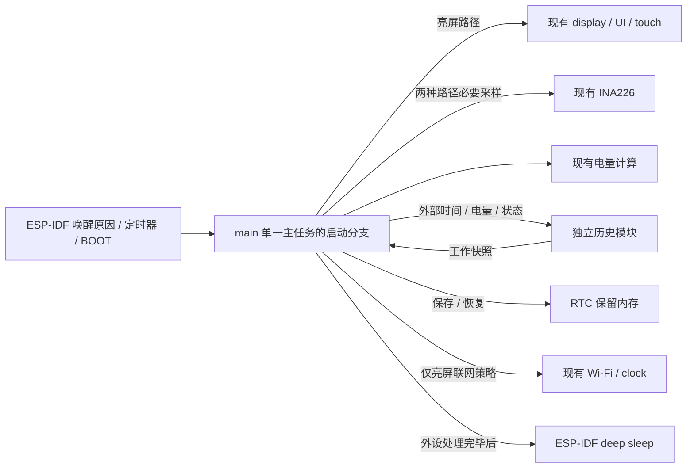
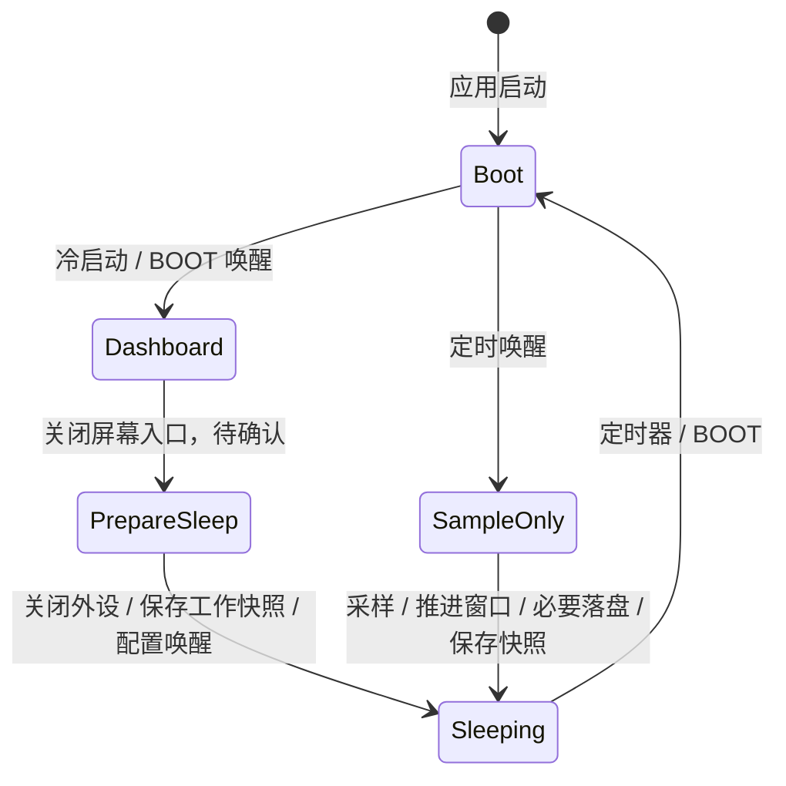

# 深度休眠与低频采集设计

状态：本轮讨论形成的后续设计，不实现深睡、RTC 工作快照或 BOOT 唤醒。用户同意历史工作状态跨深睡保留、定时唤醒只采集且不亮屏/联网，以及低功耗优先于累计。Wh/mAh 的删除已单独授权本轮执行；历史设计见 [history.md](history.md)。

后续进度：Wh/mAh 删除及真实历史版均已烧录，工作快照导出/恢复接口为 72 字节、无指针。尚未把它放入 RTC，也未实现定时唤醒/BOOT 路径。定时路径的最小初始化与恢复优化仍属未来深睡实现，不能据主机快照恢复测试宣称已经深睡保留。

## 目标与优先级

- 亮屏期间保留现有每秒 INA226 采样、电量估算、30 秒估算平滑、10 mA 方向阈值和连续 60 秒状态确认，不改变校准或显示接线。
- 关闭屏幕后进入真正的 ESP32-S3 deep sleep，而非仅关闭画面后继续执行主循环。
- 定时唤醒的讨论基准为十分钟，只执行必要的采样和历史维护，然后再次深睡。只按主板 BOOT 才恢复亮屏；触摸不作为休眠唤醒入口。
- 历史每半小时封窗落盘，不为凑够样本或做积分额外常醒，不在每次唤醒时写 Flash。
- 本轮移除 Wh/mAh 的展示、单位切换、积分、候选累计、区间累计和对应日志；不设计低频积分估算、补算或双累计模式。后续需要时由用户重新提出。

## 职责与运行状态

不新增应用任务或让历史模块接管休眠。以下是未来主任务启动分支的设计，不表示现有 `main.c` 已有这些路径。

- 启动首先判断是否为深睡唤醒及唤醒原因，再决定是否创建显示、触摸和网络资源；不能先执行现有完整初始化再把屏幕关掉。
- 定时唤醒与 BOOT 同时发生、或采样期间按下 BOOT 时，应检查按键请求并优先恢复亮屏，避免用户必须等下次十分钟唤醒。去抖和具体检查时机在实现时验证。
- 关闭屏幕的交互入口及自动熄屏时间尚未指定，不默认增加倒计时、手势或菜单按钮。异常复位后的启动策略也需另行确认，不把它无条件当作可恢复深睡。

## RTC 工作状态

- `RTC_DATA_ATTR` 所在的保留内存可跨正常 deep sleep/wake 周期保存少量数据，前提是对应电源域按需保留。
- 保留当前半小时的历史聚合、必要提交进度、时间有效性/连续性标识及调度信息。只保存可校验的纯数据，不保存指针、LVGL 对象、I²C/SPI 句柄或任务句柄。
- 历史模块导出/恢复自己的工作快照；主任务负责 RTC 放置和生命周期，历史模块不直接调用其他应用模块或睡眠 API。
- 深睡恢复时检查唤醒原因、快照标识/版本和完整性，再恢复工作状态；不能恢复后调用初始化把它清零。
- 普通 RAM 和 PSRAM 不承担跨深睡持久化。冷启动、真正断电或无效 RTC 快照时，从已提交 Flash 历史恢复，不把随机 RTC 内容当有效采样。
- 恢复无需把整个 7 日历史装入 RTC。定时采集只恢复小型工作状态和必要的存储提交信息；完整历史查询留给亮屏路径。

## 十分钟采集与半小时提交

1. 定时唤醒，判断原因并恢复有效的 RTC 工作状态和时间。
2. 只初始化必要的 INA226/I²C，取得新的有效电压和电流，外部计算电量及本次方向。
3. 按外部当前时间推进半小时时间窗，完成窗口只提交一次；采样属于自己的左闭右开窗口，不跨窗混合。
4. 保存更新后的 RTC 工作快照，按下一个采样目标时刻配置定时唤醒和 BOOT 唤醒，然后再次深睡。

正常情况下 `[12:00, 12:30)` 含 12:00、12:10、12:20 三个点，12:30 唤醒封闭上一窗并采集新窗。不能在 12:20 数够 3 点就封窗，也不能因其中一次读取失败而把落盘延后十分钟。首个部分窗口或唤醒漂移按真实时间处理。

现有 INA226 为 16 次平均、总转换约 35.2 ms 的连续测量配置。恢复初始化后必须确认读到新的有效转换，不能把尚未就绪的寄存器值写入历史；不能为了连续 60 秒状态确认而在采样路径停留一分钟。

## 时间与联网

- 运行已经取得有效时间且未断电时，使用 RTC 支持的系统时间跨深睡继续走时，十分钟唤醒不需要每次启动 Wi-Fi 或 SNTP。
- 当前配置为 `CONFIG_LIBC_TIME_SYSCALL_USE_RTC_HRT=y`，RTC 慢时钟使用内部 RC；时间会漂移，不能把短睡眠描述成永久免校时。
- `esp_timer_get_time()` 是本次启动以来的计时，深睡重启后不能延续之前的绝对计数。历史用外部有效 UTC 时间；采集目标和跨睡眠调度使用可恢复的时间基准，不能直接保存旧的开机计时截止值后比较。
- 定时采样路径不初始化 Wi-Fi、HTTP、扫描或 SNTP，也不调用会自动联网的现有 `wifi_init()`。即使校时计划到期，普通十分钟采集也不偷偷联网。
- 后续可保留十二小时作为亮屏自动校时的起点：休眠期间到期只标记待校时，BOOT 恢复亮屏后按已有凭据及超时策略执行。是否另设长期休眠专用校时唤醒、允许的最大漂移和最终周期尚未批准。
- BOOT 唤醒不是冷启动，不能每次都重新执行“有凭据启动校时”。冷启动无有效时间时仍按已有联网/手动策略获取时间；未取得时间前不补造带日期的历史。

## 电量与状态

- 电量曲线、系统 4.10 V 满电锚点、99% 上限和 INA226 校准不因休眠或删除累计而改变。
- 亮屏连续采样仍按现有 60 秒确认状态。每次低频唤醒的电量按新采样估算，采样方向由外部按电流阈值提供，不要求恢复 UI 的连续候选证据。
- 低频点不能证明两点之间持续充放电；历史状态统计只是采样状态，不称为精确充电时长。
- 无 Wh/mAh 积分或区间起止恢复需求。历史只保存电量与外部状态；不得为旧累计特性增加常醒、RTC 数据或联网。

## BOOT 与外设功耗

- 主板 BOOT 通常为 GPIO0，低电平有效；必须核实本板实际连接。ESP32-S3 的 GPIO0 属于可用于深睡外部唤醒的 RTC IO。
- GPIO0 同时是启动配置引脚。按住 BOOT 进行上电/复位可能进入下载模式，必须和正常深睡按键唤醒区分；验证释放、去抖和再次入睡，避免一直按住导致重复唤醒。
- 外部唤醒方式和 RTC 电源域选择在实现时比较功耗与板上拉电阻条件，不能为了按键唤醒无条件保留多余外设电源。
- 入睡前等待显示 DMA/SPI 完成；后续需验证 CO5300 的显示关闭与面板休眠命令，再用于此路径。只显示黑色不等于面板休眠，不能擅自写电源页或 MTP。
- 当前屏幕 EN/电源开关未接，触摸也可能仍有静态耗电。INA226 当前持续转换，同样不是零耗电；其触发测量/待机配置要按硬件资料和实测另行确认。
- 还需核对板载电源 LED、稳压器、USB、GPIO48 LED 和 I²C 拉电阻等静态耗电。不得用 INA226 电池通路电流代替 ESP32 整机休眠电流测量。
- 初期不为定时采样建立显示缓冲、LVGL 或触摸轮询；PSRAM 开机内存测试等启动成本是否可按唤醒路径调整，需先验证 ESP-IDF 初始化约束，不默认全部可跳过。

## 实现前确认与验收

- 确认熄屏入口、最终采样周期、最长可接受时间漂移和长时间不亮屏的校时策略。
- 确认 BOOT 接线、GPIO 上拉和面板/INA226 的低功耗命令，不用本设计推断已验证的硬件能力。
- 主机测试窗口、RTC 导出恢复和重复提交；真实设备连续多轮十分钟唤醒后每半小时一条记录，读取失败不改变窗口节奏。
- 实机验证定时唤醒不闪屏、不启用触摸或无线，只按 BOOT 才亮屏；采样期间按键、长按、再次入睡和异常复位不能造成唤醒循环。
- 验证断电后只恢复已提交历史，深灰缺口与真实 0% 可区分；整屏/局部刷新以及原配网和手动时间同步仍正常。
- 测量睡眠电流、每次采样的唤醒时长和能耗，以及持续多天 RTC 漂移。目标是整机低功耗，不以“调用 deep sleep 成功”代替验收。
