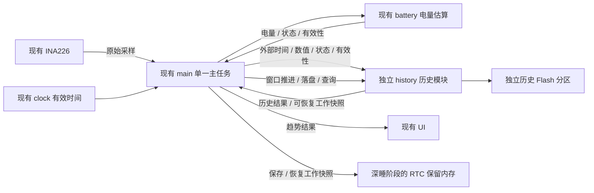
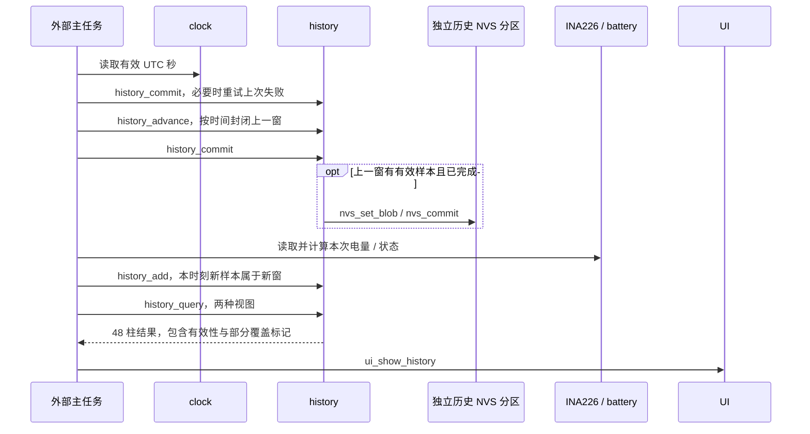

# 电量历史存储设计

状态：用户已确认历史模块独立、24 小时默认视图、7 日 48 柱、深灰色无数据区域、独立 Flash 分区，以及按半小时时间窗落盘。独立 `history.c/.h`、主任务接入、真实趋势与分区已实现，当前历史版已按用户要求烧录并通过写入校验。深睡协作见 [deep-sleep.md](deep-sleep.md)，实际休眠与 RTC 属性尚未实现。

## 模块边界

- 历史模块是外挂存储：接收数据、按时间窗聚合、持久化并提供读取结果。其公开数据类型不依赖 `battery`、INA226、Wi-Fi、clock 或 LVGL 的类型。
- 模块不主动采样、不获取系统时间、不定义电量曲线或电流阈值、不调用其他应用模块，不拥有屏幕、Wi-Fi、任务、定时器或休眠生命周期。
- Flash 读写属于历史模块内部实现，使用 ESP-IDF 存储接口；外部只调用模块接口，不维护其记录格式或直接写历史分区。
- 主任务负责把已有模块的结果转换成历史输入，推进时间窗、请求落盘和查询，再交给 UI。采集与落盘是独立操作，采集接口不因为凑够若干次采样而自动写 Flash。
- 历史模块提供小型、无指针的工作快照用于导出和恢复；RTC 放置属性及休眠前后保存由外部管理。历史模块不直接配置 RTC 电源域或调用休眠接口。
- 历史不保存 Wi-Fi 凭据，也不记录 Wh/mAh 或进行充放电积分。

## 调用顺序

`history_add` 不隐式推进窗口，也不写 Flash。初始化读取已完成的历史；`history_export`/`history_restore` 提供 72 字节工作快照，外部可在未来放入 RTC。接口使用独立的数值、时间和状态类型，不暴露 NVS 句柄。

## 时间与聚合

- 基础时间窗为 30 分钟，用 UTC 秒对齐：`window_start = timestamp / 1800 * 1800`。北京时间只用于 UI 标签格式化。
- 窗口为左闭右开区间 `[window_start, window_start + 1800)`。边界时刻的新采样属于下一窗，不能既计入上一窗又计入下一窗。
- 每次有效采样只更新其所属窗口的电量聚合、有效采样数量及外部状态统计。电量输入保留百分之一精度，汇总前不按每窗取整；读取失败不计入电量平均，也不以旧值补采样。同一 UTC 秒只接受第一次采样，重复或倒退的样本不重复计数。
- 外部显式提供计划采样间隔：当前主任务为 1 秒，未来十分钟采集可传 600 秒。覆盖信息按本次采样与计划间隔在窗内的交集统计，不重复累计重叠部分；它只表示声明采样节奏下的覆盖，不证明期间电量或充电方向保持不变。
- 外部时间推进到窗口结束后，封闭上一窗并请求落盘；窗口内有 1、2 或 3 个有效点都按实际数量聚合，不等待凑够 3 次。首次启动的部分窗口也遵循同一规则。
- 无有效样本的窗口表示无数据，不存成电量为 0。长时间关机不需要逐窗写空记录；查询可依据记录时间生成缺口。
- 当前未封闭窗口可以通过工作结果查询，不要求为了显示实时趋势而提前写 Flash。
- 未取得有效时间时不写带绝对时间的历史，不把开机时间或存储的旧时刻当当前时间；首次有效校时之前的采样不追溯补造。
- 主任务用相邻壁钟增量与单调计时增量比较，偏差大于 5 秒时显式调用 `history_reset_time`，丢弃未完成窗口的旧样本；已经封闭待提交的窗口及已落盘历史不重写。小于此阈值的修正不跨已记录样本重复计数。
- 时间回退后不向已经提交的窗口补写，不修改保存记录的时间；壁钟超过最新提交窗口后才恢复新窗采集。前进跳过的窗口无样本，保持无数据。此策略优先避免混合不同时间段或覆盖已有记录，不假装可以准确追溯校时前每个点。

### 十分钟采集示例

正常情况下，每个半小时包含 3 个十分钟采样点；这是调度结果，不是落盘触发条件。

| 时刻 | 采集与工作状态 | Flash 操作 |
| --- | --- | --- |
| 12:00 | 采样属于 `[12:00, 12:30)`，保存 RTC 工作快照 | 不写当前窗 |
| 12:10 | 更新当前窗，保存 RTC 工作快照 | 不写当前窗 |
| 12:20 | 更新当前窗，保存 RTC 工作快照 | 即使已有 3 点，也不提前封窗 |
| 12:30 | 封闭上一窗；本时刻采样开始 `[12:30, 13:00)` | 写入上一窗的一条聚合记录 |

亮屏时仍每秒采样，同一半小时可能有约 1800 个有效点，也只生成一条基础记录。深睡调度应以采样目标时刻安排下一次唤醒，而不是在处理完成后再睡固定十分钟，避免启动和处理耗时累积成漂移。

## 视图与缺口

- 默认过去 24 小时，48 柱，每柱对应 30 分钟；400 ms 内双击柱状图区域 `(26 <= x < 309, 280 <= y < 416)` 在 24 小时和 7 日之间切换，重启恢复默认视图。点击其他区域会取消待完成的趋势双击，配网页与操作面板不响应隐藏图表。
- 两种查询都以当前半小时结束为右边界，最右柱包含当前未完成窗口，不生成未来样本。24 小时标签为北京时间 `HH:MM`，7 日标签为北京时间 `MM/DD`；未取得有效时间时刻度为空。
- 7 日维持 48 柱，每柱对应 3.5 小时，合并 7 条基础记录。使用有效采样聚合量，不把已经取整的百分比直接等权平均；全部无效时输出无数据。
- 全图采用深灰色底色。有数据时绘制电量柱，无数据时只露出背景，不沿用关机前的电量，不绘制虚假的 0% 彩色柱。真实 0% 用一像素彩色基线标记区分；电量不超过 25% 为粉红色、不超过 40% 为黄色，其余为绿色。
- 真实 0% 与无数据在结果类型中必须可区分。无效值不参与电量平均、状态统计或任何充电占比。
- 单个基础窗内部分采样失败，不让整窗作废；聚合结果保留有效数量和覆盖信息。当前窗、存在读取失败、声明节奏覆盖不足或缺少合并基础窗的柱用较暗的对应颜色。部分覆盖标记不是实际连续测量保证，也不因孤立样本取消整个窗口。
- 充放电状态由外部提供。低频采样的方向仅表示采样时刻的状态，不能据此断言整个十分钟持续充电；不把状态采样占比标成精确的充电时长。
- 本版 7 日合并沿用已确认的有效采样数加权。亮屏密集采样与未来深睡稀疏采样混合时会偏向亮屏段；未来正式增加深睡前再确认是否改用时间权重，当前不通过缓存插值补成真实数据。
- 充电状态采样占比达到 50% 的有效柱绘制深绿底及底部标记，连续宽度足够时只绘制一个居中闪电，窄组只画短线。它表达窗口内采样状态的多数，不宣称是真实连续充电区间，且不随当前顶部状态切换为另一套历史。

## Flash 与恢复

- `partitions.csv` 在 `0x210000` 添加独立 64 KiB `history` NVS 数据分区。原 Wi-Fi `nvs` 仍为 `0x9000/0x6000`、PHY 为 `0xf000/0x1000`，应用仍为 `0x10000/0x200000`；不移动、擦除旧分区，不增加文件系统或 OTA。
- 内部使用 ESP-IDF NVS 的原子更新、CRC 与磨损均衡，不另写扇区日志引擎。`trend` 命名空间的 336 个键按半小时时间编号取模，每条值为带版本的 32 字节聚合。查找还须核对完整时间戳，槽位复用不能误显示为旧窗口。
- 每个完成且有有效样本的窗口写一条，通常每天最多 48 条；复用键和扇区回收交给 NVS。查询范围只有最近 7 日，无采样时不额外写空值来擦除旧槽位，也不显示范围外记录。
- NVS 保护已完成的更新；初始化故障不调用分区擦除。无效版本、长度或聚合范围的记录跳过，其他读取故障报告并禁用本次持久化，不把故障当作首次运行清空历史。
- RTC 工作快照保存当前窗和必要的提交进度，不保存整个 7 日账本，也不保存 UI 对象或硬件句柄。深睡恢复后不能重复提交上一窗或在成功恢复后再次无条件初始化清零。
- 落盘失败返回 false 并打印错误，不清除待提交窗口。工作状态保留一条封闭待提交窗口及当前窗；若故障持续到再下一个窗口，不再覆盖这两个窗口，新样本暂不接收，存储恢复后可重试。当前实现不为持续 Flash 故障增加无限 RAM 队列。
- RTC 保留内存只解决深睡期间的工作状态保留，不保证真正断电后的数据保留。突然断电仍可能丢失未落盘部分；冷启动只恢复已提交 Flash 历史，缺失部分显示深灰色。
- 若唤醒发生在窗口结束之后，落盘只能在实际唤醒时执行；不能无条件宣称断电损失严格不超过 30 分钟。准确上限还取决于窗口边界唤醒与写入是否成功。

## 验证与限制

- 无应用模块依赖的主机聚合测试，覆盖窗口边界、首个部分窗口、有效数量不足 3、读取失败、真实 0%、长缺口和 7 日合并。
- 采集接口不写 Flash；多次采集后仅窗口封闭才提交。主机使用模拟 NVS 事务验证跨窗口、重复提交、写入失败、提交失败与恢复，以及 21 天输入后的 7 日槽位循环；底层 NVS 扇区磨损和真实写入中断电还需要硬件验证。
- RTC 工作快照连续恢复多轮仍保持聚合值，封窗只提交一次；真正断电或无效快照只能恢复 Flash。
- 真实 LVGL 检查 48 柱、双击切换、深灰缺口、真实时间标签、文字边界和局部/整屏刷新一致性。
- 接入时保持亮屏采样、配网、时间同步和既有硬件校准回归通过；不得把本文设计记录描述成已经通过的历史功能测试。

目前主机历史 sanitizer、实际 LVGL 渲染/像素一致性及原电量、无线/HTTP 回归均通过。十分钟三点、首窗两点、延迟五秒跨窗、读取失败、真实 0%、有效加权、72 字节工作快照恢复和时间回退不覆盖记录均有测试。图表空历史、24 小时带缺口及 7 日视图已目视检查；截图只在 `.pio/host-network-ui/`。当前版已烧录，半小时实机落盘、断电恢复、7 日运行及实际 RTC/深睡仍未验收。

ESP32-S3 固件构建通过，应用 1394592 字节，2 MiB 应用分区占用约 66.5%，静态 RAM 约 37.7%。ESP-IDF 解析生成的二进制分区表并校验通过，新增历史分区为 `0x210000/64 KiB`，原 NVS、PHY 和应用地址/大小不变。

## 本次烧录

- 经 `/dev/cu.usbmodem21401` 烧录，22288 字节 bootloader、3072 字节分区表和 1394592 字节应用写入哈希全部校验通过，随后自动复位。未执行全片擦除或擦除原 Wi-Fi NVS。
- 本地原始日志为 `logs/device-monitor-261101-225323.log`。抓取从开机约 20 秒开始，约 54 秒内取得 54 次正常 INA226 采样及 SOC 报告；电压约 4.090–4.092 V、电流约正负 0.15 mA、SOC 99%、状态待机，无累计字段。
- 捕获 18 次触摸按下和 18 次松开，采样持续；此期间未发现 panic、栈溢出、INA226 读取失败或历史提交错误。仅触摸日志不能证明柱状图双击命中与实际显示已验收。
- 此次未捕获完整启动、历史分区恢复或 SNTP 日志，也未跨半小时时间窗确认落盘。主机分区核验和烧录哈希不能替代真实历史持久化验收；需要保持运行至下一半小时边界，再检查重启恢复。
- 串口监视已关闭，用户随后确认界面展示符合预期，并提出压缩上方留白、扩大图表的布局微调。新的布局已烧录并由用户确认正常，见 [布局微调](solar-ui.md#历史布局微调)。

## 本轮结项

用户确认最新布局微调版真机没有问题，授权提交到当前分支。本轮交付独立历史模块与 64 KiB 分区、半小时落盘和 7 日保留、24 小时/7 日 48 柱查询与双击切换、真实时间标签与深灰缺口、Wh/mAh 移除、布局调整、主机测试及设计文档。历史工作快照接口为未来 RTC 保留准备，但未启用实际深睡。

最新烧录的应用、bootloader 与分区表哈希全部通过，现有 Wi-Fi 凭据与历史分区未擦除；真实热点开启/取消、手动时间同步及无线反初始化仍正常，细节见 [布局验收记录](solar-ui.md#历史布局微调)。用户的界面确认不替代半小时落盘、真实写入中断电、7 日连续运行或 RTC/深睡功耗验收，以上仍保留待实测状态。原始串口日志和预览仅在本地忽略目录，不纳入提交。
