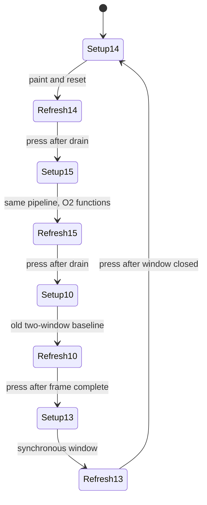
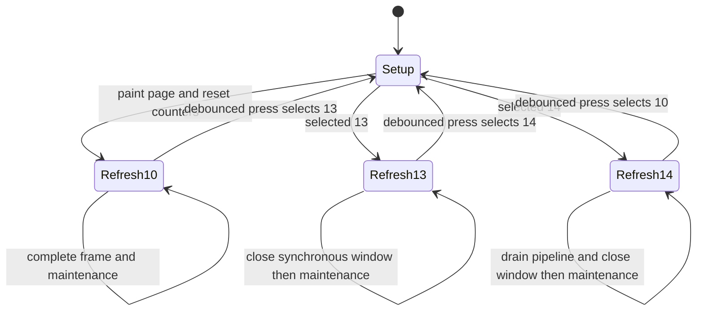

# LCD 连续窗口与小块流水线：批准设计

> 2026-10-15 P5 归档：以下为压力测试的已批准历史设计，保留所有权规则和实测依据，不再提供其中的策略菜单或接口副本。当前生产组件、矩形时序及状态机以 [UI 还原计划第4节](starchart-ui-reconstruction-plan.md#4-架构与接口草案) 为准；跨帧预生成/持续窗口仍未实施。

2026-10-14。用户已批准一帧连续窗口同步写及两个 32 行区流水线，并要求同固件按钮切换。本文定义新增测试策略的架构；10 仍遵守 [基线设计](lcd-refresh-test.md) 的同步时序。跨帧持续窗口仍未批准。

## 本轮批准范围

最新批准：14 为默认新基线，新增 15「WINDOW PIPE32 O2」，保留 10 旧基线和 13 同步窗口对照。BOOT 顺序为 14→15→10→13→14。15 只将同一份刷新函数、窗口 begin/write/submit/wait/end 编译为独立 O2 副本；原函数、共用短命令及 IDF SPI 驱动保持原编译级别，渲染器保持已有 O2。两套函数共享同一窗口状态/描述符，不允许窗口中途切换。无抽样、预取、跨帧窗口、额外缓冲或段外维护。

该实验已通过主机测试、默认/原 UI 编译并烧录。120 秒同固件对照中 14/15 动态帧同为 8.428 ms，平均 FPS 差约 0.007，未测到可辨别收益；14 保持默认，证据见 [O2 热路径实测](lcd-refresh-test.md#o2-热路径实测)。更激进的跨帧窗口/预生成仍需新时序设计和明确批准，不因 O2 无收益自动扩大范围。



15 的提交顺序、时间戳、CS、DC、频率、阻塞及所有权遵守下文 14 时序图。编译副本由各模块内部的共享 `.inc` 源生成，不构成新组件或暴露 IDF 描述符；切换只选择一整帧的固定函数族。按钮/页脚/报告代码不改变编译级别。优化收益必须按新同固件 14/15 对照测量，不能直接与上一固件 14 相减。

| 编号 | 标签 | 增量 |
|---|---|---|
| 10 | WIRE 80M MAX | 原两窗口、单 64 行区同步基线 |
| 13 | WINDOW SYNC | 一帧一次窗口，单 64 行区同步，四个像素事务跨块保持 CS |
| 14 | WINDOW PIPE32 | 13 的窗口约定，加两个 32 行区、深度 2 的中断 DMA 队列 |

以下 10/13/14 表及状态图记录上一轮批准顺序；最新默认/顺序以本节开头为准。GPIO28 BOOT 低有效、上拉，30 ms 消抖，按下产生一次切换，长按不重复，稳定释放后重新武装。只在帧边界读取和切换，切换前所有 DMA 完成、窗口关闭，40 MHz 重绘策略页，然后启用 80 MHz 像素并重置统计。原 UI 分支不初始化 BOOT。历史 11/12 不恢复；本轮不添加段外维护策略，各策略保留每秒日志和 FPS 页脚，便于相同口径比较。



```mermaid
sequenceDiagram
    participant D as main.c display task
    participant R as starchart_render.c
    participant H as chart_hardware.c
    participant S as SPI DMA
    D->>R: draw first 64 rows into single buffer
    D->>H: begin full 128-row window at 40 MHz
    H->>S: acquire bus; 2A/2B/2C; DC=1
    D->>H: write first 64 rows synchronously
    H->>S: 32764+8196 bytes at 80 MHz, keep CS
    S-->>D: both complete; buffer reusable
    D->>R: draw second 64 rows into same buffer
    D->>H: write second 64 rows synchronously
    H->>S: 32764+8196 bytes; last transaction releases CS
    S-->>D: both complete
    D->>H: end window; release bus
    D->>D: count frame; maintenance or next frame
```

硬件接口在原四步语义之外增加 `write(pixels, rows)`，专供 13 的同步写，不与异步 `submit` 混用。`begin/end` 接收计时输出，`end` 必须在提交或等待失败后也回收已提交事务并释放总线；错误停止显示测试，不在未知 CS/GRAM 状态下切策略或继续刷新。`dma` 对 14 是首次提交到最终回收的墙钟跨度，包含重叠绘制；另记 `wait` 阻塞调用耗时和 `dynamic` 动态帧总耗时，不将 `draw + spi` 相加。

## 假设与结论

以下预算和候选比较保留批准前的推导，当前策略/按钮行为以“本轮批准范围”和实现时序为准。

- 保持完整 320×128、y=96..223、RGB565 屏幕字节序，像素 80 MHz，命令/参数 40 MHz。
- 保持一个显示任务、一个 SPI 设备，不增加 ISR 绘制、完成回调、额外任务或脏矩形；看门狗继续启用。
- 现有 40960 B 内部 DMA 分配可分成两个独立 32 行区，各 20480 B；新增两个长期有效的事务描述符和深度 2 的驱动队列，不增加像素容量。
- 每次提交的像素区和事务描述符都必须等对应完成结果返回后才能复用。
- 一帧一次窗口不依赖窗口末尾回绕；跨帧持续写则依赖候选控制器的 GRAM 回绕，当前模块尚未验证，不能默认成立。

**建议先批准“一帧一次窗口 + 两个 32 行区流水线”的有限实验，不直接批准跨帧永久窗口。** 它有机会接近 120 FPS，但不能承诺达到；若实测仍明显低于目标，应先检查线上间隙再决定是否增加跨帧生命周期。

建模采用仓库已有的 Mermaid 时序图与状态图：时序图解释提交/完成顺序，状态图解释所有权；纯文本时序作为无 Mermaid 渲染器时的后备。本文预算均是实测分解或明确标注的估算，不是候选方案实测。

## 基线与关键预算

依据 `/private/tmp/lcd-baseline10-only-20261014.log`：稳定约 113.45 FPS，普通帧约 8.76 ms；首个无页脚采样窗口 `draw=0.27`、`cmd=0.181`、`dma=8.302` ms/frame。后续窗口含页脚，平均 `draw=0.29`、`cmd=0.183`、`dma=8.320`。

81920 B / 10 MB/s = 8.192 ms，理想上限 122.07 FPS。120 FPS 允许 8.333 ms，只有 0.141 ms 非像素预算；从普通帧需省约 0.427 ms。113.45 到 120 是约 5.77% 的更新率提升。

| 路径 | 每帧窗口命令 | 像素事务 | 暴露的生成工作 | 主要代价 |
|---|---|---|---|---|
| 当前同步 64 行 | 两组，每组 5 个短事务 | 4：两组 32764+8196 B | 全部约 0.27～0.29 ms | 两组重复窗口与频率往返 |
| 简单候选：连续窗口、同步写 | 一组 5 个短事务 | 同为 4 | 全部 | 新增窗口生命周期，但没有重叠 |
| 推荐候选：连续窗口、32 行流水线 | 一组 5 个短事务 | 4×20480 B | 至少首块，粗估约 0.07 ms | 两个独立区、异步提交与完成回收 |
| 激进候选：跨帧持续窗口 | 每段测速开始一次 | 每帧 4×20480 B | 预热后有望隐藏 | 回绕验证、跨帧时间戳和停止边界 |

32 行像素在线时间 2.048 ms，远大于估算的单块生成时间。32 行区在当前查询得到的 32764 B 对齐事务上限以内；实施时仍用 `spi_bus_get_max_transaction_len()` 验证，不用增大总线配置绕过硬件上限。16 行双区只用 20 KiB，但需要 8 个像素事务；64 行双区要 80 KiB 且仍拆事务。32 行是第一轮合理起点，不是已证明的最优值。

命令约减半只能作为初估：当前每帧有两轮 80→40→80 MHz，候选只留一轮；切换成本与实际短事务耗时不是均匀分布。若首块约 0.07 ms、命令约 0.09 ms、保留原约 0.11 ms DMA 软件开销，则约 8.46 ms，即 118.2 FPS。即使 DMA 开销降到 0.05 ms，估算也约 8.40 ms，即 119.0 FPS。

以上估算没有计入新增的 CPU/DMA 内存争用，也没有假定流水线能消除所有 ISR 间隙。预先排队只消除依赖任务醒来再提交的间隙，IDF 仍需在 ISR 中启动下一事务。仅隐藏绘制不等于实现稳定 120。

## 推荐时序：一帧一次窗口

一个分配分成 `A=pixels[0..10239]`、`B=pixels[10240..20479]`，地址偏移 20480 B。P0/P1/P2/P3 分别为 y=96/128/160/192 的 32 行块；同一帧全部使用同一个 `elapsed_us` 和 `frame`。

```mermaid
sequenceDiagram
    participant D as main.c display task
    participant R as starchart_render.c
    participant H as chart_hardware.c
    participant S as IDF SPI DMA
    D->>R: draw P0 into A; frame timestamp fixed
    R-->>D: A ready, MSB-first
    D->>H: begin window x=0..319, y=96..223
    H->>S: acquire bus; 2A/2B/2C at 40 MHz
    H->>H: set DC=1 after polling completes
    D->>H: submit P0/A; keep CS
    H->>S: queue persistent descriptor TA, 80 MHz
    D->>R: draw P1 into B while P0 transfers
    R-->>D: B ready
    D->>H: submit P1/B; keep CS
    H->>S: queue persistent descriptor TB, 80 MHz
    D->>H: wait for oldest result; task blocks
    S-->>H: TA complete; P1 may already be running
    H-->>D: A reusable
    D->>R: draw P2 into A while P1 transfers
    D->>H: submit P2/A; keep CS
    H->>S: queue reused TA, 80 MHz
    D->>H: wait for oldest result; task blocks
    S-->>H: TB complete
    H-->>D: B reusable
    D->>R: draw P3 into B while P2 transfers
    D->>H: submit P3/B; last block, release CS on completion
    H->>S: queue reused TB, 80 MHz
    D->>H: end window; drain P2 and P3
    S-->>H: both results returned; final CS deasserted
    H->>S: release bus
    H-->>D: frame complete, A/B reusable
    D->>D: count frame; next frame or maintenance
```

纯文本关键路径（示意，不按比例）：

```text
CPU:  draw P0 | commands | draw P1 | wait | draw P2 | wait | draw P3 | drain
SPI:                    |  P0    |   P1          |   P2          |  P3  |
CS:                     |--------------- active ----------------| high
```

窗口命令只在开始时发送；P0/P1/P2 设置 `SPI_TRANS_CS_KEEP_ACTIVE`，P3 不设置。已独占总线是使用该标志的前提。像素阶段 DC 始终为 1，不再插入 RAMWR、地址命令或 40 MHz 事务。每个像素事务继续显式写 80 MHz，不依赖 `override_freq_hz=0` 恢复默认。

每帧窗口在下一帧重新设置，避免假设屏幕地址自动回绕。代价是首块绘制、命令和最后一次回收仍在关键路径上。若想在 P3 期间预画下一帧首块，需要另外定义下一帧生成时间和提交时间，不能悄悄把现行“帧开始时间戳”改成提前采样时间；本候选不包含这种预取。

## 所有权与接口边界

下面的状态图分别适用于 `(A, TA)` 和 `(B, TB)`，两个槽互不重叠。

```mermaid
stateDiagram-v2
    [*] --> Free
    Free --> Drawing: display task takes pixel region
    Drawing --> Ready: renderer returns
    Ready --> InFlight: queue succeeds; driver owns pixels and descriptor
    InFlight --> InFlight: queued or DMA done but result not retrieved
    InFlight --> Free: matching completion result retrieved
    Ready --> Free: queue rejected; stop experiment
```



“DMA 已结束”或一个全局完成布尔值都不能作为复用依据；必须核对返回的描述符和槽。提交失败不转移该槽所有权，已经成功提交的其他槽仍必须回收。发生错误停止实验，不在未知 GRAM 状态下继续下一帧；不设计自动重试或新的错误恢复框架。

| 所在模块 | 候选责任 | 保持不变 |
|---|---|---|
| `main.c` 测试分支 | 一次分配两个区；按图生成、提交、回收；最后完成才计帧 | 一个显示任务；同帧时间戳；无帧内分配 |
| `starchart_render.c` | 用现有 `chart_render_refresh_band_wire()` 生成 32 行 | 不接触 SPI/队列；不改动画、颜色或字节序 |
| `chart_hardware.c/.h` 测试分支 | 窗口生命周期、两个长期描述符、异步队列、对应完成与总线释放 | 一个 SPI 设备；原同步 tile/UI 接口不变 |

候选接口语义只需四步：`begin(y, rows)`、`submit(pixels, rows, last)`、`wait(completed_pixels)`、`end()`。名称待实施时依本地风格确定；不把 IDF 描述符暴露给渲染器或新增通用异步框架。驱动按提交顺序选择/回收两个描述符，显示任务按返回的像素指针认领区。`end()` 回收全部剩余结果并释放总线，正常返回后才允许同步页脚和下一次 `begin()`。

窗口状态为 `Closed → Open → Draining → Closed`：`begin` 从 Closed 进入 Open，末块成功提交后进入 Draining，`end` 完成回收后回到 Closed。Open/Draining 期间禁止 `chart_lcd_tile()`、`chart_lcd_tile_profiled()`、频率模式切换和新窗口；由同一任务遵守此流程，不新增并发锁。

队列深度改成 2 仅用于测试设备，最多两个未回收像素事务。描述符不能是 `submit()` 的临时栈变量；像素区是 DMA-capable、内部、正确对齐的固定区域，实施时检查驱动没有因对齐而创建临时拷贝。队列等待和完成等待使用阻塞，不轮询忙等；等待期间 idle 任务仍可运行。跨整个窗口持有 SPI 总线不等于持有 CPU。

## 真实 UI 阶段备忘：暂不实施

2026-10-14 用户决定：以下两个方向仅备忘，停止继续扩展刷新 demo，到真实 UI 阶段根据实际负载决策。这不是实施授权；当前 14 默认基线、15 O2 对照及 10/13 保留策略不变。

| 方向 | 预期作用 | 实施前提与代价 |
|---|---|---|
| 窗口缓存 + 跨帧首块预生成 | 省重复地址命令；在上一帧尾块 DMA 期间生成下一帧首块，仍每帧关闭窗口 | 验证 RAMWR 起点；定义窗口缓存失效、下一帧快照/时间戳及预生成缓冲所有权；页脚、模式切换或错误时处理失效内容。不依赖跨帧 GRAM 回绕，优先评估 |
| 跨帧持续窗口 + 持续流水线 | 摊薄窗口命令和频率切换，同时隐藏首块生成 | 验证实际模块 GRAM 回绕；定义跨帧完成计数、停止预排、末帧释放 CS、维护和切换边界。复杂度更高，仅在前一方向仍不足时评估 |

真实 UI 先测一致模型快照的绘制时间、动态/静态区域和脏区域边界、IMU/Wi-Fi 并发负载、堆栈及帧间隔，再判断传输是否仍为瓶颈。14 的约 117.9 FPS 只针对 320×128 测试区域，不能作为真实 UI 或面板扫描率承诺。优先以正确显示、响应和帧间隔稳定性判断收益，不为 demo 的 120 FPS 单独增加架构复杂度。

若决定实施任一方向，先补对应时序、状态和缓冲所有权图并再次确认；保持看门狗，不默认增加像素内存、提高到 80 MHz 以上或将维护移出统计以宣称提速。

## 更激进的跨帧连续窗口：暂不实施

此路径在一段测速中只设置一次窗口、一次 40→80 MHz 转换，每帧末块也保持 CS；所有帧像素连续写入，靠 GRAM 到窗口末尾自动回绕。它可以把下一帧首块生成叠入上一帧尾块传输，预热后才有机会接近 `8.192 ms + 事务间隙`。

它不是“每帧少设一次地址”的等价替换，而是新的跨帧状态和停止协议。若后续批准，至少先确认：

1. 在实际模块/MADCTL 下，窗口末尾回到 y=96、x=0；上下条带、边界及逐帧标记连续正确。候选 ST7796 资料不能代替模块验证。
2. 一个帧的四块共用生成时间；生成时间和实际传输边界分别记录，不能把提前生成的时间戳当作 DMA 帧完成时间。
3. 在段结束的最后一帧前决定终止：末块不保留 CS，不再预排下一帧；回收全部结果后才能切回 40 MHz 或修改 DC。不能仅 `release_bus()` 就假定已撤销硬件 CS 保持。
4. 屏幕 FPS 与串口维护只能在已关闭的段边界执行，维护后重新设置窗口并预热；不得插进连续像素流。

因此第一轮不使用跨帧回绕，也不为其加入备用模式或隐藏开关。

## 测量口径

当前约 13.3 ms 是含动态帧的页脚维护长帧，不是页脚本身耗时；相对普通 8.76 ms，额外约 4.6 ms。页脚 y=240..271 额外发送 20480 B，80 MHz 下纯像素约 2.048 ms，剩余包括绘制、交换、命令和提交。移出测速窗口不会提高物理带宽。

建议使用有限的连续测速段：段内仍完整逐帧发送 81920 B，保留相同逐帧采集；达到原约 1 秒报告点后，在完整帧完成且窗口关闭时结束段，更新日志和屏幕 FPS，然后重新计时。首轮不同时删除详细计时，避免混入第三个优化变量。

- **段内更新率**：完整完成帧数 / 段内墙钟时间；含首块、命令、队列、回收和段内统计开销，排除段间日志/页脚。首帧预热不能偷偷扣除。
- **含维护更新率**：累计完成帧数 / 连续墙钟时间，包含所有日志、页脚和停段时间；这是与当前 113.45 FPS 比较的指标。
- **帧间隔**：分别记录段内普通间隔和跨维护边界间隔；移除长帧只在段内成立，不能宣称整段运行均匀 120 FPS。
- **像素吞吐**：段内只计动态帧 `81920×frames`；页脚字节另计，不混入动态吞吐抬高数值。
- **重叠计时**：`draw` 是 CPU 生成墙钟时间，`transfer` 是首次提交到最后回收墙钟时间，二者重叠后不能相加。另记暴露的首块/命令耗时、完成等待、总帧时间；不把等待时间直接叫纯线上 DMA 时间。

段间退出计时后才做维护，下一段开始时重置帧间隔起点。长期墙钟统计不重置。若要宣称均匀 120 FPS，必须连维护边界一起达到要求；本实验只验证传输路径潜力。

## 实施与验收顺序

1. 按最新批准，一次实现 10/13/14 三策略按钮切换：13 保持串行生成及两组 64 行发送，测窗口合并单独收益。
2. 14 按本文时序使用两个 32 行区和深度 2 队列，像素量及逐帧采集不变；与 13 比较，归因流水线收益。原 UI 编译分支继续同步 40 MHz。
3. 三策略均保留每秒日志/FPS 维护；段外维护的测量方案留作后续，本轮不实施。
4. 主机验证四块拼接在全部 320 个运动位置、两种帧标记下逐字节等于基线；增加提交/回收所有权测试，覆盖描述符复用、最终 drain 和失败停止。主机模拟不能替代真实 SPI 验证。
5. 编译测试分支与 `CHART_LCD_REFRESH_TEST=0` 原 UI 分支；烧录后先短测光学正确性，再至少 60 秒采集 FPS、普通/维护间隔、堆/最低堆、栈、DMA/看门狗/重启。
6. 若有逻辑分析仪，测 CS/SCK/DC，确认一帧 81920 B、命令 40 MHz、像素 80 MHz、块间无命令，并量出三个内部间隙与帧边界；没有该测量就不声称消除了线上间隙。

若只获得约 1% 改善，建议保留更简单的连续窗口同步路径，不继续扩大异步设计。若接近 120 且稳定性/光学验证通过，再决定是否保留流水线；离目标仍远时，先分析测量，不直接增加内存、频率、回绕或新任务。

## 依据与本轮验证边界

- 现有 `main.c` 测试循环和 `chart_hardware.c` 的同步拆分/保持 CS 行为，与 `lcd-refresh-test.md` 现行时序一致。
- 当前构建的 `CMakeCache.txt` 指向本机 ESP-IDF `~/.platformio/packages/framework-espidf`；本轮核对该版本 `spi_master.h` 与 `src/gpspi/spi_master.c`：完成结果返回前描述符不可修改、独占总线才可保持 CS、未完成队列不可混用同步/轮询传输。
- 驱动 `spi_setup_device()` 只在非零 override 与当前期望频率不同时重新计算时钟；不能按头文件“约 30 us 每次”把每个同频事务都算作一次频率重算。
- 驱动完成 ISR 可直接启动已排队的下一事务，但仍存在中断/配置开销；驱动队列完成并不证明屏幕正确接收或面板扫描率达到 MCU 更新率。
- 10/13/14 已实现；主机 ASan/UBSan 直接运行硬件驱动、刷新函数和现有渲染器，覆盖全部 320 个位置、两种帧标记、事务/字节/CS 检查、缓冲与描述符所有权、提交/完成错误和按键消抖。默认及原 UI 分支编译通过。已烧录并采集 90 秒对照，含维护更新率约 113.34/114.71/117.90 FPS；14 用户报告间歇横向条纹，光学问题仍未定位，具体证据及短期验证限制见 [实测记录](lcd-refresh-test.md#连续窗口与流水线实测)。主机模拟和无错误日志不证明面板正确接收。
- Mermaid 源采用现有文档语法；没有本地 Mermaid 渲染器，未验证渲染布局，文本后备完整保留顺序与所有权语义。
