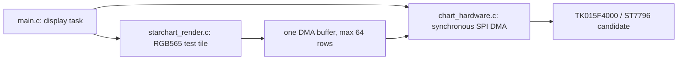
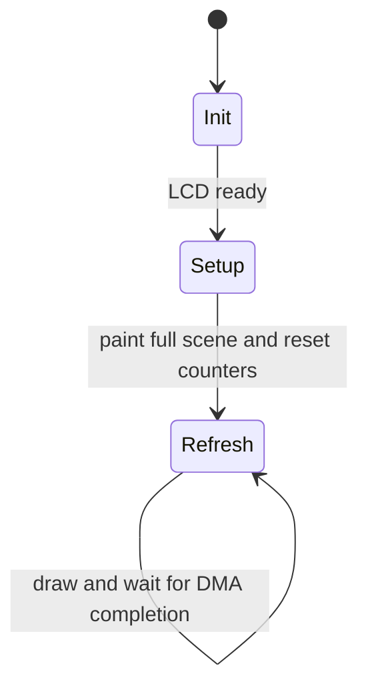

# LCD 上电刷新测试

> 2026-10-15 P5 归档：本文保留历史固件的设计、命令、日志和用户反馈，不代表当前可运行配置。压力 demo、策略菜单与重复实现已删除，生产星盘及当前验收见 [UI 还原计划](starchart-ui-reconstruction-plan.md#15-p5-执行记录)。以下“当前”“默认”等均指各次历史实验。

2026-10-14：本轮专用于连接的 TK015F4000 屏幕刷新策略对比，临时替代星盘启动流程。现有接线、ST7796 候选初始化、镜像、RGB565 和背光配置不变；不把旧 UI 的光栅化耗时混入 LCD 基准。

## 当前增量实验：14 基线与 15 O2

最新批准：上电默认 **14 WINDOW PIPE32**，新增 **15 PIPE32 O2**；保留 10 上一版同步基线、13 连续窗口同步对照。BOOT 循环为 **14→15→10→13→14**。15 使用同一份刷新/窗口源代码生成的 O2 函数副本，原函数与 IDF SPI 驱动保持原编译级别，渲染器仍为已有 O2。无算法、像素面积、缓冲数量、事务数量、逐帧采集或每秒维护口径变化；函数族仅整帧切换，仍共享同一窗口状态及描述符。已完成下述同固件对照，不直接与上一轮 117.90 FPS 相减。

本轮主机 ASan/UBSan 已验证 14/15/10/13 的全部 320 个运动位置、两种帧标记、字节输出、四次 DMA、CS、缓冲/描述符所有权及失败回收；14/15 均注入命令、提交、完成错误。默认 C5 编译通过，反汇编确认 O2 函数有独立指令实现，IDF SPI 仍为 `-Og`。

### O2 热路径实测

四策略固件已成功烧录 `/dev/cu.usbmodem1101`，原 UI 分支编译通过后已恢复默认测试镜像。120 秒日志 `/private/tmp/lcd-pipe32-o2-20261014.log` 记录 14→15→10→13→14→15，最后 15 连续约 81 秒。按各段剔除首个无页脚报告，14 有 8 个稳定报告、平均 117.886 FPS；15 有 92 个稳定报告、平均 117.893 FPS。两者 `dynamic=8.428 ms`，普通间隔约 8.43 ms，命令/DMA 墙钟跨度及维护长帧也基本一致。差约 0.007 FPS，不是可辨别的性能收益，用户观感也无明显差异。

反汇编确认 submit/wait/end 的 O2 副本与原函数指令实现不同，且只存在一份 144 B 窗口状态，像素容量与 HP SRAM 链接占用不增加。未测到收益可能是被阻塞传输/已隐藏的工作主导，不能推断 IDF SPI 驱动 O2 也无效；本次没有优化共用短命令和 IDF SPI 驱动。

未记录 DMA、看门狗、panic 或采集中重启报错。首个页脚后堆 275520 B、最低堆 271080 B、栈高水位 3472 B 保持至采集结束。14/15 的光学残留或条纹原因仍未定位，这不是面板扫描率或无撕裂验收。保持 14 默认基线，15 暂留实验对照，不擅自升级新的跨帧策略。

以下是上一轮 10/13/14 的设计与实测记录，原默认/切换顺序已由本节开头更新：

用户已批准 [连续窗口与小块流水线设计](lcd-refresh-pipeline-design.md)，并要求同固件按钮切换。本轮恢复 GPIO28 BOOT 低有效输入、上拉与 30 ms 消抖，不恢复历史 11/12。上电默认 10，每次按下按 **10 → 13 → 14 → 10** 循环，长按不重复，稳定松开后重新武装；上电不要按住 BOOT，以免进入下载模式。

| 策略 | 增量 | 像素缓冲/事务 |
|---|---|---|
| 10 WIRE 80M MAX | 原两窗口同步基线 | 单 64 行；两组 32764+8196 B |
| 13 WINDOW SYNC | 一帧一次完整窗口；跨块保持 CS，末事务释放 | 同 10；单 64 行同步复用 |
| 14 WINDOW PIPE32 | 13 的窗口约定 + 32 行双区流水线 | 原 40960 B 分成 A/B；4×20480 B，两个长期描述符、深度 2 队列 |

完整 320×128、80 MHz 像素和 40 MHz 命令不变。切换仅在全部 DMA 回收、窗口关闭的帧边界进行；切换时用 40 MHz 重绘检查页，恢复 80 MHz 后重置该策略统计，初始化/切换页不计入 FPS。正常帧内没有分配；窗口/队列错误停止显示任务，不在未知 CS/GRAM 状态下继续。看门狗不关闭，也不使用长像素轮询忙等。

三者均保留每秒串口日志和 FPS 页脚，`fps/interval/max_work` 包含维护，未移到段外。新增 `dynamic` 和 `max_dynamic` 是纯动态刷新路径平均/最大墙钟时间（含生成、命令、提交、回收），用于比较普通帧；不是另一个 FPS 或线上时间。`wait` 对窗口路径为同步发送/完成回收调用墙钟耗时；10 未拆等待，值为 0。14 的 `dma` 是首次异步提交至最终回收跨度，含重叠绘制，不能与 10/13 的串行 DMA 调用耗时直接相减。`spi` 仍为驱动调用墙钟耗时；`draw + dma` 在流水线中不能相加。

主机测试覆盖三策略全部 320 个黑条位置和两种帧标记的输出一致、单窗口命令顺序、四次 DMA、CS 末尾释放、缓冲/描述符完成前不复用；注入窗口命令、同步事务、异步提交及完成错误，验证停止/回收；BOOT 消抖、长按、释放重武装及循环通过。ASan/UBSan、默认 C5 及原 UI 恢复分支编译通过。三策略固件已烧录并完成下述短期对照；光学问题仍未定位。下文“当前只保留 10”的描述是上一轮清理版基线，不适用于新增策略。

一次上机对照建议：每策略至少 60 秒，按 BOOT 顺序各测一次，再回到 10 验证无漂移/泄漏；记录颜色、上下反向运动、帧标记、边界、花屏/冻结、堆栈及 DMA/看门狗/重启。先读日志 `strategy=...` 确认切换，再比较稳定窗口和 `dynamic`，不把切换页开销或首秒无页脚统计当增益。

```sh
~/.platformio/penv/bin/pio device list
~/.platformio/penv/bin/pio run -t upload --upload-port /dev/cu.usbmodem1101
~/.platformio/penv/bin/python tools/measure_lcd.py --port /dev/cu.usbmodem1101 --seconds 210 --log /private/tmp/lcd-window-pipeline.log
```

端口以设备列表为准；采集中手动按 BOOT，原 UI 用 `PLATFORMIO_BUILD_FLAGS=-DCHART_LCD_REFRESH_TEST=0` 编译恢复。

## 连续窗口与流水线实测

2026-10-14 已烧录到 `/dev/cu.usbmodem1101`，bootloader、分区表、应用写入哈希校验通过。90 秒日志 `/private/tmp/lcd-window-pipeline-20261014.log` 记录 10→13→14→10→13；14 连续约 16.4 秒，尚未达到每策略 60 秒的验收计划。下表为同一固件中各段剔除首个无页脚报告后的稳定窗口均值，不是面板扫描频率。

| 策略 | 稳定报告数 | 含维护 FPS | 动态帧平均 | 实际命令/像素时钟 |
|---|---|---|---|---|
| 10 | 19 | 113.34 | 8.769 ms | 40000/80000 kHz |
| 13 | 49 | 114.71 | 8.663 ms | 40000/80000 kHz |
| 14 | 15 | 117.90 | 8.428 ms | 40000/80000 kHz |

13 相比 10 约 +1.22%，普通动态路径减少约 0.106 ms，命令均值从约 0.183 降到 0.084 ms/frame。14 相比 13 约 +2.78%，相比 10 约 +4.03%；普通动态路径累计省约 0.341 ms。绘制总工作仍约 0.27 ms（含每秒页脚后的窗口约 0.29 ms），收益主要来自窗口合并及生成/传输重叠，不是减少像素或删除生成工作。

14 的 8.428 ms 动态帧距 120 FPS 的 8.333 ms 仍约差 0.094 ms，且每秒页脚仍形成约 13.2～13.3 ms 长帧；不能宣称均匀 120 FPS。14 的 `dma` 墙钟跨度含重叠，不能与 10/13 的串行调用时间直接相减归因。

日志没有新增 DMA、看门狗、panic 或重启报错，只有烧录后的预期启动。堆通常 275520 B、最低堆 271080 B，约 70 秒时各降 64 B 后保持至采集结束（275456/271016 B）；栈高水位 3472 B。未观察到持续下降，但这次短测不能证明无泄漏或长期稳定。

用户观察：14 看起来更快，尤其两个黑块内部刷新；固定停留时，间歇出现明显横向刷新条纹；其他策略有些闪烁拖影。用户已澄清不是 BOOT 切策略时出现，并认为可能是视觉残留；原因尚未测定，不归因于切策略逻辑。

当前 y=112..143 和 y=176..207、x=288..318 的帧标记刻意每帧黑/灰翻转，高对比频闪与运动黑条不是同一现象。GRAM 写入未与面板扫描同步，存在新旧帧交界撕裂的可能；像素响应也可能形成拖影，但尚无视频、TE 同步或线上测量，不能排除 80 MHz 接收问题或数据问题，更不能仅凭无 DMA 日志认定光学通过。

本轮只记录实测，不修改固件来掩盖现象。下一次先固定停留 14、不按 BOOT，区分条纹是否移动、是否固定在 32 行块边界（y=128/160/192）以及是否局限于帧标记。移动交界更支持扫描撕裂，固定块边界更值得查缓冲/事务连续性；这些只是定位线索，不是诊断结论。TE 引脚尚未确认，不自行接线或引入同步架构。

## 行为与边界

当前只保留用户确认的 **10：WIRE 80M MAX** 作为新基线，上电直接运行。策略选择表、BOOT 消抖/切换、限速分支、抽样计时分支和 12 的重复行倍增生成器均删除。10 保留原逐帧详细计时、每秒日志及屏幕 FPS 更新，依旧完整发送 320×128 像素。原星盘恢复分支保留；80 MHz 观感确认只代表当前模块/接线的短期测试，不代表厂商频率保证。

本次收敛经用户授权删除 BOOT 输入依赖，不增加其他模块：仍一任务、一块 64 行 DMA 缓冲、同步等每次事务完成，靠中断 DMA 阻塞让空闲任务运行，看门狗保持启用。10 的逐行复制栅格、原字节序约定及数据传输边界不变；仅移除运行选择和实验辅助分支，不引入异步接口或脏矩形。

历史 11/12 测量见后文；其约 1 FPS 的边际收益不值得在新基线里保留额外生成器和抽样逻辑。初始化和每秒 FPS 文字仍按已有渲染器绘制，不缓存额外屏幕缓冲。

```mermaid
sequenceDiagram
    participant D as Display task
    participant R as starchart_render.c
    participant H as chart_hardware.c
    D->>R: generate baseline 64 rows
    R-->>D: one MSB-first DMA tile
    D->>H: synchronous tile write; timing optional
    H-->>D: all pixel transactions complete; buffer reusable
    D->>D: repeat for second 64 rows
    D->>D: begin next frame after DMA completion
```

初始化和启动页用 40 MHz，之后像素用 80 MHz；所有命令和参数始终 40 MHz。当前无运行时低速切换，若需要低速重新诊断，需明确修改/烧录测试配置。软件发送完成不等于屏幕逐像素正确接收。

```mermaid
sequenceDiagram
    participant D as Display task
    participant H as chart_hardware.c
    participant S as One SPI device
    D->>H: select 80 MHz pixels after 40 MHz startup page
    H->>S: 0x2a, 0x2b, 0x2c and parameters at 40 MHz
    H->>S: pixels at selected clock; keep CS across DMA chunks
    S-->>H: all DMA complete
    H->>H: query actual command and pixel clocks
    H-->>D: timing, actual clock kHz, buffer reusable
```

IDF 5.5.5 的设备源预分频在创建时确定，`override_freq_hz` 只重新计算该源范围内的事务时钟。测试设备因此以 80 MHz 配置创建以保留 80 MHz 时钟范围，但在任何初始化事务发送前，第一条软件复位及后续命令/参数均显式指定 `CHART_LCD_SPI_HZ=40 MHz`；并读取第一次命令后的实际 40000 kHz。长像素事务每次指定所选像素频率，包括 64 行块拆出的两次事务；下一个命令显式切回 40 MHz，不能依赖 override 自动恢复。原 UI 恢复配置仍按 40 MHz 创建。未增加第二个 SPI 设备、异步任务或新的缓冲。





当前压力测试遵循此组件图，使用 `chart_render_refresh_band_wire()` 在同一渲染模块内生成 y=96..223 范围的 MSB-first RGB565 块。两组 64 行条带使用同一帧时间戳，等待第一组 DMA 完成后复用缓冲处理第二组。帧尾不额外限速或延时，也不关闭看门狗。

不需要周期性额外延时的依据是当前 IDF 5.5.5 `spi_device_transmit()` 内部提交后调用 `spi_device_get_trans_result(..., portMAX_DELAY)`，在完成队列上阻塞等 DMA 中断；空闲任务可在此期间运行。这不是轮询 DMA 的 CPU 忙等。每秒 FPS 页脚绘制和串口日志保持原基线，全部开销计入统计。

```mermaid
sequenceDiagram
    participant D as main.c display task
    participant S as SPI interrupt DMA
    participant I as FreeRTOS idle task
    D->>S: submit pixels
    D->>D: block on completion queue
    I->>I: run while display task is blocked
    S-->>D: DMA complete; display task resumes
    D->>D: begin next complete frame
```

`chart_lcd_tile_profiled()` 对动态块采用 WIRE 模式，跳过交换且不修改像素。屏幕字节序定义为每像素高 8 位先于低 8 位，与 RGB/BGR 设置无关；渲染器预打包少量色值，再生成/复制行。原 `chart_lcd_tile()`、原 UI 和启动页仍接受 CPU 字节序，保持原交换路径；每秒 FPS 字符区使用 O2 交换并计入统计。不实现脏矩形、异步流水线或连续跨块窗口接口。

```mermaid
sequenceDiagram
    participant D as main.c display task
    participant H as chart_hardware.c
    participant S as SPI DMA
    D->>H: chart_lcd_tile_profiled(y, rows, pixels, write_mode, timing)
    H->>S: column/page commands (polling)
    alt CPU-order FPS band
        H->>H: O2 RGB565 byte swap
    else Screen-order motion bands
        H->>H: No byte swap; preserve pixel buffer
    end
    H->>S: RAMWR command (polling)
    H->>S: pixel transactions, wait for all completions
    S-->>H: complete
    H-->>D: timing + status; buffer reusable
```

`CHART_LCD_REFRESH_TEST=1` 默认上电直接进入测试，仅启动现有显示任务；不启动姿态、统计、串口命令和 Wi-Fi 任务。置为 `0` 恢复原有星盘启动路径及原先测试页，不删除原 UI。测试不调用需查表的星盘几何绘制，故不必调用 `chart_render_init()`。

BOOT 不再作为运行控制，不初始化 GPIO28，不轮询按键。上电仍不要按住 BOOT，以免硬件进入下载模式。GPIO0 背光配置保持不驱动。

## 策略

初始化、命令与参数固定 40 MHz，启动页像素也为 40 MHz；之后动态块和 FPS 字符区像素为 80 MHz。动态区域为 **320×128**（y=96..223）。两组 RGB/白条带分别占 64 行，各有逐帧翻转的右侧标记；上组黑条向右、下组向左，均为 160 px/s。初始化时间不计入 FPS。

| 屏幕编号 | 标签 | 每帧传输 | 目的 |
|---|---|---|---|
| 10 | WIRE 80M MAX | 2 个 64 行块，像素 80 MHz、命令 40 MHz | 原详细计时、每秒 FPS 更新，不限速新基线 |

默认只启动 10，无 BOOT 模式切换。只使用一个最大 40960 B 内部 DMA 缓冲，不分配 128 行缓冲；帧内不分配内存。所有像素传输同步等待完成。

实机补充：C5 / IDF 5.5.5 的单次 DMA 事务还有硬件长度上限，`SPI_MS_DATA_BITLEN=0x3ffff`，驱动校验有效字节上限为 32767 B。40960 B 的 64 行块不能直接作为一个事务。本版通过 `spi_bus_get_max_transaction_len()` 查询并按 4 B 对齐取 32764 B，将 64 行块分为 32764+8196 B 两次同步 DMA；块内独占总线并保持 CS 有效，GRAM 像素连续写入。仍然是一块只设置一次窗口，缓冲仅在所有事务完成后复用；未添加异步状态。16/32 行块不拆分。

屏幕 FPS 每约 1 秒更新，串口输出 `lcd: perf strategy=... fps=... draw=... spi=... max_work=... payload=... frames=... interval=...`。`draw` 为像素生成耗时；`spi` 含字节交换、窗口命令、像素 DMA 及等待；均为墙钟时间。`payload` 为实际像素字节吞吐量，单位十进制 MB/s。`interval` 为帧开始间隔最小/最大值，包含日志、等待及 FPS 区域维护。局部模式每秒额外刷新 y=240..271 的 FPS 区域，此开销计入统计；静态底部标签位于 y=288，避免条带与文字重叠。局部 FPS 是局部区域更新率，不能与完整屏幕帧率或面板扫描 Hz 等同。

`swap/cmd/dma`（ms/frame）分拆 `spi`：`swap` 只包含原地像素字节交换，`cmd` 包含 0x2a/0x2b/0x2c 命令与参数，`dma` 包含像素事务提交、总线独占、完成等待和释放；它不是纯线上时钟时间。10 的动态块交换耗时为 0，但每秒 FPS 字符区仍使用共同 O2 交换，窗口平均 `swap` 因此可能为极小的非零值。每帧不会动态分配内存。

快速栅格只生成动态条带，不重复查找静态字形；每条色带先生成一行完整 RGB565 像素，其余相同的行通过 `memcpy()` 复用。黑条跨边界和帧标记逻辑不变。主机测试逐一检查全部 320 个黑条位置、两种帧标记以及非 16 行对齐分块，与原渲染结果逐像素一致。

40 MHz 理想像素带宽为 5 MB/s。320×128 RGB565 每帧 81920 B，纯像素传输 16.384 ms；60 FPS 要求 4.9152 MB/s，即理想带宽的 98.304%，只剩 0.283 ms/帧用于其他工作。50 FPS 对应 4.096 MB/s（81.92%）。80 MHz 下纯像素时间降为 8.192 ms，60 FPS 留有更多余量，但必须确认屏幕实际正确接收；DMA 双缓冲本身不能突破纯像素带宽。

## 轻量策略评估与收敛

清理版已编译并烧录 `/dev/cu.usbmodem1101`，哈希校验通过，日志 `/private/tmp/lcd-baseline10-only-20261014.log` 记录 25 秒：稳定段约 **113.45 FPS**，普通帧间隔约 **8.76 ms**，FPS 维护最长约 **13.3 ms**，实际时钟 40000/80000 kHz。堆 275704 B、最低堆 271264 B、栈高水位 3584 B 稳定，未记录到看门狗、DMA 错误或重启。主机 ASan/UBSan、字节序测试及原 UI 恢复分支编译通过。去掉策略和按键控制后表现仍接近原 10，不把约 0.3 FPS 波动当作可泛化的优化成果。

上一轮日志 `/private/tmp/lcd-refresh-lite80-20261014.log` 共 90 秒：10 稳定段约 113.17 FPS、12 约 114.02 FPS（提升约 0.75%）；11 平均约 60.29 FPS，但 100 Hz RTOS 下帧间隔约 10/20 ms，并不均匀。12 除减少性能采集之外，还将逐行复制改为倍增复制；用户确认 10/12 观感都正常。收益不足以抵消额外策略/生成器复杂度，按本轮要求删除 11/12 及其他策略，仅保留 10。历史数据不等同于新基线的实测，也不将 12 的约 1 FPS 收益归因于单一变量。

## 120 FPS 讨论预算

新增 13/14 时序、缓冲所有权、预算和验收见 [连续窗口与小块流水线：批准设计](lcd-refresh-pipeline-design.md)。用户已批准一帧连续窗口和流水线，10 保持本文同步基线；跨帧持续窗口仍未批准。

维持完整 320×128 RGB565 和 80 MHz 单线 SPI：每帧 81920 B，纯像素时间 8.192 ms，理想上限约 122.07 FPS。120 FPS 每帧 8.333 ms，只剩约 0.141 ms 总开销，要求有效像素吞吐约 9.8304 MB/s（理想带宽的 98.304%）。清理后 10 普通帧约 8.76 ms，需再缩短约 0.43 ms；每秒 FPS 维护约 13.3 ms 的长帧也必须单独解决，才能谈均匀 120 FPS。

当前普通动态帧估算：绘制约 0.29 ms、命令约 0.18 ms、像素 DMA 等待约 8.30 ms（含约 0.11 ms 的驱动间隙）。仅减日志或去掉绘制都不能保证 120。可能方案是同时减少重复窗口命令/事务间隙，重叠生成与传输；涉及连续窗口状态、异步完成与缓冲所有权，需要明确新设计并经用户确认后实施。若保留逐帧串行生成、单缓冲同步写和每秒屏幕 FPS 维护，稳定 120 FPS 不应作为承诺。超过 80 MHz 不符合目前确认的 C5 SPI2 主机上限；脏矩形明确留到真实 UI，不用降低发送面积来改变 demo 测试口径。本轮只做策略清理，不实现新 120 FPS 实验。

## 80 MHz 像素实验实测（历史对照）

已将实验固件烧录到 `/dev/cu.usbmodem1101`，bootloader、分区表和应用写入哈希校验通过。主机 ASan/UBSan 模拟、字节序与交换测试通过，原 UI 恢复分支编译通过；恢复分支不会创建 80 MHz 范围的测试设备。90 秒日志位于 `/private/tmp/lcd-refresh-pixel80-20261014.log`，记录 9→10→8→9→10，10 两次分别连续运行约 31/35 秒。未记录到不支持频率、DMA 错误、空闲任务看门狗或重启。

| 策略 | 实际命令/像素时钟 | 稳定段 FPS | 平均 DMA ms/frame | 普通帧间隔 |
|---|---|---|---|---|
| 9：WIRE 40M MAX | 40000/40000 kHz | 约 58.6 | 16.555 | 约 16.93 ms |
| 10：WIRE 80M MAX | 40000/80000 kHz | 约 113.15 | 8.320 | 约 8.79 ms |
| 8：O2 原调度基线 | 40000/40000 kHz | 约 54 | 约 16.56 | 约 18.13 ms |

10 实际像素频率是驱动传输完成后的读取值，不是配置文本；窗口命令后的读取值确认仍为 40000 kHz。第一次软件复位完成后的初始化频率也是 40000 kHz。高低速切换成功，切回低速没有重新初始化或增加缓冲。高频切换使平均命令开销约 0.183 ms/帧，像素 DMA 提交/等待约 8.320 ms/帧，FPS 数字维护工作最长约 13.5 ms；`heap=275560`、`min_heap=271120`、`stack_free=3536` 字节稳定。

以上是 MCU 更新屏幕 GRAM 的软件提交/传输统计，不能证明模块收到每个像素、面板扫描率是 113 Hz 或已通过 80 MHz 接收可靠性验收。还需用户确认两组 RGB/白条带、黑条反向动画、边界与字形是否正常、有无花屏或冻结。当前策略 10 不限速，尚未实现或验证精确固定 60 FPS 节拍；如果光学正常，下一轮才评估稳定 60 FPS 和更长运行时压力。

## DMA 自然节拍实测（历史 40 MHz 版本）

本轮只取消 9 帧尾重复的 RTOS 等待，8 的等待规则保留；渲染、字节序、每秒 FPS 维护和 SPI 事务与上一轮相同。新增 `heap/min_heap/stack_free` 运行统计；IDF 5.5.5 中栈高水位单位为字节。不关闭空闲任务看门狗，不调用看门狗重置来掩盖空闲任务饥饿。

已编译并烧录 `/dev/cu.usbmodem1101`，哈希验证通过，实际 SPI 40000 kHz。日志 `/private/tmp/lcd-refresh-dma-paced-20261014.log` 记录 75 秒运行与 BOOT 往返对照，其中 9 最后连续停留约 36 秒；未记录到 DMA 报错、空闲任务看门狗警告或重启。原 UI 恢复分支编译、主机 ASan/UBSan 模拟及字节序测试通过。

| 策略 | 稳定段 FPS | 普通帧间隔 | 每秒维护长帧 | 平均 draw / spi |
|---|---|---|---|---|
| 8：O2 交换＋原节拍 | 约 54.00 | 约 18.13 ms | 工作约 24.7 ms，含等待的间隔可更长 | 0.32 / 17.92 ms |
| 9：WIRE DMA MAX | 约 58.62 | 约 16.93 ms | 约 23.5 ms | 0.32 / 16.71 ms |

9 相比上一轮 WIRE 60FPS 约 54.62 FPS 提升约 7.3%，窗口传输/绘制耗时基本不变；以前约 25.31 ms 的周期性额外等待消失，但每秒 FPS 维护长帧仍存在。普通帧理论速度约 59 FPS，实际统计包含日志、FPS 维护和调度。4.82 MB/s 的实际像素吞吐量已接近 40 MHz 单线 SPI 的 5 MB/s 理想带宽，不能据此宣称屏幕扫描率为 58.6 Hz 或均匀 60 FPS。

已观察的稳定段 `heap=275560`、`min_heap=271120`、`stack_free=3568` 字节，未出现持续堆下降。看门狗保持启用；短期运行结果不能替代更长的整机稳定性验收或真实 Wi-Fi/IMU 负载下的测量。完整 320×128 逐帧发送、单 40960 B 缓冲及 40 MHz 不变，未开发脏矩形。

## 直接屏幕字节序实测（上一轮）

已编译并烧录 `/dev/cu.usbmodem1101`，哈希验证通过，实际 SPI 40000 kHz。仅保留 8 基线和 9 WIRE 对照，默认从 8 开始。65 秒记录位于 `/private/tmp/lcd-refresh-wire-20261014.log`，包含多次 8/9 切换；未记录到 DMA 报错、看门狗或重启。原 UI 恢复分支编译通过。

| 策略 | 稳定段 FPS | swap | cmd | dma | draw | 普通帧工作 |
|---|---|---|---|---|---|---|
| 8：O2 交换基线 | 约 54.00 | 1.203 ms | 0.145 ms | 16.561 ms | 0.33 ms | 约 18.13 ms |
| 9：直接屏幕字节序 | 约 54.62 | 0.005 ms | 0.145 ms | 16.560 ms | 0.32～0.33 ms | 约 16.94 ms |

窗口平均计时包含每秒 FPS 区域维护。9 普通动态帧 `swap=0.000`，平均极小的 `swap` 来自共同的 FPS 文字块。普通动态块传输路径由约 17.83 ms 降到 16.63 ms，绘制与命令/DMA 耗时保持一致，证明省掉了约 1.2 ms 交换，而非搬到了绘制阶段。9 实测仅小幅提高 FPS，是因为这次保留了 8 的 100 Hz RTOS 限速规则及每约 100 ms 主动让出 CPU；普通 16.94 ms 帧之外还有约 25.31 ms 的等待间隔。FPS 字符维护仍形成约 23.4 ms 工作长帧。

主机 ASan/UBSan 比较两组条带全部 320 个运动位置、两种帧标记及非对齐分块：9 缓冲每像素的两个字节都等于 8 原 RGB565 的高字节/低字节，保护像素未改写；没有先生成整块 CPU 像素再交换。原有星盘统计、模拟、渲染与交换函数测试仍通过。软件测试不能替代屏幕光学颜色/方向确认，也不宣称达到均匀 60 FPS。后续若继续提升 demo FPS，应单独评估节拍/等待开销，不把它与本轮字节序优化混为同一个变量；脏矩形仍留到真实 UI。

## 字节交换热点优化结果（上一轮）

本轮保持 40 MHz、完整 320×128 逐帧刷新、相同画面和单 64 行缓冲，仅增加同步分项计时及独立 O2 交换函数。策略 5～10 都保留；9 使用当前同固件中的原算法基线，8/10 使用优化交换。原 UI 不使用新增计时。未做脏矩形，也未引入异步 DMA、双缓冲或更高 SPI 频率。

已编译并烧录 `/dev/cu.usbmodem1101`，哈希校验通过。70 秒记录位于 `/private/tmp/lcd-refresh-swap-o2-20261014.log`，包含全部策略及两次 8/9/10 对照，未记录到 DMA 报错、看门狗或重启。主机测试通过 ASan/UBSan，比较全部 65536 个 RGB565 值、奇数长度、16/32/64 行长度及缓冲前后保护像素；交换两次恢复原始数据。设备目标文件反汇编确认 O2 循环改为指针步进，基线保留索引循环，其他驱动仍为原编译级别。原 UI 恢复分支编译通过。

| 策略 | 稳定段 FPS | swap | cmd | dma | draw |
|---|---|---|---|---|---|
| 8：O2，目标 60 FPS | 约 54.00 | 1.203 ms | 0.145 ms | 16.562 ms | 0.33 ms |
| 9：原交换，不限速 | 约 49.3～49.7 | 1.718 ms | 0.146 ms | 16.569 ms | 0.33 ms |
| 10：O2，目标 50 FPS | 50.00 | 1.202 ms | 0.146 ms | 16.568 ms | 0.33 ms |

计时包含每秒 FPS 区域维护。当前同固件交换函数对比减少约 0.515 ms/帧（约 30%），命令/DMA 耗时基本一致；普通帧工作由约 18.64 ms 降至 18.13 ms。9 的基线循环在本轮提取为独立函数，不能把旧固件 18.94 ms 的总传输耗时与本轮数值直接归因于 O2。8/9 的实际 FPS 差异还包含限速节拍与主动让出 CPU 的时机，不能把全部帧率增幅归因于交换耗时。

用户确认 8 观感比 10 快。两者渲染和交换完全相同，8 是目标 60、实际约 54 FPS，10 限制在 50 FPS；运动速度仍同为 160 px/s。8 作为 demo 流畅度候选基线，10 保留为限速对照；每秒维护仍产生约 24.7 ms 的长帧，不宣称达到均匀 60 FPS。DMA 已接近 16.384 ms 的纯像素时间；后续完整面积优化重点是交换剩余耗时，脏矩形明确留到真实 UI 开发。

## 第一轮实机基线

2026-10-14 已烧录到 `/dev/cu.usbmodem1101`，哈希验证通过，实际 SPI 40000 kHz。初版 64 行事务超限导致重启，已在同步驱动内拆分修复并重新烧录。修复版连续采集 90 秒，1～7 均取得日志；64 行策略不再发生该报错。记录文件为 `/private/tmp/lcd-refresh-fixed-reconnect-20261014.log`。

| 策略 | 观察到的 FPS | 平均 draw / spi ms | 备注 |
|---|---|---|---|
| 1 | 约 14.3 | 17.5 / 48.6 | 全屏基线 |
| 2 | 约 15.4 | 14.0 / 47.6 | 样本较短 |
| 3 | 约 15.4～16.6 | 12.6～12.9 / 47.2 | 样本较短，不据此判定稳定胜者 |
| 4 | 约 16.6 | 12.5～12.7 / 47.0 | 样本较短，CPU 忙等 |
| 5 | 约 71～73 | 3.18 / 9.57 | 吞吐上限对照 |
| 6（旧 60FPS 标签） | 约 49.5 | 3.22 / 9.62 | 原 16667 us 周期受 RTOS tick 量化 |
| 7 | 约 14.4 | 17.2 / 48.6 | 帧工作超出 50 ms，不能达到 20 FPS |

用户确认 1/2 观感没有明显差异、动画有卡顿，5/6 明显改善。选择 6 的限速局部刷新作为下一轮基线，明确改为 50 FPS，不将旧标签的 60 视作实测值。第二轮初测发现原相对等待直接改成 20000 us 会因 tick 边界多等待至 30 ms，实测约 34 FPS；已将 6/8 统一为绝对 20 ms 节拍，避免这一回归。保留 5 作为原吞吐上限；8/9 仅优化测试图生成与帧节拍，不代表已完成星盘 UI 脏区域实现，也不证明面板扫描率。

## 第二轮实机结果

第二轮已编译、烧录且哈希验证通过，仍为 40 MHz、单 40960 B DMA 缓冲，未调整屏幕初始化或接线。`/private/tmp/lcd-refresh-round2-20261014.log` 记录快速策略，`/private/tmp/lcd-refresh-round2-paced-20261014.log` 记录最终节拍修正后的基线 6。未记录到 DMA 长度报错或固件重启。新渲染器通过 ASan/UBSan 与全部黑条位置逐像素一致检查。

| 策略 | 稳定段 FPS | draw / spi ms | 帧开始间隔与说明 |
|---|---|---|---|
| 6（最终修正版） | 50.00 | 3.20 / 9.62 | 普通帧约 20 ms；每秒 FPS 维护造成约 26 ms 长帧及约 14 ms 追赶帧 |
| 8 | 50.00 | 0.19 / 9.52 | 取得的稳定采样段 interval=20.00..20.00 ms；样本较短，仍需更长视觉验证 |
| 9 | 约 98.6～99.1 | 0.17 / 9.47 | 普通工作约 9.6 ms，维护/让出 CPU 时会出现更长帧；60 秒记录中约 30 秒停留在 9 |

5 与 6 的区域、像素量和 SPI 传输方式相同。5 更高的 FPS 来自不限速、等待更少，不是单帧 SPI 更快。8 与 6 采用相同的 50 FPS 节拍，额外时间预算可供后续其他任务使用；9 是同一快速渲染的吞吐上限。平均 FPS 不能单独衡量动画均匀性，也不能将 99 次 GRAM 更新/秒等同于 99 Hz 的 LCD 面板扫描。

## 硬件资料与结论

### 320×128 压力测试实测

已烧录 5～10 策略固件到 `/dev/cu.usbmodem1101`，哈希验证通过，实际 SPI 40000 kHz。75 秒串口日志位于 `/private/tmp/lcd-refresh-128-20261014.log`，全部保留策略及回绕切换均有记录；9 连续停留约 47 秒。未记录到 DMA 报错、看门狗或固件重启。

| 策略 | 稳定段 FPS | draw / spi ms/frame | 结论 |
|---|---|---|---|
| 5 | 约 38 | 6.01 / 18.98 | 原栅格生成限速 |
| 6 | 约 38 | 6.02 / 18.98 | 单帧超出 20 ms，达不到 50 FPS |
| 7 | 约 14.3 | 18.28 / 48.50 | 全屏压力对照 |
| 8 | 约 49.3～49.6 | 0.33 / 18.94 | 60 FPS 目标未达到 |
| 9 | 约 49.4～49.6 | 0.33 / 18.94 | 上限相较旧单组约 99 FPS 接近减半 |
| 10 | 约 49.5 | 0.33 / 18.95 | 接近目标 50 FPS，余量很小 |

快速策略普通帧工作约 19.15 ms，维护 FPS 数字的帧约 26 ms；让出 CPU 也会形成更长帧，平均 FPS 不代表完全均匀。用户确认动态面积翻倍后 MAX 未到 60 FPS。当前主要限制在传输路径，保留完整面积的下一步应先分拆字节交换、窗口命令与 DMA 等待计时，再逐项优化；脏矩形需要另行确认绘制边界设计，不能作为同像素量压力测试的直接等价胜出。

主机 ASan/UBSan 已验证双组全部 320 个运动位置、反向运动、两种帧标记、跨边界和非对齐分块的快速/原始栅格一致；位图检查标题、FPS 与条带无重叠。关闭压力测试的原星盘分支编译通过；屏幕光学观感由用户实机确认。

16 行不是硬件最优值。扩大块可减少软件和 SPI 事务间隙，但像素总量不变；最优尺寸应由 FPS、绘制耗时、任务响应和实际可用 DMA 内存共同决定。

- [ESP32-C5 数据手册 v1.5](https://www.espressif.com/sites/default/files/documentation/esp32-c5_datasheet_en.pdf)：HP CPU 最高 240 MHz，HP SRAM 384 KB（不等于应用可分配堆）；SPI2 主机最高 80 MHz，可连接 GDMA。Flash/PSRAM 的 SPI0/1 参数不是屏幕 SPI2 参数。
- [ESP-IDF 5.5 C5 SPI 主机文档](https://docs.espressif.com/projects/esp-idf/en/v5.5/esp32c5/api-reference/peripherals/spi_master.html)：DMA 默认 `max_transfer_sz=4092` 是未配置时的默认值，不是 4092 B 的绝对限制。但显式增大该参数不能突破芯片单次事务长度上限，必须查询上限并拆分。基准总线容量设置为 40960 B。DMA 数据需满足内存/对齐要求。轮询能降低队列及调度开销但占用 CPU；异步队列可让 CPU 同时绘制下一块，但要求缓冲和事务在完成前保持有效。
- [Sitronix ST7796S V1.0 数据手册（Waveshare 托管）](https://files.waveshare.com/wiki/common/ST7796S_Datasheet.pdf)：第 54 页 4-SPI 写周期最小 66 ns，约 15.15 MHz；这是 VDDI=1.8 V、VDDA=2.8 V、25°C 的表格，不能外推成模块保证支持 40/80 MHz。同手册提供 GRAM 地址窗口、RAMWR/RAMWRC、TE 输出和扫描线同步；TE 同步可改善撕裂，但不能增加 SPI 像素带宽。

未找到 TK015F4000 厂家可核验的模块规格及初始化表，也未确认实际 IC 后缀、逻辑电压与 TE 是否引出。ST7796S 资料只是候选参考，不能声称就是本模块的最终规格。用户现已确认当前 80 MHz 像素、40 MHz 命令的观感可行，故保留 10 作为新基线；准确频率保证与更长稳定性验收仍需厂家规格及实际测试。13.33 MHz/10 MHz 可作为需重新烧录的保守排查点。

320×320 RGB565 一帧 204800 B。仅像素带宽理想上限：40 MHz 约 24.41 FPS、80 MHz 约 48.83 FPS；按 66 ns 写周期约 9.25 FPS。实际还需扣除命令、绘制、等待和调度开销。40 MHz 下局部 320×64 只需 8.192 ms 像素时间，但“局部超过 60 FPS”不代表面板能显示同样多的独立扫描帧。

后续可评估：16/32/64 行双缓冲流水线（20/40/80 KiB）、一帧只设一次窗口连续写、静态 UI 缓存和脏矩形。它们需要明确新的缓冲所有权、异步完成接口或绘制边界设计，当前不自行加入。整屏单缓冲 200 KiB、双缓冲 400 KiB；未确认 PSRAM 和运行时预算前不作为默认。SPI 模块未确认支持 QSPI/并口/MIPI，不能因 C5 或芯片支持其他接口就用软件切换现有转接板。

## 验证

`sh tools/test_chart.sh`：通过 ASan/UBSan，新增 16/32/64 行拼接与整屏一致、RGB 色带、时间运动、帧标记及局部范围测试。`pio run`：通过 ESP-IDF 5.5.5 的 ESP32-C5 编译链接；临时用 `PLATFORMIO_BUILD_FLAGS=-DCHART_LCD_REFRESH_TEST=0` 编译原 UI 分支也通过。使用设备共用渲染器生成 320×320 位图检查文字与色带；FPS 使用已有完整 20 px 字库，避免 28 px 数字专用字库缺小数点和单位。

当前已收敛为单一 10，后续验收应记录更长运行的 FPS、`spi/draw`、堆栈、边界、颜色、花屏和撕裂；没有按键策略响应项。软件只能测提交与传输完成，当前没有读回或自动光学反馈，不能据此宣称测到了 LCD 面板扫描频率。
