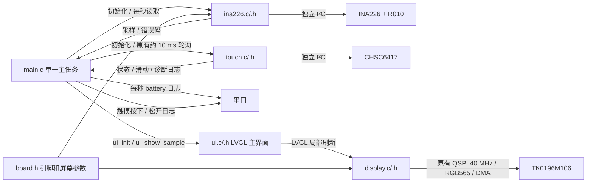
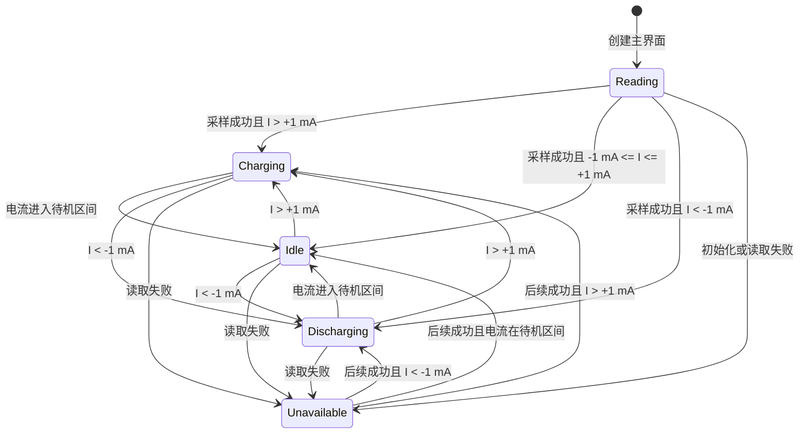

# 太阳能充电监测主界面（基本 UI 阶段）

用户确认：按 `design.png` 还原 368×448 主界面。基本 UI 已烧录并经用户确认完成，预览图已清理。电压、电流、功率和充放电状态接入现有 INA226；电量固定显示示例 72%，趋势和横轴时刻为设计稿示例，不代表历史记录。真实电量估算、历史记录、Wi-Fi／配网、时间对齐留到下一阶段。

本设计替代 `AMOLED/bringup-plan.md` 中测试画面、雷达任务、BOOT 切档和触摸翻页的运行流程。GPIO、INA226 校准和已验证的 QSPI 初始化／DMA 传输方式不变。按用户补充要求保留触摸初始化、轮询和日志，但不触发翻页；旧无线／RLCD 代码不参与本阶段构建。

## 组件关系

- `main.c`：硬件日志 → 显示初始化 → 主界面创建及首次刷新 → 触摸初始化 → INA226 初始化 → 原有触摸轮询以及每秒采样／更新界面／输出日志。单一主任务运行 LVGL，循环中释放 CPU；不新增任务、队列或采样定时器。
- `ina226.c/.h`：沿用现有初始化、校准、正充电／负放电和读取接口，不依赖 UI。
- `ui.c/.h`：`ui_init(lv_display_t *)` 创建界面；`ui_show_sample(const ina226_sample_t *)` 更新实时区域，NULL 表示读取失败。仅在 UI 内派生展示状态，不改变传感器读数。
- `display.c/.h`：沿用原有 SPI 事务队列、双 DMA 缓冲和 ISR `flush_ready`。删除开机测试屏、3 秒测试等待及 benchmark 统计；不改变屏幕必需的复位／初始化延时。
- 删除 `radar.c/.h` 以及雷达任务、BOOT／滑动测试操作、FPS 和触摸测试提示。
- `touch.c/.h`：保留原有约 10 ms 采样限频、坐标解析、异常取消和松手识别滑动。驱动记录初始化和带位移的上／下滑；本阶段不驱动 UI。按用户实机反馈，读取失败日志暂降为 DEBUG（默认不输出），主任务只比较成功读取的触点状态，跳过 ERROR／OFF，避免将错误恢复误记为松开。首次无触点不记录日志；真实按下／松开仍记录。此调整只影响日志，不修复既有 I²C 错误，也不改变滑动状态机。

## 展示状态

- 充电：蓝色状态点和电流，电池内显示白色闪电，功率文案为“充入”。
- 待机：白色状态点，电流显示 0 mA，功率显示 0.00 W，不显示方向图标。±1 mA 展示死区覆盖已实测的 ±0.15 mA 空载抖动。
- 放电：粉红色状态点和电流，电池右侧显示输出箭头，功率文案为“输出”。
- 功率为本次修正后电压乘以电流绝对值；待机只在显示上归零，串口仍保留原始有符号采样。
- 根据用户微调要求，电流／电压数值从 y=192 下移至 y=198，与标题留出少量空白；功率说明从 y=237 下移至 y=243，分隔线下端缩至 y=237，避免长说明穿过分隔线。充电／放电显示“11:35 以来充入/输出 xx.xx W”，待机维持“功率 0.00 W”。11:35 是本 UI 阶段固定示例起始时间，W 仍是本次实时功率，不做真实计时或累计能量计算。
- 初始化前显示“读取中”；初始化或读取失败显示“读取失败”，实时数值置为 `--`，不把旧值显示成新采样。后续读取成功时自动恢复。
- 电量、电池填充、趋势柱和时间刻度为固定示例；三种状态分别使用设计稿对应的示例趋势。时间刻度不读取系统时钟，右上角留空。
- 趋势下方充电区间线与示例充电背景区域左右对齐，中央只显示一个闪电，闪电两侧按用户要求缩为各 4 px 留白以区别于线段。三种状态均使用对应示例区间，不代表当前真实充电时长。
- 根据真机较大的圆角裁切反馈，顶部状态点从 (26,25) 内移至 (44,32)，状态文字同步右移／下移；底部首个时间刻度从 x=26 内移至 x=50，四个刻度间距改为 67 px，保留图标与时间之间的纵向间隔。具体真机可见边界以重新刷机后的目视检查为准。

## 验证

使用同一 `src/ui.c` 在主机 LVGL 中渲染 368×448 PNG，检查三种状态、读取失败、±1 mA 边界、负电流符号、最大量程及文字边界；然后构建 ESP32-S3 固件。主机截图不能代替 AMOLED 实机目视验证。已按用户后续要求烧录；以下主机验证记录保留原阶段结果。

本阶段验证结果：

- `pio run -e esp32-s3-n8r8` 通过，ESP-IDF 5.5.5 / LVGL 9.4.0，生成 `firmware.bin`；Flash 占用约 7.2%，静态 RAM 约 25.8%。
- 临时主机测试直接使用 `src/ui.c` 和固件同一份字体，`-Wall -Wextra -Werror` 构建通过。检查充电／待机／放电、初始化等待、失败及恢复、±0.15 mA 空载抖动、±1 mA 边界、±1.1 mA、±3278 mA 展示、功率和符号；全部通过。
- 检查所有标签的字形覆盖和 368×448 屏幕边界，以及电流单位不越过分隔线、电压单位不越过右边界；全部通过。
- 各状态先局部刷新，再强制整屏重绘，对比完整 RGB565 帧缓冲；像素一致，无旧闪电、箭头、文字或趋势图残留。
- 已目视检查三种状态、最大电流和读取失败的主机截图。主机截图使用测试电压／电流输入，固件正常运行时读取 INA226；预览图已由用户清理，不纳入提交。
- `git diff --check` 通过。

## 首次刷机反馈

- 已通过 `/dev/cu.usbmodem21401` 烧录，Bootloader、分区表和 604192 字节应用的写入哈希均校验通过。
- 串口连续运行期间 INA226 每秒读取成功，VBUS 约 0–0.001 V、电流 ±0.15 mA；用户确认当前未接电池和负载，电压为 0 正常。
- 用户实机反馈趋势下方充电图标与线段混杂；按上述区间对齐、单图标及留白方式调整。
- 触摸仍有既有间歇 `ESP_ERR_INVALID_STATE`，用户同意临时屏蔽刷屏日志；此阶段不修复通信问题。

## 细节调整验证

- 已重新构建并通过 `/dev/cu.usbmodem21401` 烧录，604176 字节应用及 Bootloader／分区表写入哈希校验通过。
- 主机三态渲染与局部／整屏刷新一致性测试通过。像素检查确认每个示例充电区间的两端与背景对齐，闪电为单个连通图形，闪电与左右线段各有至少 8 px 空白。
- 状态点与首个时间标签通过模拟 100 px 圆角的像素边界检查。此半径只用于保守主机检查，并非测量得到的面板参数；真机裁切是否完全避开仍待用户目视确认。
- 新版串口捕获到启动全过程：8 MB PSRAM／80 MHz、内存测试通过、QSPI 40 MHz、CHSC6417 0x2E 与 INA226 0x44 初始化成功。
- 12 秒串口检查获取 11 次正常电池采样，VBUS 0–0.001 V、电流 ±0.15 mA，符合用户未接电池和负载的状态。没有 `touch: Read failed` 或 `Contact up` 刷屏，未发现 panic；串口已关闭。
- 真实按下／松开、上／下滑日志在本次短时检查中未操作验证，功能代码保留。`git diff --check` 通过。

## 文本间距微调验证

- 标题／数值／功率说明间距及示例时间文案的主机测试通过，包括待机不显示时间、充放电说明、最大电流、字形覆盖、文字边界和局部／整屏重绘一致性。
- 三态像素检查确认闪电为一个连通图形，两侧空白分别恰好为 4 px，区间端点仍与背景左右对齐。三态预览已更新。
- 固件构建及烧录通过，604448 字节应用和 Bootloader／分区表写入哈希校验通过。
- 本次串口启动显示 PSRAM 内存测试及 QSPI 初始化成功；触摸探测超时，诊断为 SCL=1、SDA=0，触摸按原有失败路径禁用。本次没有修改触摸初始化或硬件通信逻辑。
- 独立 INA226 初始化成功，12 秒检查获得 9 次正常电池采样，显示／采样不受触摸失败影响，未发现 panic。启动诊断仍有 I²C 扫描错误日志；运行阶段无触摸读取／松开刷屏。串口已关闭，真机文本间距仍待用户目视确认。

## 阶段结项

用户已确认 UI 完成，包括实机圆角适配、文本间距、充电区间图标与留白。本轮只交付基本 UI 和现有实时采样展示，不将示例电量／时间／趋势当作真实统计。上述逐步验证记录保留当时结果；触摸启动超时和间歇读取错误仍是已知未解决问题。

## 下阶段准备

以下是用户指定的后续范围和设计前需要确认的事项，不是已经批准的架构，也不在本轮实现。涉及模块、接口、任务、存储或状态机的扩展，需先给出相关设计图并获得确认。

1. **真实电量估算**：替换固定 72% 和电池填充。先确认电池化学体系、串联节数、标称／可用容量、满充与低电压边界，以及上电初始电量来源。电压估算与电流积分方案的精度／漂移取舍需讨论后确定，不默认把负载下电压线性映射为百分比。现有 INA226 低电压段增益验证和电流幅值核对仍待补充。
2. **配网与时间校准**：确认配网入口及方式（如 SoftAP 或 BLE）、凭据保存／清除、连接状态反馈和重连行为；确认时区、校时来源、未联网／未校时的显示以及重启后的时间恢复策略。不在文档中保存 Wi-Fi 密码。
3. **真实历史累计**：在采样、估算和时间语义确定后，替换示例 24 小时趋势、充电背景区间及 11:35 起始时间。先确认记录粒度、保留时长、充放电区间起止、累计统计范围和断电保存要求，再确定存储设计。

统计单位需区分：实时功率为 W，累计能量为 Wh，累计电荷为 mAh。“某时以来充入／输出”若表示累计，需切换为确认后的累计单位，不能继续用 W 作为累计量。首次校时／后续时间跳变、采样失败、设备离线及重启期间的缺口如何展示和积分，也需在设计中明确，不能用缓存数值补造历史。

开始下一阶段时，优先补齐电池规格和容量信息，确认电量估算目标，再确定配网入口；触摸若作为入口使用，需要将既有通信问题纳入验证。
