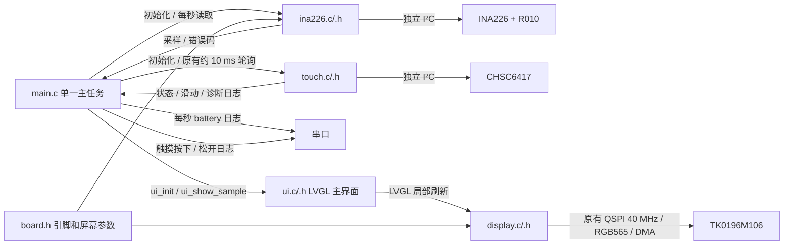
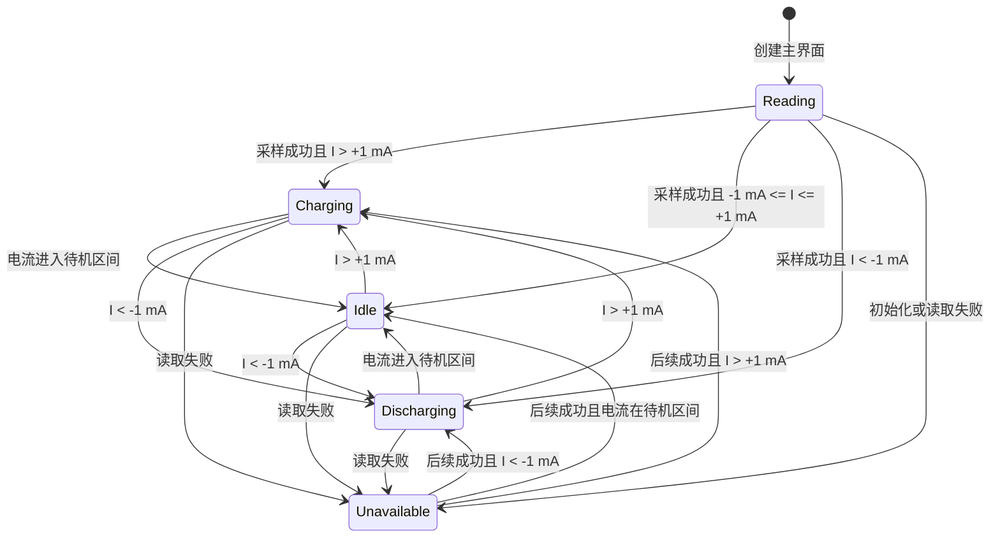

# 太阳能充电监测主界面（基本 UI 阶段）

用户确认：按 `design.png` 还原 368×448 主界面。基本 UI 已烧录并经用户确认完成，预览图已清理。电压、电流、功率和充放电状态接入现有 INA226；电量固定显示示例 72%，趋势和横轴时刻为设计稿示例，不代表历史记录。真实电量估算、历史记录、Wi-Fi／配网、时间对齐留到下一阶段。

本设计替代 `AMOLED/bringup-plan.md` 中测试画面、雷达任务、BOOT 切档和触摸翻页的运行流程。GPIO、INA226 校准和已验证的 QSPI 初始化／DMA 传输方式不变。按用户补充要求保留触摸初始化、轮询和日志，但不触发翻页；旧无线／RLCD 代码不参与本阶段构建。

## 组件关系

- `main.c`：硬件日志 → 显示初始化 → 主界面创建及首次刷新 → 触摸初始化 → INA226 初始化 → 原有触摸轮询以及每秒采样／更新界面／输出日志。单一主任务运行 LVGL，循环中释放 CPU；不新增任务、队列或采样定时器。
- `ina226.c/.h`：沿用现有初始化、校准、正充电／负放电和读取接口，不依赖 UI。
- `ui.c/.h`：`ui_init(lv_display_t *)` 创建界面；`ui_show_sample(const ina226_sample_t *)` 更新实时区域，NULL 表示读取失败。仅在 UI 内派生展示状态，不改变传感器读数。
- `display.c/.h`：沿用原有 SPI 事务队列、双 DMA 缓冲和 ISR `flush_ready`。删除开机测试屏、3 秒测试等待及 benchmark 统计；不改变屏幕必需的复位／初始化延时。
- 删除 `radar.c/.h` 以及雷达任务、BOOT／滑动测试操作、FPS 和触摸测试提示。
- `touch.c/.h`：保留原有约 10 ms 采样限频、坐标解析、异常取消和松手识别滑动。驱动记录初始化和带位移的上／下滑；本阶段不驱动 UI。按用户实机反馈，读取失败日志暂降为 DEBUG（默认不输出），主任务只比较成功读取的触点状态，跳过 ERROR／OFF，避免将错误恢复误记为松开。首次无触点不记录日志；真实按下／松开仍记录。此调整只影响日志，不修复既有 I²C 错误，也不改变滑动状态机。

## 展示状态

- 充电：蓝色状态点和电流，电池内显示白色闪电，功率文案为“充入”。
- 待机：白色状态点，电流显示 0 mA，功率显示 0.00 W，不显示方向图标。±1 mA 展示死区覆盖已实测的 ±0.15 mA 空载抖动。
- 放电：粉红色状态点和电流，电池右侧显示输出箭头，功率文案为“输出”。
- 功率为本次修正后电压乘以电流绝对值；待机只在显示上归零，串口仍保留原始有符号采样。
- 根据用户微调要求，电流／电压数值从 y=192 下移至 y=198，与标题留出少量空白；功率说明从 y=237 下移至 y=243，分隔线下端缩至 y=237，避免长说明穿过分隔线。充电／放电显示“11:35 以来充入/输出 xx.xx W”，待机维持“功率 0.00 W”。11:35 是本 UI 阶段固定示例起始时间，W 仍是本次实时功率，不做真实计时或累计能量计算。
- 初始化前显示“读取中”；初始化或读取失败显示“读取失败”，实时数值置为 `--`，不把旧值显示成新采样。后续读取成功时自动恢复。
- 电量、电池填充、趋势柱和时间刻度为固定示例；三种状态分别使用设计稿对应的示例趋势。时间刻度不读取系统时钟，右上角留空。
- 趋势下方充电区间线与示例充电背景区域左右对齐，中央只显示一个闪电，闪电两侧按用户要求缩为各 4 px 留白以区别于线段。三种状态均使用对应示例区间，不代表当前真实充电时长。
- 根据真机较大的圆角裁切反馈，顶部状态点从 (26,25) 内移至 (44,32)，状态文字同步右移／下移；底部首个时间刻度从 x=26 内移至 x=50，四个刻度间距改为 67 px，保留图标与时间之间的纵向间隔。具体真机可见边界以重新刷机后的目视检查为准。

## 验证

使用同一 `src/ui.c` 在主机 LVGL 中渲染 368×448 PNG，检查三种状态、读取失败、±1 mA 边界、负电流符号、最大量程及文字边界；然后构建 ESP32-S3 固件。主机截图不能代替 AMOLED 实机目视验证。已按用户后续要求烧录；以下主机验证记录保留原阶段结果。

本阶段验证结果：

- `pio run -e esp32-s3-n8r8` 通过，ESP-IDF 5.5.5 / LVGL 9.4.0，生成 `firmware.bin`；Flash 占用约 7.2%，静态 RAM 约 25.8%。
- 临时主机测试直接使用 `src/ui.c` 和固件同一份字体，`-Wall -Wextra -Werror` 构建通过。检查充电／待机／放电、初始化等待、失败及恢复、±0.15 mA 空载抖动、±1 mA 边界、±1.1 mA、±3278 mA 展示、功率和符号；全部通过。
- 检查所有标签的字形覆盖和 368×448 屏幕边界，以及电流单位不越过分隔线、电压单位不越过右边界；全部通过。
- 各状态先局部刷新，再强制整屏重绘，对比完整 RGB565 帧缓冲；像素一致，无旧闪电、箭头、文字或趋势图残留。
- 已目视检查三种状态、最大电流和读取失败的主机截图。主机截图使用测试电压／电流输入，固件正常运行时读取 INA226；预览图已由用户清理，不纳入提交。
- `git diff --check` 通过。

## 首次刷机反馈

- 已通过 `/dev/cu.usbmodem21401` 烧录，Bootloader、分区表和 604192 字节应用的写入哈希均校验通过。
- 串口连续运行期间 INA226 每秒读取成功，VBUS 约 0–0.001 V、电流 ±0.15 mA；用户确认当前未接电池和负载，电压为 0 正常。
- 用户实机反馈趋势下方充电图标与线段混杂；按上述区间对齐、单图标及留白方式调整。
- 触摸仍有既有间歇 `ESP_ERR_INVALID_STATE`，用户同意临时屏蔽刷屏日志；此阶段不修复通信问题。

## 细节调整验证

- 已重新构建并通过 `/dev/cu.usbmodem21401` 烧录，604176 字节应用及 Bootloader／分区表写入哈希校验通过。
- 主机三态渲染与局部／整屏刷新一致性测试通过。像素检查确认每个示例充电区间的两端与背景对齐，闪电为单个连通图形，闪电与左右线段各有至少 8 px 空白。
- 状态点与首个时间标签通过模拟 100 px 圆角的像素边界检查。此半径只用于保守主机检查，并非测量得到的面板参数；真机裁切是否完全避开仍待用户目视确认。
- 新版串口捕获到启动全过程：8 MB PSRAM／80 MHz、内存测试通过、QSPI 40 MHz、CHSC6417 0x2E 与 INA226 0x44 初始化成功。
- 12 秒串口检查获取 11 次正常电池采样，VBUS 0–0.001 V、电流 ±0.15 mA，符合用户未接电池和负载的状态。没有 `touch: Read failed` 或 `Contact up` 刷屏，未发现 panic；串口已关闭。
- 真实按下／松开、上／下滑日志在本次短时检查中未操作验证，功能代码保留。`git diff --check` 通过。

## 文本间距微调验证

- 标题／数值／功率说明间距及示例时间文案的主机测试通过，包括待机不显示时间、充放电说明、最大电流、字形覆盖、文字边界和局部／整屏重绘一致性。
- 三态像素检查确认闪电为一个连通图形，两侧空白分别恰好为 4 px，区间端点仍与背景左右对齐。三态预览已更新。
- 固件构建及烧录通过，604448 字节应用和 Bootloader／分区表写入哈希校验通过。
- 本次串口启动显示 PSRAM 内存测试及 QSPI 初始化成功；触摸探测超时，诊断为 SCL=1、SDA=0，触摸按原有失败路径禁用。本次没有修改触摸初始化或硬件通信逻辑。
- 独立 INA226 初始化成功，12 秒检查获得 9 次正常电池采样，显示／采样不受触摸失败影响，未发现 panic。启动诊断仍有 I²C 扫描错误日志；运行阶段无触摸读取／松开刷屏。串口已关闭，真机文本间距仍待用户目视确认。

## 阶段结项

用户已确认 UI 完成，包括实机圆角适配、文本间距、充电区间图标与留白。本轮只交付基本 UI 和现有实时采样展示，不将示例电量／时间／趋势当作真实统计。上述逐步验证记录保留当时结果；触摸启动超时和间歇读取错误仍是已知未解决问题。

## 下阶段准备

以下为 UI 结项时的准备记录；电量估算／本次累计现已完成用户讨论确认，现行规则见本文末“电量与本次累计阶段”。配网、时间、真实历史仍未实施。

以下是用户指定的后续范围和设计前需要确认的事项，不是已经批准的架构，也不在本轮实现。涉及模块、接口、任务、存储或状态机的扩展，需先给出相关设计图并获得确认。

1. **真实电量估算**：替换固定 72% 和电池填充。先确认电池化学体系、串联节数、标称／可用容量、满充与低电压边界，以及上电初始电量来源。电压估算与电流积分方案的精度／漂移取舍需讨论后确定，不默认把负载下电压线性映射为百分比。现有 INA226 低电压段增益验证和电流幅值核对仍待补充。
2. **配网与时间校准**：确认配网入口及方式（如 SoftAP 或 BLE）、凭据保存／清除、连接状态反馈和重连行为；确认时区、校时来源、未联网／未校时的显示以及重启后的时间恢复策略。不在文档中保存 Wi-Fi 密码。
3. **真实历史累计**：在采样、估算和时间语义确定后，替换示例 24 小时趋势、充电背景区间及 11:35 起始时间。先确认记录粒度、保留时长、充放电区间起止、累计统计范围和断电保存要求，再确定存储设计。

统计单位需区分：实时功率为 W，累计能量为 Wh，累计电荷为 mAh。“某时以来充入／输出”若表示累计，需切换为确认后的累计单位，不能继续用 W 作为累计量。首次校时／后续时间跳变、采样失败、设备离线及重启期间的缺口如何展示和积分，也需在设计中明确，不能用缓存数值补造历史。

开始下一阶段时，优先补齐电池规格和容量信息，确认电量估算目标，再确定配网入口；触摸若作为入口使用，需要将既有通信问题纳入验证。

## 电量与本次累计阶段

用户已确认本阶段直接开发，无需额外 UI 设计图。沿用既有 `main` 单一任务、INA226、touch、UI 和 display 的职责；补充纯计算 `battery.c/.h`，由主任务传入采样和单调时间，再将计算快照传给 UI。此节替代基本 UI 阶段中的固定 72%、即时 ±1 mA 状态和示例 11:35 功率说明，不涉及时间、配网或历史存储。

- `battery_init()`／`battery_update()`：无硬件、LVGL、任务或定时器依赖，输入现有 `ina226_sample_t` 与微秒单调时间；输出有效标志、百分比、已确认状态、本次 Wh／mAh 及单调起止时间。NULL／非有限采样中断连续性并保留已有累计。
- 当前已采用用户确认的 OCV 工程模板：3.00 V=0%、3.20=10%、3.38=20%、3.53=30%、3.61=40%、3.72=50%、3.82=60%、3.90=70%、3.99=80%、4.07=90%、4.14=95%、4.20=100%。10%-90% 来自 TI 查询表示例，0%／95%／100% 为工程设定，不是本电芯实测曲线，不使用容量、库仑计 SOC 或自动充满判断。
- `BATTERY_EMPTY_VOLTAGE_V` 默认 3.00 V，仅影响 0%-10% 段；`BATTERY_FULL_VOLTAGE_V` 默认 4.20 V，仅影响 95%-100% 段，固定中间节点不随宏变化。下限需小于 3.20 V，上限需大于 4.14 V；需要越过相邻节点时须根据实测重新审定相邻局部段，不拉伸全表。传感器读数误差与 OCV 百分比误差分别处理，详见 [OCV 校准备忘](battery-ocv-draft.md)。首个有效采样直接显示估算，连续采样采用 30 秒时间常数平滑；不靠四舍五入将低于上限的电压显示成 100%。图标从 90% 起满格，不等同于充满。
- `I > +10 mA` 为充电候选，`I < -10 mA` 为放电候选，含边界的 ±10 mA 为待机。初始确认状态为待机；所有后续切换需候选连续 60 秒，期间改变候选或缺采样则重新确认。状态变化后按候选开始的时刻记录区间起止。
- 积分只用相邻有效且同方向超过阈值的采样，以实际间隔对电流／功率作梯形积分；进入待机、反转的跨界间隔不插值。候选充放电的前 60 秒暂存，确认后成为本次累计；未确认的短候选不另开区间，反向电流不进入原方向累计。
- 本次区间中短暂待机不重置开始时间，但立即停积；反方向持续 60 秒则开始另一方向区间，并重新统计本次。确认待机后保留刚结束的累计在 RAM 中，UI 隐藏累计说明行。本阶段无历史总账／断电保存，重启清零。
- 主循环名义 1 Hz；相邻采样超过 2.5 秒视为缺口，不补积分、不将缺口视为持续状态证据。读取失败立即显示不可用，恢复后重新确认候选，但不擅自清零既有区间累计。计量不依赖壁钟。
- UI 保留布局，百分比／电池填充改为估算值。无有效采样时实时数值显示 `--` 和空电池；100% 使用较小数字子集以容纳三位数。电流数字和 mA 单位颜色立即按本次采样方向显示：大于 +10 mA 蓝色，小于 -10 mA 粉红色，含边界的 ±10 mA 白色 0 mA；读取失败白色 `--`。顶部状态点／文字及电池闪电／箭头仍跟随 60 秒后确认的状态，两者可暂时不一致。
- 累计说明行只在有效采样且已确认充电／放电时显示“本次充入／本次输出 xx.xx Wh”，不显示瞬时 W。首次确认前、待机确认后和读取失败均隐藏该行，不显示 `--`，固定坐标保持其他布局不动。已确认充放电期间短暂进入阈值内，立即停积但保留累计显示，满 60 秒确认待机后才隐藏；确认后的有效微小累计即使四舍五入为 0.00 Wh 也显示。
- 点击可见累计行区域 (x=26–342,y=235–269) 切换为 mAh，再次点击切回；隐藏时不响应，不保存单位偏好。读取失败保留内部已有累计，不补算失败间隔。趋势及时间刻度继续为示例数据。本次规则由用户再次讨论确认，替代上一版持续显示待机／失败时累计的行为。
- `touch_poll(status,tap)` 增加可选点击输出，原有上／下滑事件保持。500 ms 内单点按下并松开、最大运动不超过 12 px 才输出点击起点；横滑、长按、往返大幅移动及错误／多点／越界取消的接触不作为点击。主任务调用 `ui_handle_tap()` 做局部命中判断，不注册新的 LVGL 输入设备或任务。
- INA226 校准、GPIO、显示 DMA 与触摸既有通信问题不在此阶段调整。

验证使用主机模型测试、真实 LVGL 渲染／局部重绘对比、模拟触摸与固件构建；预览保存在临时目录，不重新加入用户已清理的预览图。

本阶段验证结果：

- `sh tools/test_battery.sh` 通过，`-Wall -Wextra -Werror`、AddressSanitizer／UndefinedBehaviorSanitizer；测试默认 4.20 V 与宏覆盖为 4.12 V，覆盖曲线单调／端点、平滑、10 mA 含边界、59／60 秒、起止追溯、短暂待机、反向候选、失采样／非有限输入和新旧区间累计隔离。
- 恒定 4.0 V／1 A 连续一小时得到 4.0 Wh／1000 mAh，变电压／电流及非整秒间隔的梯形积分检查通过；确认前的 60 秒在确认后计入。
- 主机 LVGL 使用同一 UI、模型和字体验证 0／82／100%、失败及恢复、Wh／mAh 往返点击、区域外／待机／失败点击不切换、最大量程和大累计数值、字形／文字边界，以及局部与强制整屏重绘像素一致性。全部通过，临时截图目视检查无重叠。
- 直接编译 `touch.c` 的模拟 I²C／时钟测试通过，覆盖点击 12／13 px 和 500／501 ms 边界、单次松手事件、原有上下滑、往返运动、多点／越界／读取失败取消及恢复、高位坐标与可选输出。
- PlatformIO ESP32-S3 构建通过，`firmware.bin` 616608 字节；静态 RAM 约 25.9%，Flash 约 7.3%。`git diff --check` 通过。
- 本阶段新版已按用户要求烧录，真实充放电及点击切换仍待实测；既有触摸启动超时／间歇读取错误仍可能影响点击，不能以主机通过代替硬件验证。

本阶段刷机检查：

- 经 `/dev/cu.usbmodem21401` 烧录，616608 字节应用、Bootloader 和分区表写入哈希校验全部通过。
- 启动日志确认 8 MB PSRAM／80 MHz，内存测试通过，QSPI 40 MHz 显示、CHSC6417 0x2E 和 INA226 0x44 初始化成功。
- 70 秒串口检查取得 68 次正常采样与 68 次 SOC／累计报告。电压约 4.090–4.092 V，估算 SOC 为 89%，电流约 −0.15 mA，已确认状态持续待机，本次 Wh／mAh 均为零；没有 INA226 读取失败或触摸读取告警，未发现 panic。
- 此次电流始终在阈值内，只验证待机与不误累计，不代表真实充放电的 60 秒切换或点击单位切换已经通过。启动捕获到触点按下日志；屏幕视觉和真实点击仍待用户确认。串口已关闭。

## 电流颜色与累计显隐调整

- 用户已确认真机短点击累计区域切换 Wh／mAh 正常；再次讨论后确认电流颜色立即按阈值响应，顶部状态和电池方向图标仍以连续 60 秒确认，累计行仅在有效且已确认充放电时显示。
- 本次仅修改 UI 展示和点击可用性，不改变电量曲线、积分、10 mA 阈值、60 秒状态确认或 INA226 采样。
- `sh tools/test_battery.sh` 默认 4.20 V／人工 4.12 V 两组模型测试通过。
- 主机 LVGL 检查覆盖充放电未确认时数字／mA 颜色与顶部不同、±10 mA 边界、短暂待机保持累计、待机确认后隐藏、反转等待中仍显示原区间累计、读取失败隐藏／恢复、隐藏区域点击不切换及确认后 0.00 Wh 不隐藏。切换 Wh／mAh、字形与文字边界及局部／整屏重绘一致性通过；隐藏区域像素为黑色，无残留，不移动其他元素。截图仍只保存在临时目录。
- PlatformIO 构建通过，静态 RAM 约 25.9%，Flash 约 7.4%；`git diff --check` 通过。
- 本次查询未发现开发板 USB 串口，因此尚未烧录此调整版；重新连接后需要验证电流颜色和累计说明行显隐的真机表现。

## 4.10 V 上限与重新刷机

- 按用户要求将 `BATTERY_FULL_VOLTAGE_V` 从 4.20 V 改为 4.10 V；4.00 V=80%、4.05 V=90%、4.10 V=100%，中低电压曲线、传感器校准、充电硬件及积分规则不变。
- 默认 4.10 V 与宏覆盖 4.12 V 的主机模型测试通过，增加了 90% 中点验证。真实 LVGL 测试确认新上限下百分比、100% 排版、电流即时颜色、累计行显隐／点击及局部／整屏重绘一致性通过。
- 经 `/dev/cu.usbmodem21401` 重新烧录，617424 字节应用、Bootloader 及分区表写入哈希校验全部通过。此固件包含前一节尚未烧录的电流颜色与累计显隐调整。
- 启动确认 8 MB PSRAM／80 MHz 内存测试通过、QSPI 40 MHz、触摸 0x2E 重试后成功、INA226 0x44 初始化成功。
- 70 秒检查得到 69 次电压电流采样与 68 次 SOC／累计报告，电流由约 -22.65 mA 变为 LED 负载约 -184 至 -186 mA，同方向超过阈值持续 60 秒后，于开机约 62 秒确认放电，累计为 0.0114 Wh／2.84 mAh。起始电压约 4.060 V 对应估算 92%，负载后电压约 4.020 V、平滑 SOC 约 85%。没有 INA226 读取失败、触摸读取告警或 panic，串口已关闭。
- 本次验证了真实放电的 60 秒确认和累计接入；真机即时电流颜色、累计行出现／隐藏的可见效果仍需用户目视确认。

## 静置电压曲线审计

- 用户确认累计状态正常，并撤回此前为贴近显示预期而提出的 4.10 V 上限；源代码恢复 4.20 V。此前 4.10 V 烧录结果保留为历史记录，不代表当前源代码。
- 本轮审计只讨论静置、无充放电电压（OCV），不将厂商带载放电曲线直接当作 OCV 表，也不把“刚停用负载”自动视为已充分静置。当前未新增只在无负载时更新 SOC 的运行规则。
- 21700／18650 是外形尺寸，不唯一规定化学体系或 OCV–SOC 曲线。3.3 V 可作为低电量提示参考，但不是所有电芯的 0% 或厂商允许最低放电电压。
- 先前“4.05 V=96%、4.06 V约97%”的建议只是显示映射方案，缺少特定电芯 OCV 依据，撤回；不按期待百分比反推曲线。
- 现有表仅为初始工程近似。特别是 3.60 V=20%、3.80 V=50% 等节点不能宣称具有普适精度；需结合具体电芯型号的 OCV 数据或实测校准再确定分档。本轮不擅自重写整条曲线。
- 用户先要求常规电芯模板，现已确认采用 OCV 表及局部上下端修正方案；节点已接入 `battery.c`，来源与后续修正方法见 [battery-ocv-draft.md](battery-ocv-draft.md)。没有新增静置检测逻辑。此前阶段的电压映射和烧录结果作为历史记录保留。
- OCV 模板默认端点和局部修正（3.10 V／4.16 V）模型测试、原有累计／状态回归、主机 LVGL 显示／刷新回归和 PlatformIO 构建通过；已按用户后续要求烧录且写入校验通过，详见校准备忘末尾的验证记录。
- 当前 OCV 版 70 秒实机串口检查取得 69 次采样及 68 次 SOC 报告，初始电压约 4.063–4.064 V、SOC 89%，期间短时负载没有满足连续 60 秒确认，状态保持待机。本次无读取失败或崩溃，串口已关闭；不据此宣称电芯 OCV 容量标定或持续放电累计已完成。

## 本轮结项

用户已确认最新 OCV 固件运行正常，累计状态和 Wh／mAh 点击切换正常，授权提交本轮改动。交付范围为 OCV 工程估算及校准备忘、10 mA／60 秒状态确认、本次 Wh／mAh 积分、电流即时颜色和累计显隐。特定电芯容量精度标定、静置检测、配网、校时和真实历史持久化不在本轮交付中，仍保留既有触摸通信问题记录。
