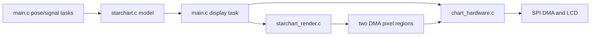

# 星盘 UI 还原：需求拆解与实施计划

2026-10-14。P0 已完成：需求、现有实现与架构核对完毕，接口确认稿与第 8 节五项待确认已获用户批准。本阶段未修改固件、未烧录；可进入 P1。

## 1. 状态与依据

已确认的方向：按图2近似还原大星盘，外圈 R=114、圆心上移至 (160,156)；辅助文字可先用 10 px，其他字号可以缩小；预留底部两行文字空间；采用 16×16 脏格、相邻格合并、两个最大 320×32 行缓冲区；**目标为转动时约 120 FPS，与已测策略 14 近似**；迁移实际需要的刷新机制，最终删除 `CHART_LCD_REFRESH_TEST` 和压力测试实现。

最初要求先拆解需求和计划；当前 P0 已获批准，每阶段结束后仍等待反馈。本文接口、时序与预算已确认为实施基准；具体像素级排版、绘制成本与 FPS 达成情况仍需 P1/P2/P6 实测，不是已经实现或已经验收的能力。P0 的代码核对、基线换算和批准记录见第 9 节。

流畅度是本轮体验的核心指标：静止画面不要求重复发送，转动时盘面内容必须连续跟手。

设计依据：

- [概念图](UI_Design.png)：只还原中间「02 弧带扫描」有效屏幕内容。
- [V1 实现要求](星盘UI_V1_AI实现要求.md)：保留采样、坐标、渐隐、信源和异常状态语义。本文已确认的新布局取代原文 R≈98、圆心 (160,170) 的视觉基准，不修改测量逻辑。
- [原型职责划分](starchart-prototype.md#范围与设计依据)：沿用现有模块和任务。
- [刷新流水线设计](lcd-refresh-pipeline-design.md#所有权与接口边界)：承接缓冲所有权、完成回收和窗口关闭规则；不照搬 demo 的面积、策略菜单或跨帧行为。
- [LCD 实测记录](lcd-refresh-test.md)：仅用于预算与策略比较，不能当作真实星盘 UI 的实测结果。

当前代码仍默认进入刷新 demo，现有 PNG 仍是旧布局。本文不改变这个事实。

## 2. 范围与非目标

本轮交付目标：单屏视觉还原、真实 UI 的矩形渲染与差异刷新、刷新代码迁移清理，以及主机和实机验收记录。

不增加页面、信源列表、BLE、距离估算、自动航向修正、实体按钮或触摸。不开启 PSRAM，不分配整屏帧缓冲，不引入 LVGL、新任务、ISR 绘制、完成回调或独立刷新框架。不实施跨帧持续窗口、TE 同步或超过 80 MHz 的像素时钟。

本轮**允许且要求**帧内重叠：在矩形 N 的像素在途/排空期间，用另一个缓冲区绘制矩形 N+1。这是同一帧内、同一快照、同一显示任务内的提前渲染，不是跨帧预生成，也不新增任务或回调。跨帧预生成仍不做——下一帧必须用下一个快照。

## 3. 需求拆解

### 3.1 视觉与信息

| 编号 | 需求 | 验收条件 |
|---|---|---|
| V01 | 屏幕逻辑坐标仍为 320×320；外圈 R=114，圆心 (160,156) | 外圈几何范围约 x=46..274、y=42..270；刻度和光晕另计，不裁切 |
| V02 | 采样圈约 R=103；网格、射线、三角、读数按新圆心协同排布 | 信号仍在固定半径，不用 RSSI 改变点位远近；角标与文字不重叠 |
| V03 | 缩小字体并保留嵌入式字库 | 已确认字号：名称 18 px、RSSI 24 px、转角数字 18 px、频率 12 px、辅助文字 10 px；P1 生成预览确认排版 |
| V04 | 修复名称下划线与字形裁切，数字宽度稳定 | `CAM_02` 正确显示；必要可见字形有有效像素，空格除外；长名称省略，负数、位数变化和未知字符不越界 |
| V05 | 底部两行文字与进度 | 已确认：转角留在盘内；盘外第 1 行 `180°`、第 2 行沿用现有状态文案，覆盖进度条置于两行之间。y 坐标在 P1 预览后冻结，不新增信息 |
| V06 | 保持图2的色彩与扫描弧层次，同时遵守真实数据语义 | 同状态比较 0°、+30°、+60°，青色当前弧、单个琥珀峰及灰蓝历史可辨；缺测不补圈 |
| V07 | 模拟、等待、校准、倾斜、IMU/Wi-Fi 错误仍清楚显示 | 每种状态均有预览；主布局不跳变，不以真实模式错误替换为模拟 |

### 3.2 差异刷新

| 编号 | 需求 | 验收条件 |
|---|---|---|
| D01 | 用全屏 20×20 个 16 px 脏格标记变化，不将星盘限定为224×224刷新框 | 标记表有界，位图为50 B；大外圈、屏幕边缘和底部都能被覆盖 |
| D02 | 依据上一次成功显示的状态与本次一致快照判断变化 | 不是比较两次 IMU/Wi-Fi 采样；同一轮所有矩形使用同一模型快照和单调时间戳 |
| D03 | 标记变化元素的旧、新像素覆盖范围 | 包含连接弧、峰值、光晕、线宽及抗锯齿边缘；跨 ±180° 和角度跳变不漏刷、不残影 |
| D04 | 有时间驱动的变化也要更新 | 无新包时盘仍随姿态旋转；渐隐、趋势线滚动/滚出、超时状态可独立触发刷新；不新增假样本 |
| D05 | 脏格同一行相邻合并为矩形，矩形内完整重画所有相交图层 | 背景、网格、射线等恢复正确；重画在离屏小缓冲内完成，不在可见屏上先擦后画 |
| D06 | 对多窗口与较大窗口作有界成本比较 | 避免大量小事务；按第 5 节「1 窗口 ≈ 420 像素」换算合并，首次/整体失效全屏重画；阈值由 P6 实测校准 |
| D07 | 真正不变的内容不必发送 | 无变化测试中无像素事务；读数变短、清空、重置、状态消失均擦除旧像素 |
| D08 | 局部重建后的屏幕与整帧参考渲染一致 | 主机虚拟屏按矩形写入后，逐像素等于同快照、同时间戳的完整参考图 |

“差异”是元素几何、可见文字和时间效果的变化，不是整屏新旧像素逐点比较。脏格只决定传输范围，不降低角度精度，也不限制渲染坐标精度。

第一版允许保守地多标记，禁止漏标记。时间驱动效果先随显示节拍检查，不先增加顶栏、渐隐、页脚各自的调度器。若后续降低某区域更新率，需重新定义该区域的已显示状态和验收条件。

### 3.3 驱动、调度与内存

| 编号 | 需求 | 验收条件 |
|---|---|---|
| H01 | 两个最大 320×32 行内部 DMA 缓冲区，像素总量40 KiB | 不分配整屏缓存，无帧内分配；两区地址不重叠，实测报告额外快照/状态及栈开销 |
| H02 | 支持 (x,y,w,h) 矩形窗口，内部按不超过32行分块 | 宽度不再写死320；坐标含现有屏幕偏移；数据连续紧密排列，颜色、镜像和方向正确 |
| H03 | 保留两个长期描述符和深度2队列 | 只有匹配完成结果返回后才复用像素与描述符；短矩形可一次提交，不强求两区同时在途 |
| H04 | 每个矩形独立打开、排空、关闭窗口 | 窗口内 DC=1、块间保持CS、末块释放CS；关闭后才可发下个窗口命令或换频率 |
| H05 | 命令/参数40 MHz，像素80 MHz作为起测配置，保留40 MHz诊断能力 | 驱动实际频率可观测；查询并遵守事务上限/对齐约束；不把发送完成视为光学验收 |
| H06 | 明确 RGB565 字节序，只转换一次 | 第一版建议保留 CPU 序纯渲染，在提交前复用已有 O2 交换；转换后才移交DMA，不再重复交换；不直接套用demo色带的WIRE生成器 |
| H07 | 转动时尽快连续出帧，静止时让出 CPU | 有脏格则画完即进入下一轮，不等 tick；无变化轮不发像素并让出至少一个 tick。不保留全局 tick 修改，不堆积过期显示帧，不连发补帧；姿态采集和包处理不受显示节拍替代 |
| H08 | 部分提交失败后回收已提交事务并停止显示 | 不提交“成功显示状态”，不继续未知GRAM状态下的绘制；无法确认归还时禁止复用/释放该缓冲 |
| H09 | 串口报告真实UI耗时和负载，不恢复屏幕FPS测试页脚 | 记录实际更新次数、字节数、窗口数、绘制/交换/命令/等待、绘制与传输重叠后的总工作、间隔、堆栈；重叠耗时不相加 |
| H10 | 绘制与传输在帧内重叠 | 矩形 N 在途期间绘制 N+1；报告 `max(绘制, 传输)` 与两者之和的差，证明重叠真实发生 |

120 FPS 是转动时的流畅度目标，不表示静止画面必须重复发送，也不表示面板扫描率。全屏首次绘制和整体失效单列耗时，不强求它们达到普通差异帧预算。100 Hz tick 无法表达 8.33 ms 周期，因此本轮不用固定节拍调度显示，改为「脏则连跑、净则让出」，实际帧间隔由 P6 实测记录。

### 3.4 迁移与清理

| 编号 | 需求 | 验收条件 |
|---|---|---|
| C01 | 默认直接运行真实项目的星盘任务，不再依靠压力测试开关分叉 | `CHART_LCD_REFRESH_TEST` 从源码、配置、构建和有效测试命令中删除 |
| C02 | 删除demo画面、BOOT策略切换、策略10/13/14/15表与O2重复函数副本 | 不初始化压力测试按钮；无旧FPS覆盖层、黑条/帧标记动画和demo专用常量 |
| C03 | 有用实现回到现有对应模块，不让测试代码成为生产依赖 | 生产调用链遵循下一节组件图；删除双份include用途消失后的 `.inc` 文件；保留实际需要的单份交换/窗口实现 |
| C04 | 保留并迁移主机正确性测试和硬件诊断能力 | 颜色/边界诊断不是压力demo；`CHART_LCD_HOST_TEST` 等测试桩不因名称含TEST而误删；默认诊断展示策略待确认 |
| C05 | 保留原采集、统计、同步、重置行为与历史测试证据 | 现有行为测试通过；清理test/tools对demo的依赖；README/原型说明更新，历史实测文档注明归档而不伪造新结果 |

## 4. 架构与接口草案

保持现有模块边界；以下为拟议设计，不新增架构组件。



| 模块 | 本轮拟议责任 | 不改变的边界 |
|---|---|---|
| `main.c` | 保存上次成功显示状态/时间；获取当前快照；遍历脏格合并矩形；调度、提交、回收及统计 | 一个显示任务；不在锁内绘制/传输；不新增采集控制路径 |
| `src/starchart_render.c` / `include/starchart.h` | 纯变化覆盖计算与矩形RGB565绘制；同一几何/字体规则用于整帧参考与局部绘制 | 不调用SPI、队列或时钟；不修改测量模型；不保存DMA所有权 |
| `src/chart_hardware.c` / `include/chart_hardware.h` | 矩形窗口、字节交换、长期描述符、完成核对、排空和总线释放 | 不识别星盘/脏格，不暴露IDF描述符给渲染器 |
| `starchart.c` | 只同步共享圆心参数用于已有屏幕点坐标接口 | 不改变积分、采样半径语义、方向桶、滤波、峰值或软件时间同步 |
| `starchart_config.h` 与字库工具 | 集中布局、字号、脏格/缓冲尺寸、显示节拍和SPI参数；生成精简字库 | 接线、背光策略、屏幕初始化保持现有已知约束 |

拟议接口语义：

- 渲染：`render_rect(snapshot, time, x, y, width, rows, pixels)`；坐标是全屏坐标，缓冲步长是矩形宽度，写入限定范围。
- 变化：`mark_dirty(previous, previous_time, current, current_time, mask)`；覆盖所有可能变化像素，计算规则与实际绘制共享。
- 硬件：`begin(rect)`、`submit(pixels, rows, last)`、`wait(completed_pixels)`、`end()`；已有同类接口改为矩形语义，不额外保留demo版本。

具体名称沿用仓库风格，实施前确定公开签名。50 B脏格表可按行遍历，第一版不默认增加大矩形列表、全屏静态位图或像素校验缓存。

### P0 公开签名确认稿

以下仅为待批准签名，不修改头文件，也不新增组件。渲染和脏格类型放在现有 `include/starchart.h`，硬件接口放在现有 `include/chart_hardware.h`，尺寸常量放在 `include/starchart_config.h`。

```c
/* CHART_DIRTY_BYTES = (20 * 20) / 8 = 50. */
typedef struct { uint8_t bits[CHART_DIRTY_BYTES]; } chart_dirty_mask_t;

void chart_render_rect(const chart_model_t *snapshot, int64_t now,
                       int x, int y, int width, int rows, uint16_t *rgb565);
void chart_mark_dirty(const chart_model_t *previous, int64_t previous_time,
                      const chart_model_t *current, int64_t current_time,
                      chart_dirty_mask_t *mask);

esp_err_t chart_lcd_window_begin(int x, int y, int width, int rows);
esp_err_t chart_lcd_window_submit(uint16_t *pixels, int rows, bool last);
esp_err_t chart_lcd_window_wait(uint16_t **completed_pixels);
esp_err_t chart_lcd_window_end(chart_lcd_timing_t *timing);
void chart_lcd_fast_pixels(bool enabled);
```

- `chart_render_rect` 输出 CPU 序 RGB565，步长为 `width`，只写 `width * rows` 个像素；合法矩形完整位于 320×320 内，非空缓冲由调用方提供。非法坐标、零/负尺寸不写入；不把裁剪后的宽度偷偷当作原缓冲步长。P2 保留 `chart_render_tile` 为全宽参考入口，不要求纯渲染器只能绘制 32 行。
- `chart_mark_dirty` 每次覆盖写入整个 mask；格索引为 `row * 20 + column`，字节内低位优先。`previous == NULL` 表示没有成功显示基准，标记全屏；否则只比较影响视觉的字段及时间效果，不以模型 `memcmp` 或采样计数变化代替视觉判断。两份模型只读，所有矩形使用同一个 `current/current_time`。
- `begin` 接收整个窗口高度，`submit` 接收该窗口后续连续行块，宽度沿用窗口且每块不超过 32 行；实际字节数严格为 `width * rows * 2`。只有恰好耗尽窗口的块可带 `last=true`，禁止补发像素凑长度。坐标加上现有屏幕偏移，SPI 描述符不出硬件模块。
- 建议在 `submit` 内、队列接受前复用现有 O2 交换函数，CPU 序到屏幕 MSB-first 只转换一次。显示任务不另行交换；`Ready` 表示转换完成、尚未被队列接受，随后才进入 `InFlight`。提交被拒绝时该缓冲可能已转换，停止而不重试，不假定其仍为 CPU 序。
- `wait` 仅在核对完成描述符后返回对应像素指针；未确认归还时不交出可复用指针。`end` 即使在部分提交失败后也尝试排空；只有全部确认归还才释放总线。所有矩形都成功后，显示任务才提交已显示快照和时间；错误则停止显示，不释放或复用所有权不明的区，也不停止姿态/信号任务。
- 两个像素区在任务启动时一次分配，总量 40960 B，单区固定偏移 20480 B；不按短矩形宽度改变两区间距。设备队列深度为 2，两个长期描述符。采用手动 DMA 对齐校验禁用驱动临时拷贝，查询事务上限；长度、地址及缓存同步约束以当前 IDF/C5 为准，不把“所有宽度的字节数必须是 4 的倍数”当作通用事实。P3 必须验证奇数宽度、奇数行数及 1×1，若约束无法同时满足 H01/H02，停止并确认方案，不能偷偷增加缓冲或扩大窗口。
- `chart_lcd_fast_pixels(false)` 保留 40 MHz 像素诊断能力，只在已关闭且排空的窗口之间调用；命令仍为 40 MHz。生产矩形路径只保留这一组异步签名；同步 `window_write`、`*_o2` 窗口副本和策略选择随 P3/P5 迁移清理，不增加另一套生产模式。

### 窗口时序

```mermaid
sequenceDiagram
    participant D as main.c display task
    participant R as starchart_render.c
    participant H as chart_hardware.c
    participant S as SPI DMA
    D->>D: capture one snapshot and timestamp
    D->>R: compare last successful display; mark dirty cells
    R-->>D: bounded mask; merge cells into rectangles
    D->>R: render first block of rectangle 1 into A
    loop each merged rectangle N
        D->>H: begin rectangle N at command clock
        D->>H: convert then submit prepared block
        H->>S: queue persistent descriptor
        loop remaining blocks of N when present
            D->>R: render next block into the other region
            D->>H: reclaim matching slot before reuse
            H-->>D: completed slot returned
            D->>H: convert then submit; last flag only on final block
            H->>S: queued pixels; keep CS except final block
        end
        Note over D,S: while N drains, draw rectangle N+1 into the free region
        D->>R: render first block of rectangle N+1 (same snapshot/time)
        D->>H: end rectangle N; drain all pending results
        H->>S: release bus after completion
        H-->>D: window closed
    end
    D->>D: commit displayed state only after all rectangles succeed
    D->>D: if nothing dirty next round, yield at least one tick
```

绘制与传输的重叠只发生在帧内、同一快照下：矩形 N 排空期间绘制 N+1 的首块，使每帧趋近 `max(Σ绘制, Σ传输+命令)`。窗口命令仍严格串行——N+1 的 `0x2A/0x2B/0x2C` 必须等 N 关闭后才发出，重叠的只是 CPU 绘制，不是 DMA。

短矩形仍使用同一协议，不维护另一套同步策略。无变化轮不提交像素；首次显示按完整矩形路径完成。

```mermaid
stateDiagram-v2
    [*] --> Free
    Free --> Drawing: display task owns slot
    Drawing --> Ready: full block rendered and converted
    Ready --> InFlight: queue accepted
    InFlight --> Free: matching result retrieved
    Ready --> Stopped: submission rejected
    InFlight --> Stopped: error; drain accepted transactions before release
```



停止状态不表示缓冲已可复用。窗口在正常路径为 `Closed -> Open -> Draining -> Closed`；异常路径回收能确认的在途事务后停止，不新增自动恢复机制。

## 5. 预算与推荐策略

先保证R=114的可见盘面，不按某个刷新矩形反向缩小UI。

### 5.1 从策略 14 推出的换算基准

策略 14 实测每帧 320×128 = 40960 像素、81920 B，动态工作 8.428 ms（`src/main.c:411`、`src/lcd_refresh_frame.inc:6-12`）。由此得到本轮唯一的换算基准：

- **像素成本 0.2057 µs/像素**（8.428 ms / 40960），对比 80 MHz 理论值 0.2 µs/像素，即基线已跑在约 97% SPI 效率上，像素侧没有可挖的余量。
- **窗口命令约 0.084 ms ≈ 420 像素 ≈ 840 B**。这是合并规则的唯一依据。
- **120 FPS 的预算即「每帧脏像素约 40960 个」**，与策略 14 载荷基本相等——这正是 120 FPS 目标可行的前提，也是全屏 320×320（204800 B、20.48 ms）必须排除的原因。

| 候选 | 示例像素字节/更新 | 80 MHz纯像素时间 | 代价 |
|---|---:|---:|---|
| 整屏320×320 | 204800 B | 20.48 ms | 已实测FPS不足，本轮排除 |
| 224×224包围框示例 | 100352 B | 10.04 ms | 不是本版固定更新边界，不能漏掉外圈或文字 |
| 策略 14 实测基线 320×128 | 81920 B | 8.428 ms（实测） | 换算基准，非真实UI工作量 |
| R≈103、含光晕约20 px环带，16 px脏格 | 约41472 B | 约4.15 ms | 约81格、约26个行合并窗口，另需约2.18 ms命令 |
| 同一示例，32 px脏格 | 约73728 B | 约7.37 ms | 示例约12个窗口，较少命令但更多无变化像素 |

环带示例合计约 6.33 ms（4.15 像素 + 2.18 命令），对 8.33 ms 预算余量约 2 ms。该预算只是保守几何覆盖示例，不包含顶栏、转角、状态、较大角度跳变或回退窗口；不能当作每帧上限。

### 5.2 合并规则

由「1 窗口 ≈ 420 像素」直接定死，不设可调阈值：

> 同一格行内，**间隔 1 个空格即合并**（补 16×16 = 256 像素 < 420）；**间隔 ≥2 格则断开**（512 像素 > 420）。

### 5.3 真正的瓶颈是 CPU 绘制

demo 的绘制成本接近零：每 32 行块只真正生成 2 行，其余 30 行 `memcpy`（`src/starchart_render.c:385`），且 UI/IMU/Wi-Fi 全部关闭（`src/main.c:411`）。因此 8.428 ms 几乎是纯 SPI 时间，**不能用于推断真实星盘的绘制成本**。

真实渲染器画一段弧是「每 1° → `line()` → 每步 `disc()` → 逐像素 alpha 混合」（`src/starchart_render.c:100-110`、`41-60`），且每段弧画三遍（光晕 w+4、w+2、本体，`:243-245`）。叠加清屏、网格、射线后每个输出像素实际被写入约 5–8 次。若要在约 2 ms 余量内完成约 20736 个环带像素，需约 23 cycles/像素（240 MHz），以当前 `pixel()` 路径难以达成。

应对顺序（按第 2 节已批准的帧内重叠）：

1. **先靠重叠吸收**：每帧总时间目标为 `max(Σ绘制, Σ传输+命令)`，而非两者相加。显示任务比传输提前一个矩形渲染。
2. **P2 结束设绘制成本闸门**：实测 `chart_render_rect` 的 µs/像素，用数据决定下一步，不提前承诺。
3. 若闸门未过，再讨论削减光晕层数或改增量光栅化；不在本轮预先实施。

另：历史数据显示 10/13/14 = 113.34/114.71/117.90 FPS，「一帧只开一次窗口」(10→13) 与流水线 (13→14) 各自只值 1–3%，而差异刷新要开约 26 个窗口，等于把 13 的收益反向吐回约 2.18 ms。所以本轮收益必须来自**少传像素**，不是来自窗口技巧。另一次 14/15 O2 对照没有可辨别收益；demo 的横向条纹仍未定位。

### 5.4 本版固定路径

16 px 脏格、行合并、40 KiB 双区、每矩形排空关闭、帧内绘制/传输重叠、脏则连跑净则让出，80 MHz 像素 / 40 MHz 命令。复用已有交换函数，暂不新增直接 WIRE 星盘光栅化。

| 显示目标 | 周期 | 本轮定位 |
|---|---:|---|
| 120 FPS | 8.33 ms | 转动时的流畅度目标，与策略 14 近似；由 P6 实测验收 |
| 60 FPS | 16.67 ms | 若绘制闸门未过时的回退参考，不默认采用 |

100 Hz tick（`CONFIG_FREERTOS_HZ=100`，`sdkconfig.esp32-c5:2662`）无法表达 8.33 ms 周期，本轮**不修改全局 tick**，改用「脏则连跑、净则让出」。静止不刷新是预期行为：`display_heading` 以 0.1 s 时间常数收敛（`src/starchart.c:226`），收敛后无视觉变化。日志如实记录实际帧间隔分布，不把波动说成严格 8.33 ms；不新增高精度定时任务。

策略 14 的 117.90 FPS 是在 UI/IMU/Wi-Fi 全部关闭下测得。真实系统有 100 Hz 姿态任务与 Wi-Fi 扫描争用 CPU，这部分开销目前**没有任何数据**。按既定目标推进，P6 暴露问题后再针对性讨论优化策略。

## 6. 实施计划与依赖

所有状态按本次文档工作填写，未开始的实现不标成完成。

| 阶段 | 状态 | 工作与需求 | 交付/退出条件 |
|---|---|---|---|
| P0 需求与设计确认 | **已完成**（2026-10-14 获批准） | 确认V01..V07、接口/时序、第8节五项与120 FPS目标 | 已批准：底部布局、字号、生产协议、上电诊断、刷新策略与重叠方案 |
| P1 布局与字库 | **主机侧完成，待实机确认字号** | V01..V07；同步共享圆心与字号，修复下划线，暂保留原渲染入口作参考 | 已交付新 320×320 预览、10 个文本/状态用例、字形回归测试；底部排版与字号待实机目视确认 |
| P2 矩形纯渲染 | 未开始，依赖P1 | D05、D08、H02；扩展裁剪与紧密步长，保留整帧参考调用 | 任意矩形与整帧对应像素相等；越界/保护区/16与32行分块测试通过；**附绘制成本闸门：实测 µs/像素并与 2 ms 余量对照** |
| P3 生产DMA接口迁移 | 未开始，依赖P0接口确认 | H01..H06、H08；现有硬件模块内迁移窗口/描述符，去掉生产能力对demo开关的依赖 | 非全宽窗口的字节量、地址、CS/DC/时钟、所有权及失败回收主机测试通过 |
| P4 脏区域与调度集成 | 未开始，依赖P2/P3 | D01..D08、H07/H09/H10；成功显示基准、变化覆盖、行合并、帧内重叠与日志 | 虚拟屏差异刷新逐像素匹配整帧参考；脏则连跑/净则让出路径可编译；重叠可观测；无帧内分配 |
| P5 压力测试清理 | 未开始，依赖P4 | C01..C05；删除开关/菜单/重复实现，迁移测试和工具，更新说明 | 默认为星盘；生产调用不依赖demo；全部主机测试、C5构建和非空SSID分支通过 |
| P6 实机视觉与性能验收 | 未开始，依赖P5及设备访问 | V/D/H综合验收；先UI_SIM，再IMU_SIM_RSSI和LIVE_WIFI | 字号/底部布局反馈、转动场景帧间隔分布、条纹核查、并发与十分钟记录；用实测决定是否需要优化渲染器 |

P2与P3在签名确认后可独立开发/测试，但P4必须等待两者验收。P2 的绘制成本闸门是 120 FPS 可行性的第一个真实数据点，未过不阻塞 P3/P4 开发，但必须在 P4 前如实报告。任何实现不符合已确认图示或需新增组件时停止并重新确认。P5不是简单删除宏，而是生产机制迁移成功后的清理。

## 7. 验收场景与证据

| 场景 | 需要验证 | 对应需求 |
|---|---|---|
| 同状态静态预览 | 图2比例、圆心、顶栏、角标、底部两行、字形下划线 | V01..V07 |
| 局部/全圈顺逆转与±180°跨界 | 旧位置恢复、连接弧/峰值/光晕、无缺测补圈 | V06、D02/D03/D05/D08 |
| 停包但继续转动；静止但时间推进 | 历史反向跟随、渐隐和趋势滚出、等待信号 | D04、V07 |
| 读数/名称/状态变短或消失 | 无旧字残留；同格相交图层恢复 | V04/V07、D03/D05/D07 |
| clear/zero/cal/模式切换 | 历史、峰值、覆盖同步清除，不沿用旧显示基准 | D02/D03/D07、C05 |
| 任意宽度、屏幕边缘、1块/多块矩形 | 紧密步长、裁剪、分块、末块、事务长度/对齐 | H01..H06、D08 |
| 命令/提交/完成故障注入 | 已排队描述符与像素不提前复用，停止且不提交显示状态 | H03/H04/H08 |
| 无视觉变化与碎片化脏格 | 无像素发送、合并/回退可观测，状态与容器有界 | D01/D06/D07、H09 |
| 绘制与传输重叠 | `max(绘制, 传输)` 与两者之和的差；窗口命令仍严格串行 | H10、D05 |
| 实机局部/全圈，低速/较快转动 | 实际更新字节、窗口、工作和帧间隔；至少60秒/场景 | H07/H09 |
| 实机十分钟并发 | 堆/最低堆、栈、采样队列、丢包/同步拒绝、看门狗/重启及目视条纹 | H01/H07..H10、C05 |

主机检查使用现有C测试和ASan/UBSan。虚拟LCD允许在主机分配整屏参考图，这是测试用内存，不是固件方案。损坏/失败路径不要求屏幕继续等于参考图，而要求停止和所有权正确。

实机报告分开记录：实际有像素更新的轮次、无变化轮次、各轮字节/窗口/绘制/传输/重叠后总工作、帧间隔 P50/P95/最大值；转动场景的普通工作预算为 8.33 ms，超出就如实报告，不降低测量质量或隐藏维护成本。流畅度以转动时的帧间隔分布为准，不以静止时的空转次数充数。

构建、模拟正确性、实机光学、真实RSSI与长期稳定性分别报告。无实机时只交前两类证据，不把模拟时间当作实机运行，不保证无撕裂。

## 8. 已确认决策（P0 批准记录）

2026-10-14 用户批准，作为 P1 起的实施基准。

| 决策 | 结论 | 实施约束与遗留 |
|---|---|---|
| 底部两行文字 | 采用 P0-A：转角留在盘内；盘外第 1 行 `180°`、第 2 行沿用现有状态文案，覆盖进度置于两行之间 | 只使用已有信息，不新增功能；y 坐标在 P1 预览后冻结 |
| 字号与弧带细节 | 名称/RSSI/转角数字/频率/辅助 = 18/24/18/12/10 px；R=114、采样圈约 103、圆心 (160,156) | P1 先生成预览确认；实机过小再调；不承诺与概念位图逐像素一致 |
| 生产接口与协议 | 批准第 4 节签名确认稿与图示：硬件提交内一次 O2 交换、匹配完成才回收、每矩形排空关闭、失败停止、全轮成功才提交显示基准 | 细节在不影响刷新速度的前提下由实施方决策；不保留 WIRE 生成或 O2 窗口副本作生产选项 |
| 上电诊断 | 本轮是核心 UI 的 demo，上电直接进入星盘，不切换其他页面 | 颜色/边界/方向检查保留为显式编译配置，默认关闭；不加按钮或串口命令 |
| 刷新策略与目标 | 16×16 差异刷新，目标为转动时约 120 FPS（与策略 14 近似）；全屏刷新已实测不足，排除 | 合并规则按第 5.2 节定死；帧内绘制/传输重叠；不改 `CONFIG_FREERTOS_HZ`，静止不刷新 |
| 调度与并发开销 | 不用固定节拍，脏则连跑、净则让出；接受真实系统 IMU/Wi-Fi 争用开销未知 | 按目标推进，P6 实测暴露问题后再针对性讨论优化策略，不提前实施 |

P0 到此完成。每阶段更新状态、保留验收证据，等待用户反馈和继续指示，不自动推进下一阶段。

## 9. P0 核对与确认记录

### 已核对的实现基线

2026-10-14 仅阅读源码、配置、设计图和概念图，运行现有主机测试；没有修改源码、生成字库/预览、构建设备固件或烧录。原有 README/原型说明工作区改动保留。

| 核对项 | 现状与后续归属 |
|---|---|
| 模块与控制流 | 第 4 节组件/时序/状态草案沿用原型模块及已批准刷新流水线的所有权规则；不增加任务、回调或刷新框架 |
| 布局与坐标 | `starchart_render.c` 和 `chart_screen_point` 均使用旧圆心 (160,170)，渲染外圈/采样圈为 98/88；P1 同步到共享配置的新布局，不改变模型测量语义 |
| 字库 | 生成器仅有 14/20/28 px，固定 `y=-2`、高 `size+3`，需在 P1 根据实际字形边界修复裁切并生成建议字号，不能只改调用字号 |
| 底部与状态 | 转角在盘内，盘外为 `180°`、覆盖进度及一条状态；状态优先级为 IMU 错误、校准、倾斜、Wi-Fi 错误、未发现、等待、正常提示，模拟标记独立保留 |
| DMA 迁移 | 窗口 API、深度 2 队列和长期描述符仍受 `CHART_LCD_REFRESH_TEST` 控制；当前窗口宽度写死 320、提交输入为 WIRE，P3 需改为上面的矩形/CPU 序协议 |
| 显示基准 | 原星盘任务只有当前快照，整屏同步传输并带测试覆盖层；P4 才增加上次成功显示基准，P5 才完成默认分支和覆盖层清理 |
| 节拍 | `sdkconfig.esp32-c5:2662` 的 `CONFIG_FREERTOS_HZ=100`，CPU 240 MHz；100 Hz tick 无法表达 8.33 ms 周期，已确认不修改全局 tick，P4 改为脏则连跑、净则让出 |
| 内存 | 主机 ABI 的 `chart_model_t` 为 7256 B；若保存当前和上次两个完整快照为 14512 B，另有 50 B mask、40 KiB 像素及描述符/统计/栈。设备 ABI 与实机开销留到构建/实测，不把它们计入 40 KiB 像素预算 |
| 基线口径 | 策略 14 为局部 320×128（81920 B）自由运行，非整屏；UI/IMU/Wi-Fi 全部关闭，每 32 行块只真正生成 2 行、其余 `memcpy`（`src/starchart_render.c:385`）。因此 117.90 FPS/8.428 ms 近似纯 SPI 时间，是换算基准而非真实 UI 工作量 |

### 批准结论

2026-10-14 用户已批准 P0-A..P0-E，并追加确认 120 FPS 目标与帧内重叠方案。逐项结论见第 8 节。

| 编号 | 建议 | 批准结果 |
|---|---|---|
| P0-A 底部内容 | 转角留在盘内；盘外第 1 行 `180°`，进度置于两行之间，第 2 行沿用当前状态文案 | **同意**，采用该方案；y 坐标 P1 预览后冻结 |
| P0-B 字号与层次 | 名称/RSSI/转角数字/频率/辅助 18/24/18/12/10 px；R=114、采样圈约 103、圆心 (160,156) | **同意**，P1 先生成预览确认 |
| P0-C 生产协议 | 硬件提交内一次 O2 交换、匹配完成才回收、每矩形排空关闭、失败停止、全轮成功才提交显示基准 | **同意**；不影响刷新速度的细节由实施方决策 |
| P0-D 上电诊断 | 默认直接进入星盘，颜色/边界检查保留为显式编译配置 | **同意**；本轮是核心 UI 的 demo，不切换其他页面 |
| P0-E 成本与节拍 | 原建议「行合并 vs 单个包围矩形估算、保持 30 FPS」 | **部分修订**：合并规则改为按第 5.2 节的「1 窗口 ≈ 420 像素」定死；FPS 目标由 30 提升为转动时约 120，经 16×16 差异刷新达成 |

### 验证与阶段结论

- `sh tools/test_chart.sh`：通过，使用现有 C11、`-Wall -Wextra -Werror`、ASan/UBSan。覆盖坐标跨界、采样/峰值、同步/重置、校准、Beacon 过滤、整帧/分块、RGB565 交换、现有 DMA 所有权/错误回收及按键消抖。
- 600 秒模拟时间测试通过；不是实机十分钟记录。测试的是旧布局和现有 demo 协议，不是新矩形接口、差异刷新或 120 FPS 验收。
- 120 FPS 目标目前只有 SPI 侧换算支撑（环带示例约 6.33 ms / 8.33 ms 预算）。**真实 UI 的绘制成本与 IMU/Wi-Fi 并发开销均无数据**，P2 的绘制成本闸门是第一个真实数据点，P6 才是验收。
- P0 已完成并获批准；P1..P6 未开始。按约定每阶段结束等待反馈，不自动推进。

## 10. P1 执行记录

2026-10-14。主机侧完成，等待实机目视确认字号。

### 字库裁切根因与修复

V04 的"下划线裁切"实为**整条下划线丢失**：生成器用 `draw.text(..., -2)` 配固定盒高 `size+3`，把下划线推出盒子底部。14 px 侥幸保留，20 px 完全为空——而 `CAM_02` 恰好用 20 px。全库扫描确认 `_`@20px 是唯一非空格却零墨迹的字形，`g/j/p/Q` 等降部也被削平（底部余量为 0）。

修复：盒高改由字体自身 `ascent/descent` 决定，再按每个字号的实际墨迹范围统一裁剪，新增 `top` 字段让不同字号共享基线。生成器对非空格字形烘焙为空白直接报错。

| 指标 | 修复前 | 修复后 |
|---|---:|---:|
| 字号 | 14/20/28 | 10/12/18/24 |
| 字形数 | 260 | 384 |
| 位图字节 | 31784 | **30263** |
| 零墨迹非空格字形 | 1 | 0 |
| 24 px 数字盒高 | 35 行（上下空 17 行） | 18 行 |

字形多了 124 个、字节反而少 1521 B；24 px 数字盒高近乎减半，直接缩小 RSSI 读数的脏格面积。源字体与原字库**字节级一致**复现，确认来源无误；24 px 数字逐字比对源字体墨迹，紧致裁剪**零像素丢失**。

### 布局

圆心/半径/字号提取到 `include/starchart_config.h`，`starchart_render.c` 与 `chart_screen_point` 不再各自写死。实测渲染结果：盘面水平 `x=46..274`，与 V01 完全吻合；垂直方向外圈环线 42..270、刻度延伸至 274，符合"刻度另计不裁切"。底部按 P0-A 落位：`180°`(y=270) → 进度条(y=294) → 状态行(y=303)。

### 证据与测试

- 预览：`docs/preview/starchart-sim-3x.png`、`starchart-cases.png`(10 个用例合成页)及各用例单图。覆盖长名称省略、空名称 `--`、`-104` 三位数、`-180°` 跨界和六种状态文案。
- 新增主机测试 `glyph_coverage()`：全部 381 个可绘制字形必须有墨迹、数字按字号等宽、下划线墨迹不少于其宽度。**已用旧字库反向验证该测试会失败**，确认能抓住原 bug。
- `sh tools/test_chart.sh` 15 组全部通过；坐标与渲染测试中的旧硬编码像素点改为引用共享常量。
- `pio run -e esp32-c5` 成功（268 KB，RAM 3.6%）；另以 `CHART_LCD_REFRESH_TEST=0` 构建真实星盘分支亦成功。

### 遗留与风险

- **字号只经主机预览，未经实机目视**。10 px 辅助文字在 1.8 吋 320×320 面板上的可读性必须实机确认——这是 P1 唯一未关闭的验收项，也是建议尽快实测的原因。
- 概念图的弧带层次尚未逐项比对，V06 的 0°/+30°/+60° 对照留到实机与 P6。
- 源字体 17 MB 已加入 `.gitignore`，仓库只提交烘焙后的头文件与 `fonts/OFL.txt`。
