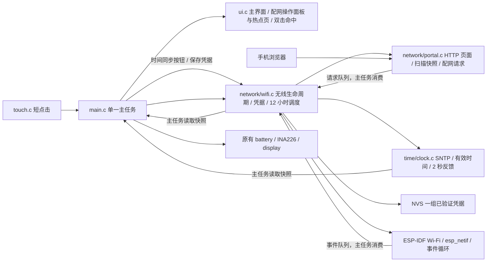
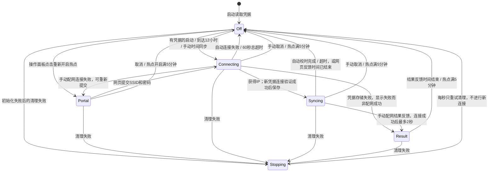
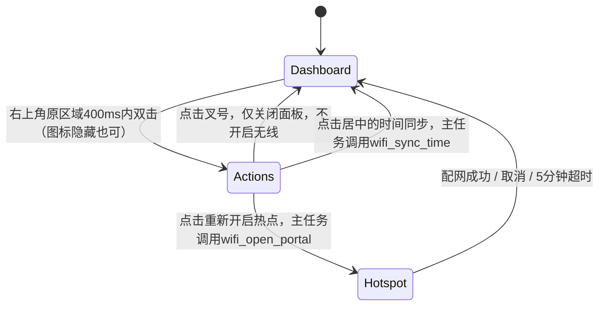

# Wi-Fi 配网与时间校准

本阶段需求和模块划分已由用户确认。保留主界面、触摸轮询、INA226 采样和单调时间电量积分，不实现真实历史记录，不启用旧无线扫描代码。

## 组件与线程边界

- 仅使用 SDK 必需的 Wi-Fi、事件、HTTP 和 lwIP 任务，不新增应用任务；回调不操作 LVGL。
- `wifi.c` 是无线生命周期唯一所有者；`portal.c` 只在手动配网期间提供网页，提交请求由主任务执行。扫描异步进行，避免阻塞采样。
- `clock.c` 独立负责 SNTP 启停、有效时间和 UTC+8 格式化；Wi-Fi 调度及累计始终使用 `esp_timer_get_time()`。
- 页面放在 `src/network/portal.html`，作为固件资源嵌入，不依赖外网字体、脚本或图标。

## 无线状态

- 未保存凭据时启动不初始化或启动 Wi-Fi，也不自动开启热点。
- 配网使用 AP+STA，手机保持访问设备网页；按用户新要求采用无密码开放热点，名称缩为`Solar-XXXX`（MAC末4位）。屏幕不再显示热点密码，热点名称使用36 px字体、完整`http://192.168.4.1`使用32 px字体，均单行显示。热点仍只在手动开启的5分钟窗口内开放，附近任何人都可能连接及提交配网请求；不宣称HTTP配网内容已加密。
- 网页直观列出扫描网络，支持刷新、手工输入 SSID、密码显隐、开放网络、进度及错误提示。首次进入热点自动扫描；提交连接时暂停扫描。
- 从连接开始至校时完成合计最多60秒；热点总时长最多5分钟，不因重试延长。连接失败回到配网页面，允许重试；校时失败不撤销配网成功。
- 只保存一组SSID/密码；新网络取得IP后才替换旧记录，不记录或打印密码。连接成功但存储失败不声称已持久配网。
- 配网成功后屏幕返回主界面，网页先收到成功状态；热点和网页仅保留有限的结果反馈时间（最多2秒），校时成功或失败后关闭全部无线。
- 成功、失败、取消、超时统一停止HTTP、SNTP、Wi-Fi并反初始化驱动和网络接口；不使用仅断开连接或省电模式代替关闭。关闭错误记录串口，不能伪报成功。
- 自动连接失败不无限重连，不自动开热点；手动双击打开操作面板，再点击重新开启热点可重新配网。
- 有凭据时，每次连接/校时尝试结束后用单调时间安排12小时后的下一次尝试。首次配网成功但尚未取到时间也适用；无凭据时无自动重试。

## 屏幕与时间

- 没有有效时间时，Wi-Fi未连接显示斜杠图标；无线运行期间仍按关联状态显示图标。已有有效时间且Wi-Fi已关闭时隐藏图标，只保留时间（或短时失败反馈）。开启热点本身不代表连接上外部Wi-Fi。
- 右上角内容以`x=324`（距屏幕右边44 px）的既有圆角安全边界右对齐。没有时间／反馈文字时只显示靠右的26 px图标；有时间或失败反馈时文字靠右，图标置于其左侧，间隔8 px。不预留空时间槽。双击区域不变。
- 从未获得有效时间时不显示时间；有有效时间后持续显示正在走时的 `HH:MM`，Wi-Fi关闭和重新校时期间均保留。不是冻结最后一次校时读数。
- 每次收到有效SNTP时间，不论壁钟是否变化，时间变绿2秒后恢复白色。超时/失败在时间位置显示红色反馈2秒，然后恢复已有时间；无有效时间则恢复为空。
- UTC+8，无夏令时。运行期间系统时钟在断网后继续走时；不把NVS里的旧时间当作断电后的当前时间。暖重启仅在系统仍有合理时间时保留显示，冷启动重新获取。
- 配网页取代主界面显示，不停止后台采样；提供取消按钮。配网成功回主界面，原Wh/mAh点击不变；没有新增LVGL输入设备。

## 手动校时与操作面板

用户已确认上一版真实配网成功，并获取到20:13的时间；本节新增手动校时与重新配网入口，替代此前双击直接开启热点的规则。

- 复用`ui.c`现有配网屏幕：默认显示居中的“时间同步”主按钮及其下方“重新开启热点”次按钮；热点启动后显示原大字热点名、网址及倒计时，不嵌套浮动卡片。
- 打开操作面板不启动或取消无线，不修改12小时截止时间；仅有保存凭据且当前无线关闭时允许点击时间同步。无凭据时同步按钮禁用，重新开启热点仍可使用。
- 点击时间同步后回主界面，`wifi.c`只启动STA，用已有凭据复用原连接／SNTP流程；不启动热点或HTTP，不写NVS。总时限60秒，成功仍绿色反馈2秒，失败保留已有时间和凭据。
- 手动同步开始时清除旧截止时间，结束并关闭无线后从本次尝试结束重新安排12小时；失败也重新计时，不在过程中触发旧的自动任务，不允许重复点击创建并发同步。
- 打开操作面板和热点页期间继续采样，不响应隐藏主界面的Wh/mAh点击。网络／SNTP回调仍不操作LVGL，模块职责与队列边界不变。
- 主任务栈分配8192字节，保持原单任务职责与调度；每秒检查历史最小剩余栈，仅在降低时输出诊断。双击面板版本在默认3584字节栈下已实测溢出，不能用主机较大栈的渲染测试代替设备栈余量验证。同步按钮启用样式仅在状态变化时更新，不在5 ms循环中重复设置。

## 验证范围

固件构建、电量模型回归、无线生命周期主机模拟、网页桌面/手机交互与截图、真实LVGL像素渲染。最终硬件仍需验证手机配网、NTP网络可达性、触摸双击及Wi-Fi关闭后的电流；没有这些实测不能宣称硬件省电验证通过。

## Flash 容量

Wi-Fi/HTTP固件约1.285 MB，超过旧默认1 MB应用分区。使用根目录`partitions.csv`，只将原`factory`分区容量扩大到2 MB；起始地址仍为`0x10000`，NVS仍为`0x9000/0x6000`，PHY仍为`0xf000/0x1000`。不添加OTA或文件系统，不移动或擦除已有NVS/PHY数据。PlatformIO最大应用大小同步为2 MB，避免只按物理8 MB Flash检查而放过超出应用分区的固件。

N8R8仍为8 MB Flash和8 MB PSRAM，2 MB仅是应用分区。应用起始地址为64 KiB，所以不能直接设为完整8 MB（会越过Flash末尾）。当前无需扩大分区，剩余Flash未分配，不影响现有运行性能或功耗。

## 本阶段验证

- ESP32-S3 / ESP-IDF 5.5.5 固件构建通过，新增网页资源已嵌入并链接；应用约1.285 MB，静态RAM约34.1%，占2 MB应用分区约61.3%（此前15.3%是按整颗8 MB Flash计算，不能用于判断应用是否可启动）。
- `sh tools/test_battery.sh`：默认OCV和局部端点覆盖、电流阈值、60秒状态确认、Wh/mAh积分与缺口回归通过，未修改电量算法。
- `sh tools/test_network.sh`：编译实际`wifi.c`与`clock.c`，模拟SDK事件和单调时间；无凭据不开无线、配网及替换凭据、断线和校时通知同时到达、60秒／5分钟边界、首次校时失败后的12小时重试、同时间值仍反馈绿色、旧事件／队列溢出和HTTP／无线关闭失败清理重试全部通过。
- 同一脚本直接测试实际`portal.c`请求处理与固件所用cJSON，覆盖分片接收、JSON类型／完整性、中文SSID的32字节边界、空密码／8-63字节密码／64位十六进制PSK、队列满、扫描去重、独立配网与校时状态、慢请求总时限。AddressSanitizer／UndefinedBehaviorSanitizer通过；业务代码使用`-Wall -Wextra -Werror`。
- `sh tools/test_network_ui.sh`：实际LVGL RGB565渲染通过，包括斜杠图标、已有时间保留、绿色／失败反馈、400ms双击边界、区域外点击取消、热点信息与取消、隐藏主界面后台更新、Wh/mAh恢复、全部显示字形及屏幕边界、局部与整屏刷新像素一致性。主界面与热点页已目视检查，截图仅在`.pio/host-network-ui/`。
- Playwright在320／390／900像素宽度验证扫描刷新、SSID选择／手工输入、密码校验／显隐、配网进度、失败重试、校时失败仍配网成功、热点关闭后保留成功提示；网络名称采用文本渲染，不解析HTML。未发现JavaScript异常或横向越界，桌面／手机截图已目视检查，预览仅在`.pio/portal-preview/`。
- 本版已修正分区容量并烧录，启动验证见下节；真实热点、路由器连接、SNTP可达性、Wi-Fi关闭电流或连续12小时运行仍待实测。既有触摸启动超时／间歇读取失败仍可能影响双击，未在本阶段修改驱动。

## 刷机与分区修复

- 首次刷机写入哈希通过，但启动时发现`Image length 1285040 doesn't fit in partition length 1048576`，导致bootloader持续重启，未进入主程序。构建时错误地以物理8 MB容量检查，遗漏实际1 MB分区限制。
- 将`factory`扩为2 MB，同步PlatformIO与ESP-IDF分区配置；生成二进制分区表经ESP-IDF解析确认，NVS／PHY位置不变。没有执行全片擦除。
- 已通过`/dev/cu.usbmodem21401`重新烧录，22288字节bootloader、3072字节分区表和1285040字节应用全部通过写入哈希校验。
- 启动日志确认`factory`长度`0x200000`且成功载入应用；8 MB PSRAM／80 MHz内存测试通过，QSPI 40 MHz显示初始化、CHSC6417 0x2E重试后初始化及INA226 0x44初始化成功。
- 启动后持续三分钟以上每秒采样，电压约4.092–4.093 V、SOC 99%、空载电流约±0.15 mA、状态待机，无新的启动循环或panic。Wi-Fi日志为`Startup: radio off, credentials absent`，未自动开启无线。该电流是INA226测量路径，不是ESP32无线关闭后的功耗实测。
- 串口监视已关闭，主界面目视和手机配网交由用户验证；不据启动正常宣称完整配网／校时验收通过。

建议实机验收顺序：未配网启动 → 双击/取消 → 手机扫描与错误密码 → 正确配网及绿色反馈 → 热点消失和关闭电流 → 重启自动校时 → 路由器离线／NTP不可达超时 → 连续12小时再次校时。不要通过擦除整个NVS分区模拟初始状态，以免丢失其他设备数据。

## 开放热点与排版调整

- 按用户要求将热点缩短为`Solar-XXXX`并改为开放网络，移除热点密码字段和显示区；目标路由器SSID／密码的输入、验证与保存规则不变。
- 未显示时间时图标右边界为`x=323`，有时间或失败反馈时文字右边界相同，图标左移并保持8 px间隔；时间再次隐藏后图标回到右边界，双击区域仍可命中。
- 热点名36 px、完整网址32 px，保持左对齐、单行及原圆角安全边距。测试用比真实十六进制后缀更宽的`Solar-WWWW`验证单行宽度，实际截图为`Solar-2F9C`；全部字形／边界、局部／整屏刷新一致性和主机目视检查通过。
- 无线模拟测试确认热点认证模式为`WIFI_AUTH_OPEN`、热点密码全零、名称长度10字节，并通过原有生命周期和HTTP解析sanitizer测试；原电量模型回归通过。
- 最新固件构建通过，约1.39 MB，占2 MB应用分区约66.2%，静态RAM约34.1%；8 MB物理Flash配置和分区表不变。
- 首次尝试因未检测到开发板USB串口而未烧录；用户重新连接后，本次调整已通过`/dev/cu.usbmodem21401`烧录，22288字节bootloader、3072字节分区表和1388384字节应用全部通过写入哈希校验。
- 新版启动确认2 MB应用分区成功加载、8 MB PSRAM／80 MHz内存测试通过、QSPI 40 MHz显示、CHSC6417 0x2E和INA226 0x44初始化成功。无凭据启动日志为`Startup: radio off, credentials absent`；电池持续每秒读取约4.089–4.090 V、SOC 99%、待机，未发现启动循环或panic。
- 串口观察到真实触摸按下／松开和双击后Wi-Fi启动；AP+STA启动成功、DHCP为`192.168.4.1`，日志报告`Provisioning hotspot Solar-2F9D at http://192.168.4.1 (5 minute limit)`，开启热点后采样仍持续。仅据此确认双击入口和热点启动，不宣称手机网页配网、路由器连接或校时已经通过。
- 串口监视已关闭；真实圆角与大字页面效果、手机配网、校时反馈和无线关闭电流交由用户继续验证。

## 手动校时验证

- 用户随后确认上一无密码热点固件配网完全正常，已获取到20:13的时间；这是实际配网及首次校时反馈，更新前述待用户验证记录。连续12小时运行和关闭无线后的整机功耗仍未验证。
- 实际`wifi.c`主机测试覆盖无凭据不进行手动联网、手动只开STA且不启动HTTP／热点、重复请求不并发、成功／失败后12小时重新计时、旧截止时间不再触发、已有时间／凭据保留，以及初始化失败／无线工作期间的请求处理。Sanitizer通过，原配网与HTTP测试、电量模型回归通过。
- 实际LVGL检查已校时时隐藏图标但保留原双击区域、操作面板／取消、未配网与工作期间同步按钮禁用、手动同步和重新开启热点命中、隐藏主界面的累计不可点击、原大字热点页和全部嵌套控件字形／边界。局部与整屏刷新像素一致性通过，操作面板与隐藏图标主界面截图已目视检查。

## 双击重启排查

- 手动校时版已烧录，但用户实测双击时间区域时重启。再次抓取原始串口日志，两次复现均在正常校时并反初始化Wi-Fi后、双击打开操作面板时报告`A stack overflow in task main has been detected`，随后`RTC_SW_CPU_RST`重启。
- 原始记录在`logs/device-monitor-261101-205306.log`。旧ELF哈希为`af87351db`；堆栈解析确认FreeRTOS栈溢出钩子，尾部帧指向`lv_obj_set_style_opa`，但堆栈已经损坏，不能将尾部帧当作完整调用链。
- 原ESP-IDF主任务栈仅3584字节；主机LVGL测试使用宿主机较大栈，未覆盖此硬件资源限制。保持原单任务与模块职责，将主任务栈增为8192字节，并仅在同步按钮启用状态变化时修改透明度，避免循环中重复更新样式。
- 增加历史最小剩余栈日志，只有余量下降时打印`Main stack minimum free: ... bytes`，ESP-IDF此API单位为字节。该诊断不修改计量或12小时调度。
- 主机100次操作面板打开／关闭及原LVGL、无线／HTTP解析、电量测试通过；修复后已刷机复测，结果见下节，不以主机测试代替硬件验证。

## 本轮结项

- 栈修复版已通过`/dev/cu.usbmodem21401`烧录，22288字节bootloader、3072字节分区表和1392112字节应用写入哈希全部通过。2 MB应用分区、8 MB Flash／PSRAM配置不变；应用分区占用约66.4%。
- 新ELF哈希为`8fc527e55`。启动确认8 MB PSRAM／80 MHz内存测试、QSPI 40 MHz、触摸和INA226初始化成功，已保存凭据在烧录后保留。
- 实机复测记录在本地`logs/device-monitor-261101-210446.log`：启动校时成功、连续双击操作、两次手动校时成功、重新开启热点与取消均正常；每次校时后明确报告Wi-Fi停止并反初始化，重新安排12小时同步。约30秒抓取期间未再次出现栈溢出或软件重启，采样持续。
- 打开操作面板后的历史最小剩余栈为3700字节，8192字节栈的峰值使用约4492字节，确实超过旧3584字节分配。已保留栈余量降低时的诊断，不新增任务或调整模块职责。
- 用户确认修复后已验证正常，授权提交当前分支。本轮交付配网、时间同步与反馈、手动操作入口、分区及栈容量修复、文档和主机测试；不交付真实历史记录。
- 连续12小时实机周期、离线路由器／NTP失败场景和无线关闭后的整机功耗仍有实测缺口，主机定时／失败测试和Wi-Fi关闭日志不能替代这些测量。原始串口日志在`logs/`，已加入Git忽略，不提交网络环境信息。
